---
format:
  html: default
  pdf:
    geometry:
      - margin=0.6in
    fontsize: 10pt
---

# Answers: Standard Normal Areas Practice

Each answer comes from the spreadsheet formula shown under it. The same answers are in [NormalAreasPractice-Answers.xlsx](data/NormalAreasPractice-Answers.xlsx). With the printed table you may get a last digit that is off by 1.

| Area | Spreadsheet formula |
|:--|:--|
| Left tail area | `=NORMSDIST(z)` |
| Right tail area | `=1.0-NORMSDIST(z)` |
| Area between $z_1$ and $z_2$ | `=NORMSDIST(z2)-NORMSDIST(z1)` |

```{=html}
<div style="display:grid; grid-template-columns:1fr 1fr; gap:0 2em; margin-bottom:1.5em">
```

```{=latex}
\noindent\begin{minipage}[t]{0.47\textwidth}
```

```{=html}
<div>
```

**1.** Right tail area for $z = 1.73$

{width=100%}

Area $= 0.0418$ \
`=1.0-NORMSDIST(1.73)`

```{=html}
</div>
```

```{=latex}
\end{minipage}\hfill\begin{minipage}[t]{0.47\textwidth}
```

```{=html}
<div>
```

**2.** Area between $z = 0.6$ and $z = 2.45$

{width=100%}

Area $= 0.2671$ \
`=NORMSDIST(2.45)-NORMSDIST(0.6)`

```{=html}
</div>
```

```{=latex}
\end{minipage}
\vspace{1.2em}
```

```{=html}
</div>
```

```{=html}
<div style="display:grid; grid-template-columns:1fr 1fr; gap:0 2em; margin-bottom:1.5em">
```

```{=latex}
\noindent\begin{minipage}[t]{0.47\textwidth}
```

```{=html}
<div>
```

**3.** Right tail area for $z = -1.38$

{width=100%}

Area $= 0.9162$ \
`=1.0-NORMSDIST(-1.38)`

```{=html}
</div>
```

```{=latex}
\end{minipage}\hfill\begin{minipage}[t]{0.47\textwidth}
```

```{=html}
<div>
```

**4.** Right tail area for $z = -0.15$

{width=100%}

Area $= 0.5596$ \
`=1.0-NORMSDIST(-0.15)`

```{=html}
</div>
```

```{=latex}
\end{minipage}
\vspace{1.2em}
```

```{=html}
</div>
```

```{=html}
<div style="display:grid; grid-template-columns:1fr 1fr; gap:0 2em; margin-bottom:1.5em">
```

```{=latex}
\noindent\begin{minipage}[t]{0.47\textwidth}
```

```{=html}
<div>
```

**5.** Left tail area for $z = -2.15$

{width=100%}

Area $= 0.0158$ \
`=NORMSDIST(-2.15)`

```{=html}
</div>
```

```{=latex}
\end{minipage}\hfill\begin{minipage}[t]{0.47\textwidth}
```

```{=html}
<div>
```

**6.** Right tail area for $z = 2.05$

{width=100%}

Area $= 0.0202$ \
`=1.0-NORMSDIST(2.05)`

```{=html}
</div>
```

```{=latex}
\end{minipage}
\vspace{1.2em}
```

```{=html}
</div>
```

```{=html}
<div style="display:grid; grid-template-columns:1fr 1fr; gap:0 2em; margin-bottom:1.5em">
```

```{=latex}
\noindent\begin{minipage}[t]{0.47\textwidth}
```

```{=html}
<div>
```

**7.** Right tail area for $z = -0.64$

{width=100%}

Area $= 0.7389$ \
`=1.0-NORMSDIST(-0.64)`

```{=html}
</div>
```

```{=latex}
\end{minipage}\hfill\begin{minipage}[t]{0.47\textwidth}
```

```{=html}
<div>
```

**8.** Left tail area for $z = 0.08$

{width=100%}

Area $= 0.5319$ \
`=NORMSDIST(0.08)`

```{=html}
</div>
```

```{=latex}
\end{minipage}
\vspace{1.2em}
```

```{=html}
</div>
```

```{=html}
<div style="display:grid; grid-template-columns:1fr 1fr; gap:0 2em; margin-bottom:1.5em">
```

```{=latex}
\noindent\begin{minipage}[t]{0.47\textwidth}
```

```{=html}
<div>
```

**9.** Area between $z = 0.25$ and $z = 1.75$

{width=100%}

Area $= 0.3612$ \
`=NORMSDIST(1.75)-NORMSDIST(0.25)`

```{=html}
</div>
```

```{=latex}
\end{minipage}\hfill\begin{minipage}[t]{0.47\textwidth}
```

```{=html}
<div>
```

**10.** Left tail area for $z = -1.62$

{width=100%}

Area $= 0.0526$ \
`=NORMSDIST(-1.62)`

```{=html}
</div>
```

```{=latex}
\end{minipage}
\vspace{1.2em}
```

```{=html}
</div>
```

```{=html}
<div style="display:grid; grid-template-columns:1fr 1fr; gap:0 2em; margin-bottom:1.5em">
```

```{=latex}
\noindent\begin{minipage}[t]{0.47\textwidth}
```

```{=html}
<div>
```

**11.** Right tail area for $z = 1.42$

{width=100%}

Area $= 0.0778$ \
`=1.0-NORMSDIST(1.42)`

```{=html}
</div>
```

```{=latex}
\end{minipage}\hfill\begin{minipage}[t]{0.47\textwidth}
```

```{=html}
<div>
```

**12.** Area between $z = -1.96$ and $z = 1.96$

{width=100%}

Area $= 0.9500$ \
`=NORMSDIST(1.96)-NORMSDIST(-1.96)`

```{=html}
</div>
```

```{=latex}
\end{minipage}
\vspace{1.2em}
```

```{=html}
</div>
```

```{=html}
<div style="display:grid; grid-template-columns:1fr 1fr; gap:0 2em; margin-bottom:1.5em">
```

```{=latex}
\noindent\begin{minipage}[t]{0.47\textwidth}
```

```{=html}
<div>
```

**13.** Area between $z = -2.58$ and $z = 1.44$

{width=100%}

Area $= 0.9201$ \
`=NORMSDIST(1.44)-NORMSDIST(-2.58)`

```{=html}
</div>
```

```{=latex}
\end{minipage}\hfill\begin{minipage}[t]{0.47\textwidth}
```

```{=html}
<div>
```

**14.** Left tail area for $z = -0.91$

{width=100%}

Area $= 0.1814$ \
`=NORMSDIST(-0.91)`

```{=html}
</div>
```

```{=latex}
\end{minipage}
\vspace{1.2em}
```

```{=html}
</div>
```

```{=html}
<div style="display:grid; grid-template-columns:1fr 1fr; gap:0 2em; margin-bottom:1.5em">
```

```{=latex}
\noindent\begin{minipage}[t]{0.47\textwidth}
```

```{=html}
<div>
```

**15.** Right tail area for $z = 0.96$

{width=100%}

Area $= 0.1685$ \
`=1.0-NORMSDIST(0.96)`

```{=html}
</div>
```

```{=latex}
\end{minipage}\hfill\begin{minipage}[t]{0.47\textwidth}
```

```{=html}
<div>
```

**16.** Area between $z = 1.12$ and $z = 2.6$

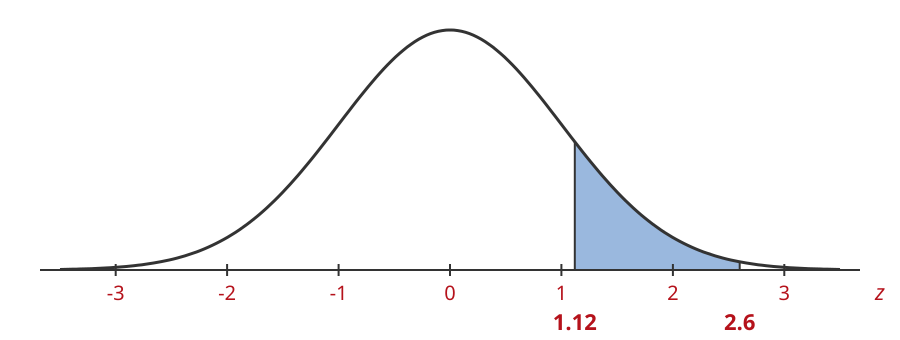{width=100%}

Area $= 0.1267$ \
`=NORMSDIST(2.6)-NORMSDIST(1.12)`

```{=html}
</div>
```

```{=latex}
\end{minipage}
\vspace{1.2em}
```

```{=html}
</div>
```

```{=html}
<div style="display:grid; grid-template-columns:1fr 1fr; gap:0 2em; margin-bottom:1.5em">
```

```{=latex}
\noindent\begin{minipage}[t]{0.47\textwidth}
```

```{=html}
<div>
```

**17.** Area between $z = -2.3$ and $z = -0.4$

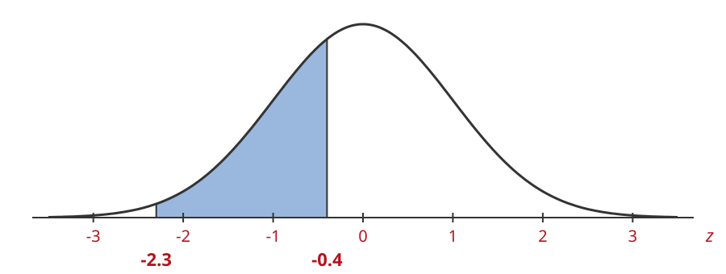{width=100%}

Area $= 0.3339$ \
`=NORMSDIST(-0.4)-NORMSDIST(-2.3)`

```{=html}
</div>
```

```{=latex}
\end{minipage}\hfill\begin{minipage}[t]{0.47\textwidth}
```

```{=html}
<div>
```

**18.** Left tail area for $z = -0.33$

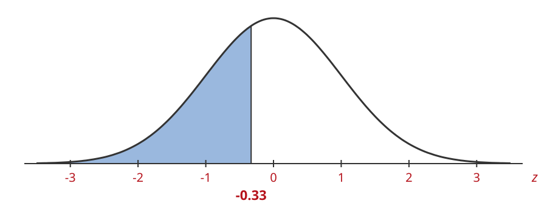{width=100%}

Area $= 0.3707$ \
`=NORMSDIST(-0.33)`

```{=html}
</div>
```

```{=latex}
\end{minipage}
\vspace{1.2em}
```

```{=html}
</div>
```

```{=html}
<div style="display:grid; grid-template-columns:1fr 1fr; gap:0 2em; margin-bottom:1.5em">
```

```{=latex}
\noindent\begin{minipage}[t]{0.47\textwidth}
```

```{=html}
<div>
```

**19.** Right tail area for $z = -1.09$

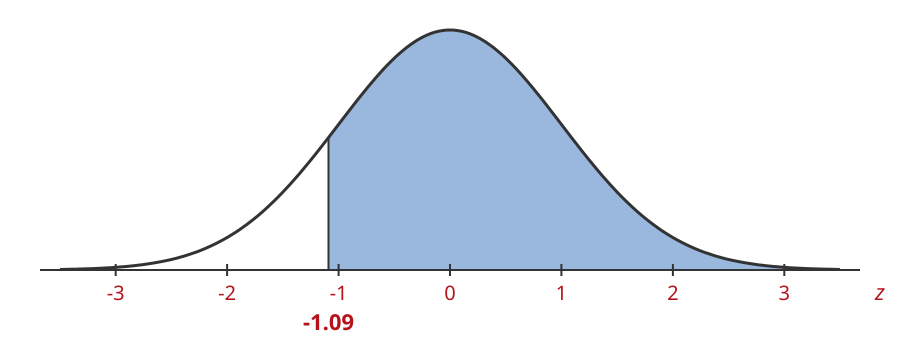{width=100%}

Area $= 0.8621$ \
`=1.0-NORMSDIST(-1.09)`

```{=html}
</div>
```

```{=latex}
\end{minipage}\hfill\begin{minipage}[t]{0.47\textwidth}
```

```{=html}
<div>
```

**20.** Area between $z = -0.94$ and $z = 1.27$

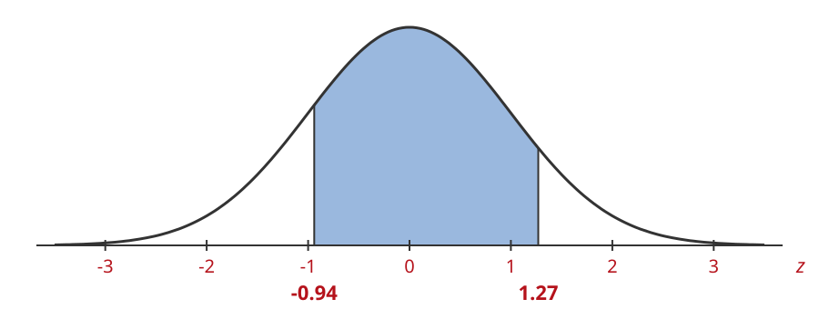{width=100%}

Area $= 0.7243$ \
`=NORMSDIST(1.27)-NORMSDIST(-0.94)`

```{=html}
</div>
```

```{=latex}
\end{minipage}
\vspace{1.2em}
```

```{=html}
</div>
```

```{=html}
<div style="display:grid; grid-template-columns:1fr 1fr; gap:0 2em; margin-bottom:1.5em">
```

```{=latex}
\noindent\begin{minipage}[t]{0.47\textwidth}
```

```{=html}
<div>
```

**21.** Right tail area for $z = 0.47$

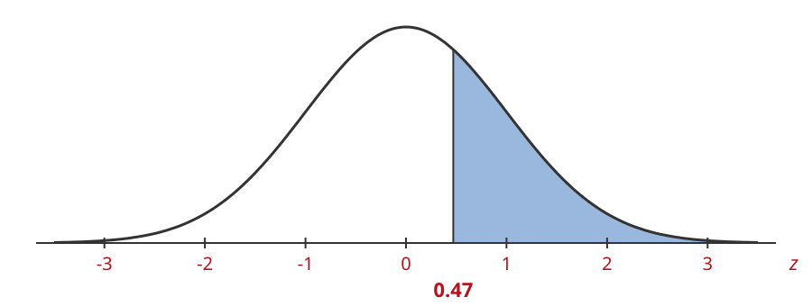{width=100%}

Area $= 0.3192$ \
`=1.0-NORMSDIST(0.47)`

```{=html}
</div>
```

```{=latex}
\end{minipage}\hfill\begin{minipage}[t]{0.47\textwidth}
```

```{=html}
<div>
```

**22.** Area between $z = -1.8$ and $z = -1.05$

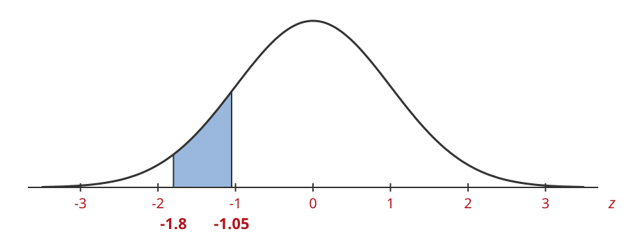{width=100%}

Area $= 0.1109$ \
`=NORMSDIST(-1.05)-NORMSDIST(-1.8)`

```{=html}
</div>
```

```{=latex}
\end{minipage}
\vspace{1.2em}
```

```{=html}
</div>
```

```{=html}
<div style="display:grid; grid-template-columns:1fr 1fr; gap:0 2em; margin-bottom:1.5em">
```

```{=latex}
\noindent\begin{minipage}[t]{0.47\textwidth}
```

```{=html}
<div>
```

**23.** Right tail area for $z = -2.21$

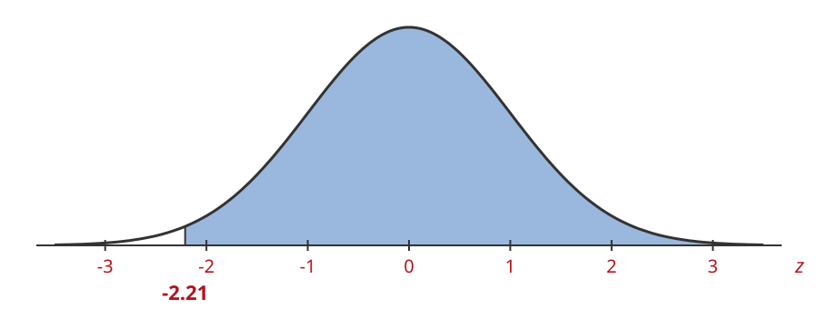{width=100%}

Area $= 0.9864$ \
`=1.0-NORMSDIST(-2.21)`

```{=html}
</div>
```

```{=latex}
\end{minipage}\hfill\begin{minipage}[t]{0.47\textwidth}
```

```{=html}
<div>
```

**24.** Left tail area for $z = -1.33$

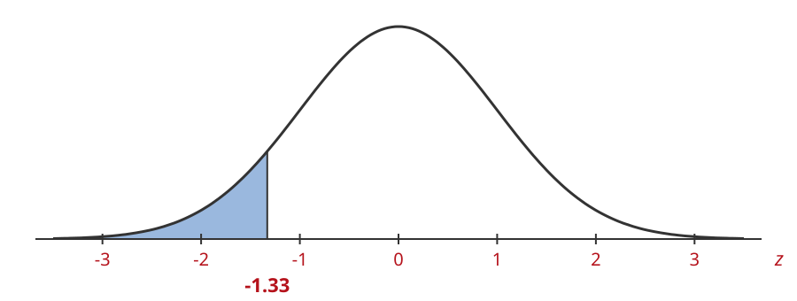{width=100%}

Area $= 0.0918$ \
`=NORMSDIST(-1.33)`

```{=html}
</div>
```

```{=latex}
\end{minipage}
\vspace{1.2em}
```

```{=html}
</div>
```

```{=html}
<div style="display:grid; grid-template-columns:1fr 1fr; gap:0 2em; margin-bottom:1.5em">
```

```{=latex}
\noindent\begin{minipage}[t]{0.47\textwidth}
```

```{=html}
<div>
```

**25.** Left tail area for $z = 0.52$

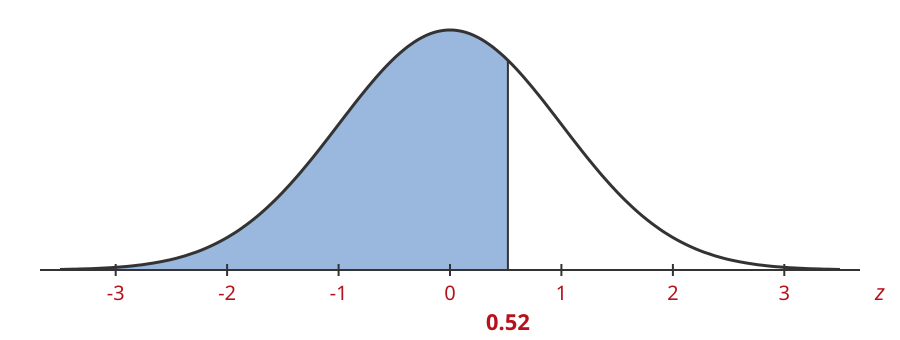{width=100%}

Area $= 0.6985$ \
`=NORMSDIST(0.52)`

```{=html}
</div>
```

```{=latex}
\end{minipage}\hfill\begin{minipage}[t]{0.47\textwidth}
```

```{=html}
<div>
```

**26.** Area between $z = -0.72$ and $z = 0.38$

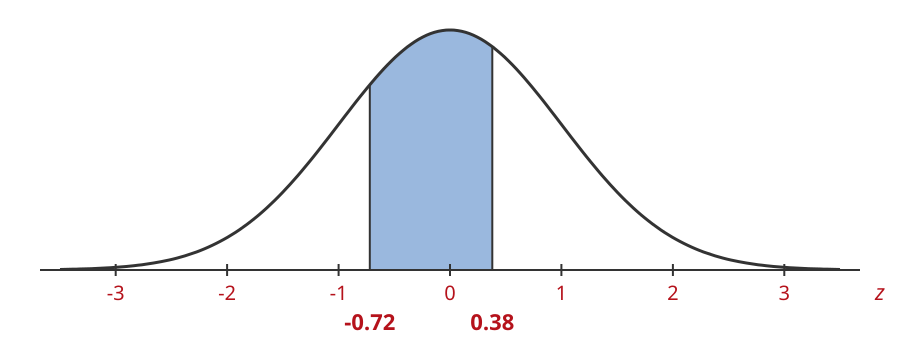{width=100%}

Area $= 0.4123$ \
`=NORMSDIST(0.38)-NORMSDIST(-0.72)`

```{=html}
</div>
```

```{=latex}
\end{minipage}
\vspace{1.2em}
```

```{=html}
</div>
```

```{=html}
<div style="display:grid; grid-template-columns:1fr 1fr; gap:0 2em; margin-bottom:1.5em">
```

```{=latex}
\noindent\begin{minipage}[t]{0.47\textwidth}
```

```{=html}
<div>
```

**27.** Left tail area for $z = 1.25$

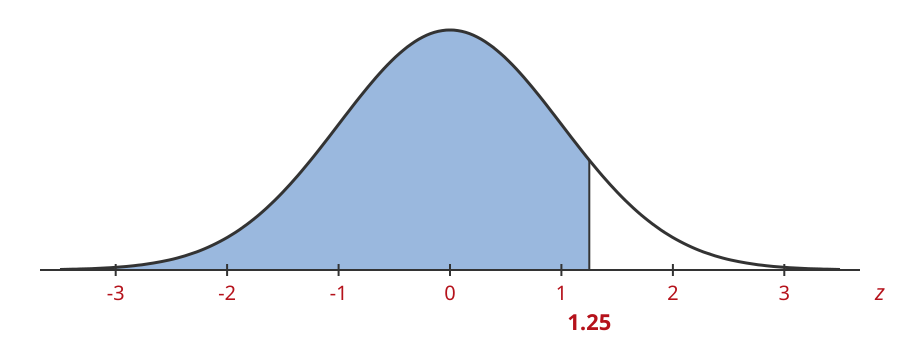{width=100%}

Area $= 0.8944$ \
`=NORMSDIST(1.25)`

```{=html}
</div>
```

```{=latex}
\end{minipage}\hfill\begin{minipage}[t]{0.47\textwidth}
```

```{=html}
<div>
```

**28.** Left tail area for $z = 2.34$

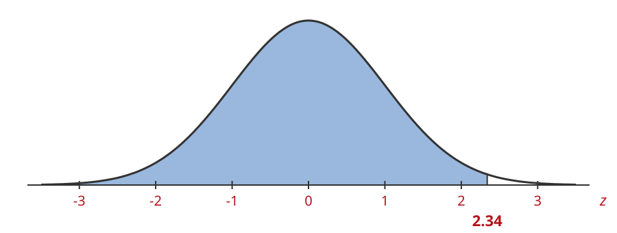{width=100%}

Area $= 0.9904$ \
`=NORMSDIST(2.34)`

```{=html}
</div>
```

```{=latex}
\end{minipage}
\vspace{1.2em}
```

```{=html}
</div>
```

```{=html}
<div style="display:grid; grid-template-columns:1fr 1fr; gap:0 2em; margin-bottom:1.5em">
```

```{=latex}
\noindent\begin{minipage}[t]{0.47\textwidth}
```

```{=html}
<div>
```

**29.** Left tail area for $z = 1.86$

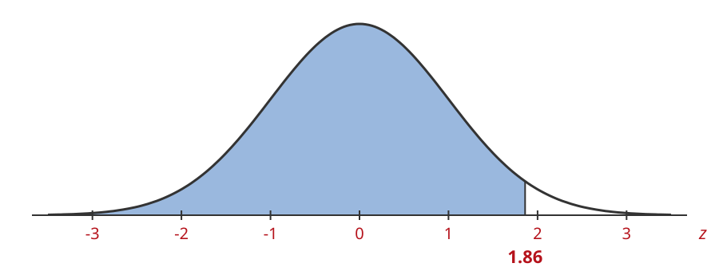{width=100%}

Area $= 0.9686$ \
`=NORMSDIST(1.86)`

```{=html}
</div>
```

```{=latex}
\end{minipage}\hfill\begin{minipage}[t]{0.47\textwidth}
```

```{=html}
<div>
```

**30.** Area between $z = -1.15$ and $z = 0.65$

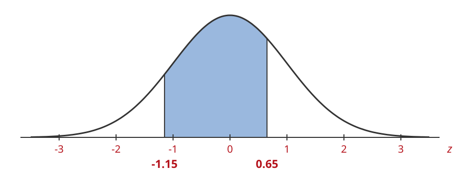{width=100%}

Area $= 0.6171$ \
`=NORMSDIST(0.65)-NORMSDIST(-1.15)`

```{=html}
</div>
```

```{=latex}
\end{minipage}
\vspace{1.2em}
```

```{=html}
</div>
```
