---
format:
  html: default
  pdf:
    geometry:
      - margin=0.6in
    fontsize: 10pt
---

# Standard Normal Areas Practice

Find each area under the standard normal curve using your standard normal table. The shaded graph shows the area. Start with the example below.

## Example: Using the Table

**Find the left tail area for $z = -1.25$.**

```{=html}
<div style="display:grid; grid-template-columns:1fr 1fr; gap:0 2em; align-items:center">
<div>
```

```{=latex}
\noindent\begin{minipage}[c]{0.47\textwidth}
```

{width=100%}

```{=html}
</div>
<div>
```

```{=latex}
\end{minipage}\hfill\begin{minipage}[c]{0.47\textwidth}
```

{width=100%}

```{=latex}
\end{minipage}
```

```{=html}
</div>
</div>
```

Split $z = -1.25$ into the **row** $-1.2$ (the ones digit and first decimal place) and the **column** $.05$ (the second decimal place). Where they meet:

$$
\text{left tail area} = 0.1056 \approx 11\%
$$

Our table has only **left tail areas**. For the other areas, look up left tail areas first:

- **Right tail area** $= 1.0 - \text{left tail area}$
- **Area between** $z_1$ and $z_2$ $=$ (left tail area for $z_2$) $-$ (left tail area for $z_1$)

## Problems

```{=html}
<div style="display:grid; grid-template-columns:1fr 1fr; gap:0 2em; margin-bottom:1.5em">
```

```{=latex}
\noindent\begin{minipage}[t]{0.47\textwidth}
```

```{=html}
<div>
```

**1.** Find the right tail area for $z = 1.73$

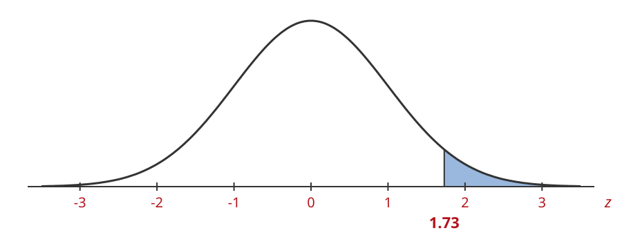{width=100%}

Area $=$ \_\_\_\_\_\_\_\_\_\_\_\_

```{=html}
</div>
```

```{=latex}
\end{minipage}\hfill\begin{minipage}[t]{0.47\textwidth}
```

```{=html}
<div>
```

**2.** Find the area between $z = 0.6$ and $z = 2.45$

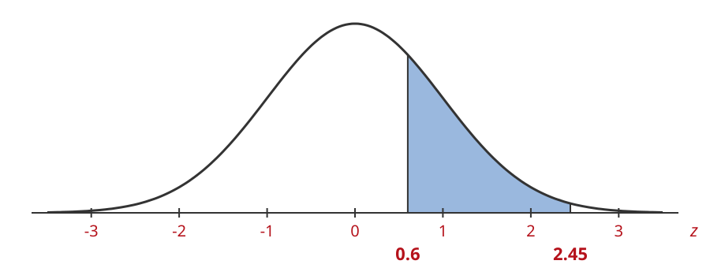{width=100%}

Area $=$ \_\_\_\_\_\_\_\_\_\_\_\_

```{=html}
</div>
```

```{=latex}
\end{minipage}
\vspace{1.2em}
```

```{=html}
</div>
```

```{=html}
<div style="display:grid; grid-template-columns:1fr 1fr; gap:0 2em; margin-bottom:1.5em">
```

```{=latex}
\noindent\begin{minipage}[t]{0.47\textwidth}
```

```{=html}
<div>
```

**3.** Find the area to the right of $z = -1.38$

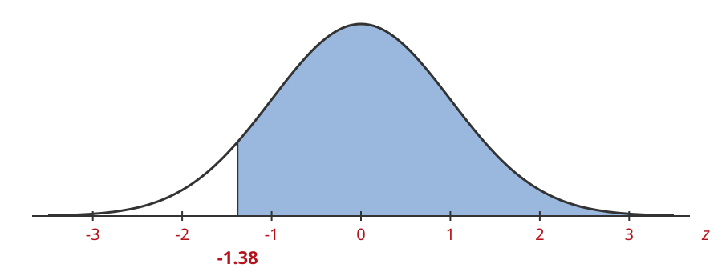{width=100%}

Area $=$ \_\_\_\_\_\_\_\_\_\_\_\_

```{=html}
</div>
```

```{=latex}
\end{minipage}\hfill\begin{minipage}[t]{0.47\textwidth}
```

```{=html}
<div>
```

**4.** Find the area where $z > -0.15$

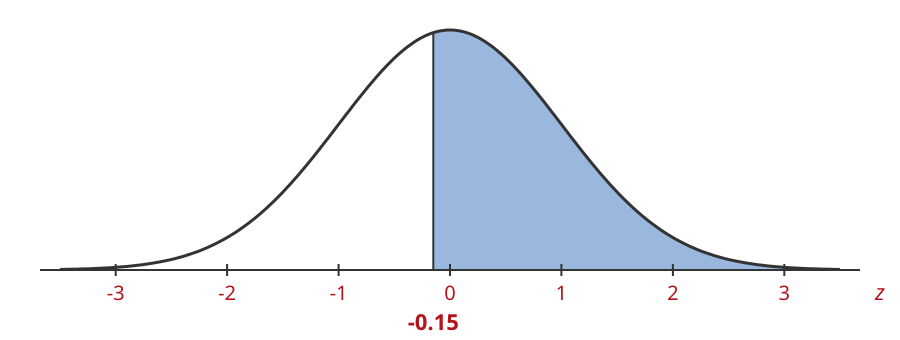{width=100%}

Area $=$ \_\_\_\_\_\_\_\_\_\_\_\_

```{=html}
</div>
```

```{=latex}
\end{minipage}
\vspace{1.2em}
```

```{=html}
</div>
```

```{=html}
<div style="display:grid; grid-template-columns:1fr 1fr; gap:0 2em; margin-bottom:1.5em">
```

```{=latex}
\noindent\begin{minipage}[t]{0.47\textwidth}
```

```{=html}
<div>
```

**5.** Find the left tail area for $z = -2.15$

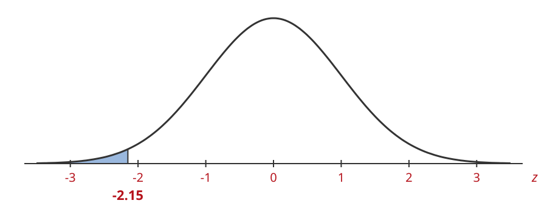{width=100%}

Area $=$ \_\_\_\_\_\_\_\_\_\_\_\_

```{=html}
</div>
```

```{=latex}
\end{minipage}\hfill\begin{minipage}[t]{0.47\textwidth}
```

```{=html}
<div>
```

**6.** Find the area for $z$ greater than $2.05$

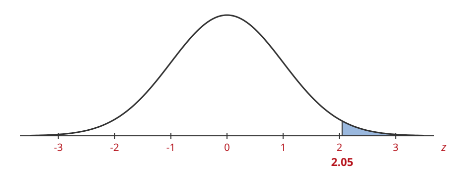{width=100%}

Area $=$ \_\_\_\_\_\_\_\_\_\_\_\_

```{=html}
</div>
```

```{=latex}
\end{minipage}
\vspace{1.2em}
```

```{=html}
</div>
```

```{=html}
<div style="display:grid; grid-template-columns:1fr 1fr; gap:0 2em; margin-bottom:1.5em">
```

```{=latex}
\noindent\begin{minipage}[t]{0.47\textwidth}
```

```{=html}
<div>
```

**7.** Find the right tail area for $z = -0.64$

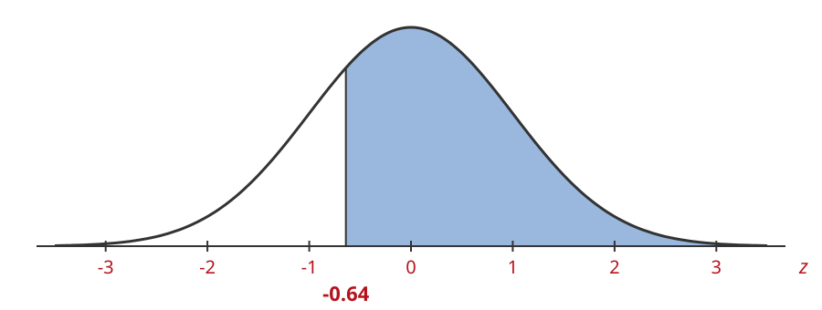{width=100%}

Area $=$ \_\_\_\_\_\_\_\_\_\_\_\_

```{=html}
</div>
```

```{=latex}
\end{minipage}\hfill\begin{minipage}[t]{0.47\textwidth}
```

```{=html}
<div>
```

**8.** Find the area to the left of $z = 0.08$

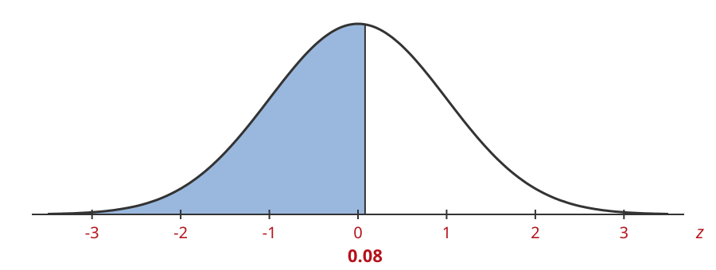{width=100%}

Area $=$ \_\_\_\_\_\_\_\_\_\_\_\_

```{=html}
</div>
```

```{=latex}
\end{minipage}
\vspace{1.2em}
```

```{=html}
</div>
```

```{=html}
<div style="display:grid; grid-template-columns:1fr 1fr; gap:0 2em; margin-bottom:1.5em">
```

```{=latex}
\noindent\begin{minipage}[t]{0.47\textwidth}
```

```{=html}
<div>
```

**9.** Find the area where $0.25 < z < 1.75$

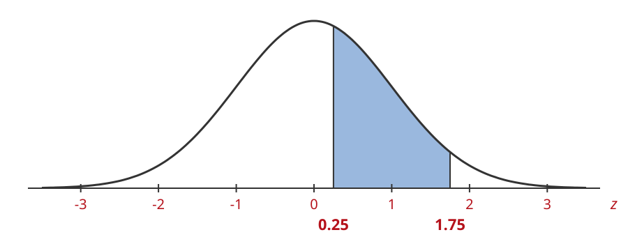{width=100%}

Area $=$ \_\_\_\_\_\_\_\_\_\_\_\_

```{=html}
</div>
```

```{=latex}
\end{minipage}\hfill\begin{minipage}[t]{0.47\textwidth}
```

```{=html}
<div>
```

**10.** Find the area where $z < -1.62$

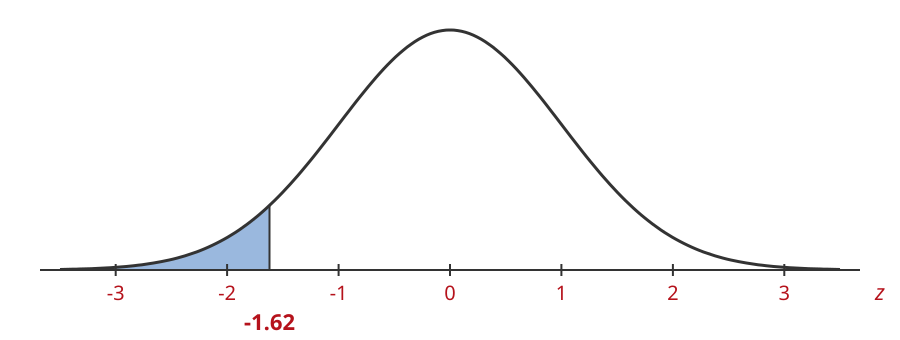{width=100%}

Area $=$ \_\_\_\_\_\_\_\_\_\_\_\_

```{=html}
</div>
```

```{=latex}
\end{minipage}
\vspace{1.2em}
```

```{=html}
</div>
```

```{=html}
<div style="display:grid; grid-template-columns:1fr 1fr; gap:0 2em; margin-bottom:1.5em">
```

```{=latex}
\noindent\begin{minipage}[t]{0.47\textwidth}
```

```{=html}
<div>
```

**11.** Find the area to the right of $z = 1.42$

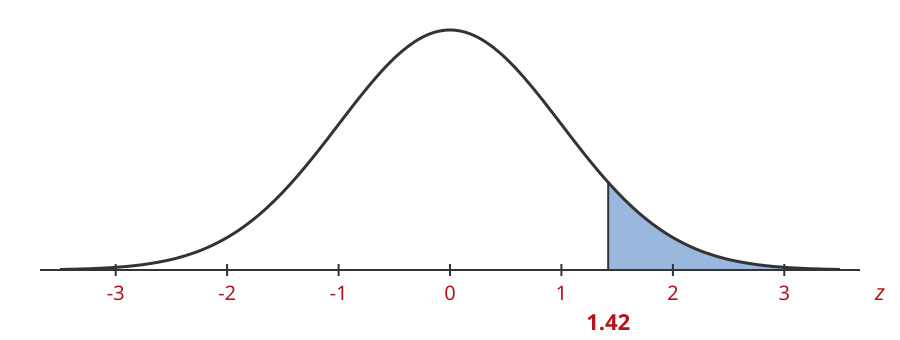{width=100%}

Area $=$ \_\_\_\_\_\_\_\_\_\_\_\_

```{=html}
</div>
```

```{=latex}
\end{minipage}\hfill\begin{minipage}[t]{0.47\textwidth}
```

```{=html}
<div>
```

**12.** Find the area for $z$ between $-1.96$ and $1.96$

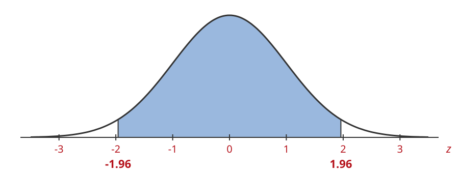{width=100%}

Area $=$ \_\_\_\_\_\_\_\_\_\_\_\_

```{=html}
</div>
```

```{=latex}
\end{minipage}
\vspace{1.2em}
```

```{=html}
</div>
```

```{=html}
<div style="display:grid; grid-template-columns:1fr 1fr; gap:0 2em; margin-bottom:1.5em">
```

```{=latex}
\noindent\begin{minipage}[t]{0.47\textwidth}
```

```{=html}
<div>
```

**13.** Find the area for $z$ greater than $-2.58$ and less than $1.44$

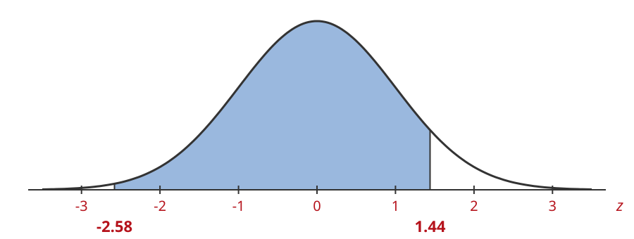{width=100%}

Area $=$ \_\_\_\_\_\_\_\_\_\_\_\_

```{=html}
</div>
```

```{=latex}
\end{minipage}\hfill\begin{minipage}[t]{0.47\textwidth}
```

```{=html}
<div>
```

**14.** Find the area for $z$ less than $-0.91$

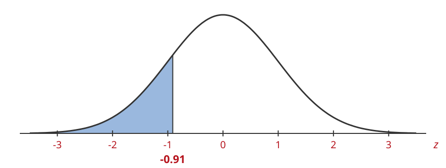{width=100%}

Area $=$ \_\_\_\_\_\_\_\_\_\_\_\_

```{=html}
</div>
```

```{=latex}
\end{minipage}
\vspace{1.2em}
```

```{=html}
</div>
```

```{=html}
<div style="display:grid; grid-template-columns:1fr 1fr; gap:0 2em; margin-bottom:1.5em">
```

```{=latex}
\noindent\begin{minipage}[t]{0.47\textwidth}
```

```{=html}
<div>
```

**15.** Find the area where $z > 0.96$

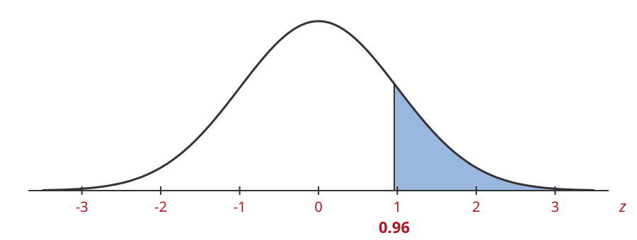{width=100%}

Area $=$ \_\_\_\_\_\_\_\_\_\_\_\_

```{=html}
</div>
```

```{=latex}
\end{minipage}
\vspace{1.2em}
```

```{=html}
</div>
```
