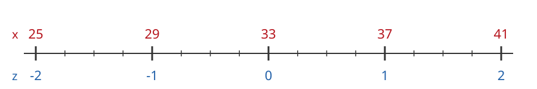
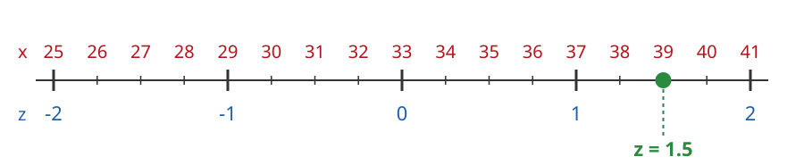
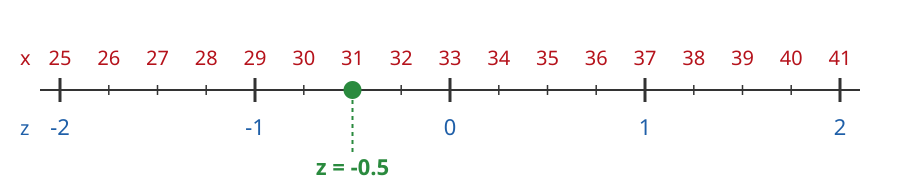
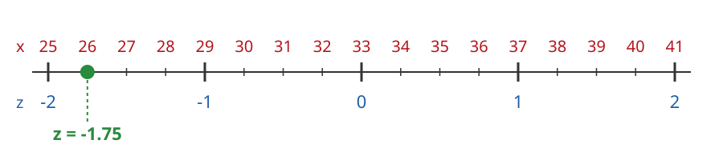
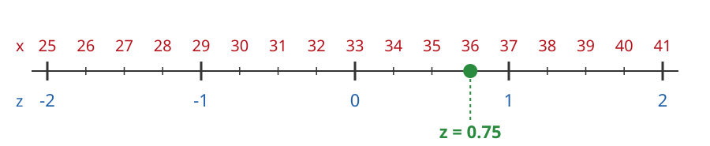

---
format:
  html: default
  pdf:
    geometry:
      - margin=0.7in
    fontsize: 10pt
---

# Answers: Z-Values for Commute Times

The commute times of students to campus have mean $\mu = 33$ minutes and standard deviation $\sigma = 4$ minutes.

The z-value of a commute time $x$ is

$$
z = \frac{x - \mu}{\sigma}
$$

**a) Fill in the x-values for each z-value on the number line.**

{width=80%}

$\mu = 33$ is at $z = 0$. Each step of one standard deviation adds or subtracts $4$:

- $33 + 4 = 37$ and $37 + 4 = 41$
- $33 - 4 = 29$ and $29 - 4 = 25$

### b) Ana's commute is $x = 39$ minutes

{width=80%}

**Visually:** $39$ is $6$ minutes above the mean. Each tick is $1$ minute and $4$ ticks make one standard deviation, so $6$ minutes is $6/4 = 1.5$ standard deviations above the mean: $z = 1.5$.

**Calculate:**

$$
z = \frac{39 - 33}{4} = \frac{6}{4} = 1.5
$$

```{=html}
<div style="height: 2em"></div>
```

```{=latex}
\vspace{1.5em}
```

### c) Ben's commute is $x = 31$ minutes

{width=80%}

**Visually:** $31$ is $2$ minutes below the mean. Each tick is $1$ minute and $4$ ticks make one standard deviation, so $2$ minutes is $2/4 = 0.5$ standard deviations below the mean: $z = -0.5$.

**Calculate:**

$$
z = \frac{31 - 33}{4} = \frac{-2}{4} = -0.5
$$

```{=html}
<div style="height: 2em"></div>
```

```{=latex}
\vspace{1.5em}
```

### d) Carla's commute is $x = 26$ minutes

{width=80%}

**Visually:** $26$ is $7$ minutes below the mean. Each tick is $1$ minute and $4$ ticks make one standard deviation, so $7$ minutes is $7/4 = 1.75$ standard deviations below the mean: $z = -1.75$.

**Calculate:**

$$
z = \frac{26 - 33}{4} = \frac{-7}{4} = -1.75
$$

```{=html}
<div style="height: 2em"></div>
```

```{=latex}
\vspace{1.5em}
```

### e) Dev's commute is $x = 36$ minutes

{width=80%}

**Visually:** $36$ is $3$ minutes above the mean. Each tick is $1$ minute and $4$ ticks make one standard deviation, so $3$ minutes is $3/4 = 0.75$ standard deviations above the mean: $z = 0.75$.

**Calculate:**

$$
z = \frac{36 - 33}{4} = \frac{3}{4} = 0.75
$$
