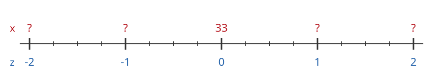
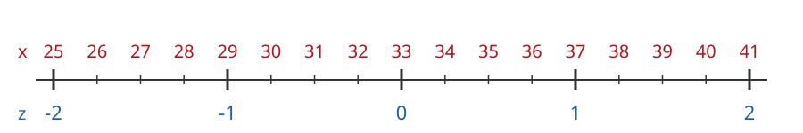

---
format:
  html: default
  pdf:
    geometry:
      - margin=0.7in
    fontsize: 10pt
---

# Z-Values for Commute Times

The commute times of students to campus have mean $\mu = 33$ minutes and standard deviation $\sigma = 4$ minutes.

The z-value of a commute time $x$ is

$$
z = \frac{x - \mu}{\sigma}
$$

a) Fill in the x-values for each z-value on the number line.

{width=80%}

For each commute time below:

- **Visually:** mark $x$ on the number line and read off its z-value.
- **Calculate:** find the z-value with the formula.

Check that your two answers match.

### b) Ana's commute is $x = 39$ minutes

{width=80%}

Visually: $z =$ \_\_\_\_\_\_\_\_\_\_\_\_

Calculate: $z = \dfrac{39 - 33}{4} =$ \_\_\_\_\_\_\_\_\_\_\_\_

```{=html}
<div style="height: 2em"></div>
```

```{=latex}
\vspace{1.5em}
```

### c) Ben's commute is $x = 31$ minutes

{width=80%}

Visually: $z =$ \_\_\_\_\_\_\_\_\_\_\_\_

Calculate: $z =$ \_\_\_\_\_\_\_\_\_\_\_\_\_\_\_\_\_\_\_\_\_\_\_\_

```{=html}
<div style="height: 2em"></div>
```

```{=latex}
\vspace{1.5em}
```

### d) Carla's commute is $x = 26$ minutes

{width=80%}

Visually: $z =$ \_\_\_\_\_\_\_\_\_\_\_\_

Calculate: $z =$ \_\_\_\_\_\_\_\_\_\_\_\_\_\_\_\_\_\_\_\_\_\_\_\_

```{=html}
<div style="height: 2em"></div>
```

```{=latex}
\vspace{1.5em}
```

### e) Dev's commute is $x = 36$ minutes

{width=80%}

Visually: $z =$ \_\_\_\_\_\_\_\_\_\_\_\_

Calculate: $z =$ \_\_\_\_\_\_\_\_\_\_\_\_\_\_\_\_\_\_\_\_\_\_\_\_
