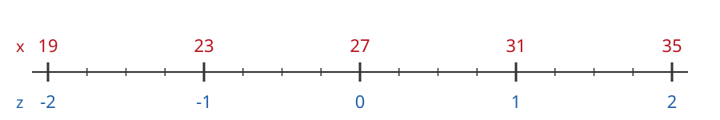
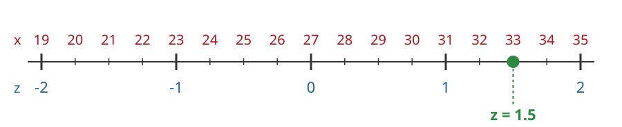
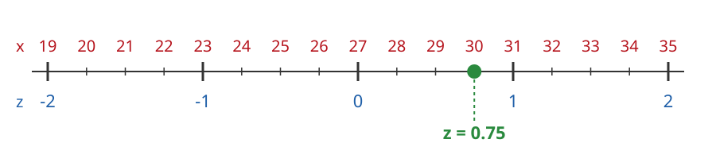
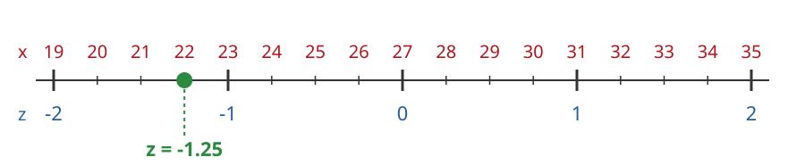
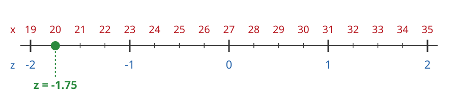

---
format:
  html: default
  pdf:
    geometry:
      - margin=0.7in
    fontsize: 10pt
---

# Answers: Z-Values on a Number Line

The mean is $\mu = 27$ and the standard deviation is $\sigma = 4$.

**a) Fill in the x-values for each z-value:**

{width=70%}

$\mu = 27$ is at $z = 0$. Each step of one $\sigma$ adds or subtracts $4$: $27 + 4 = 31$, $31 + 4 = 35$, $27 - 4 = 23$, $23 - 4 = 19$.

**b) Find the z-score of each x-value below, using $z = \dfrac{x - \mu}{\sigma}$. Then mark $x$ with a dot on its number line.**

$x = 33$: $\quad z = \dfrac{33 - 27}{4} = \dfrac{6}{4} = 1.5$

{width=60%}

$x = 30$: $\quad z = \dfrac{30 - 27}{4} = \dfrac{3}{4} = 0.75$

{width=60%}

$x = 22$: $\quad z = \dfrac{22 - 27}{4} = \dfrac{-5}{4} = -1.25$

{width=60%}

$x = 20$: $\quad z = \dfrac{20 - 27}{4} = \dfrac{-7}{4} = -1.75$

{width=60%}
