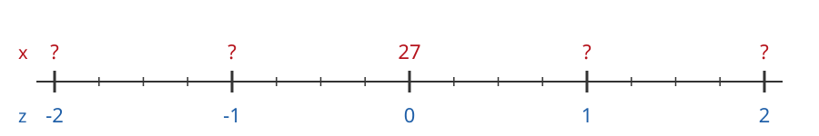
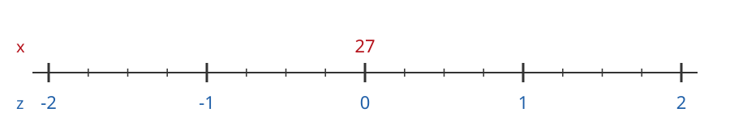

---
format:
  html: default
  pdf:
    geometry:
      - margin=0.7in
    fontsize: 10pt
---

# Z-Values on a Number Line

The mean is $\mu = 27$ and the standard deviation is $\sigma = 4$.

a) Fill in the x-values for each z-value:

{width=70%}

b) Find the z-score of each x-value below, using $z = \dfrac{x - \mu}{\sigma}$. Then mark $x$ with a dot on its number line and check that your z-score matches where the dot lands.

$x = 33$: $\quad z =$ \_\_\_\_\_\_\_\_\_\_

{width=60%}

```{=html}
<div style="height: 3em"></div>
```

```{=latex}
\vspace{2.5em}
```

$x = 30$: $\quad z =$ \_\_\_\_\_\_\_\_\_\_

{width=60%}

```{=html}
<div style="height: 3em"></div>
```

```{=latex}
\vspace{2.5em}
```

$x = 22$: $\quad z =$ \_\_\_\_\_\_\_\_\_\_

{width=60%}

```{=html}
<div style="height: 3em"></div>
```

```{=latex}
\vspace{2.5em}
```

$x = 20$: $\quad z =$ \_\_\_\_\_\_\_\_\_\_

{width=60%}
