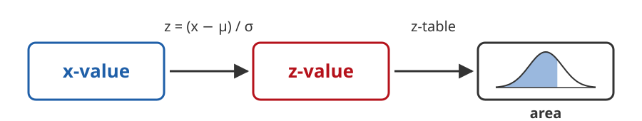
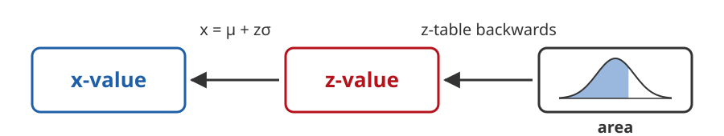
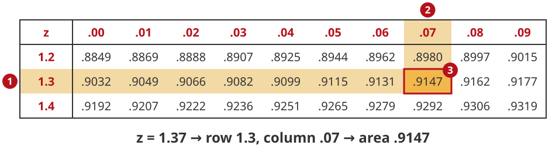
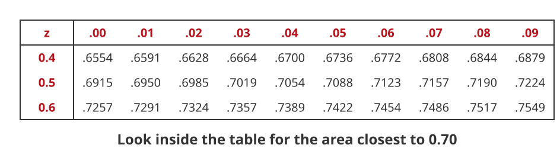
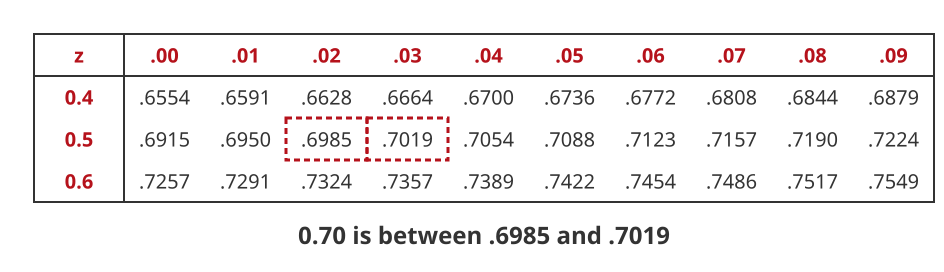
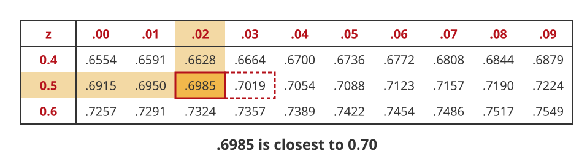
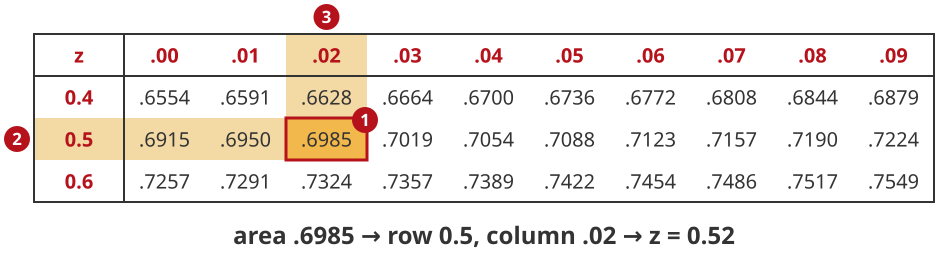
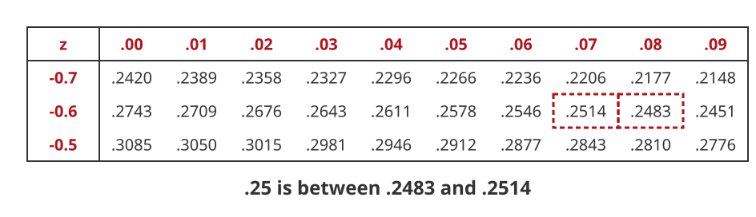
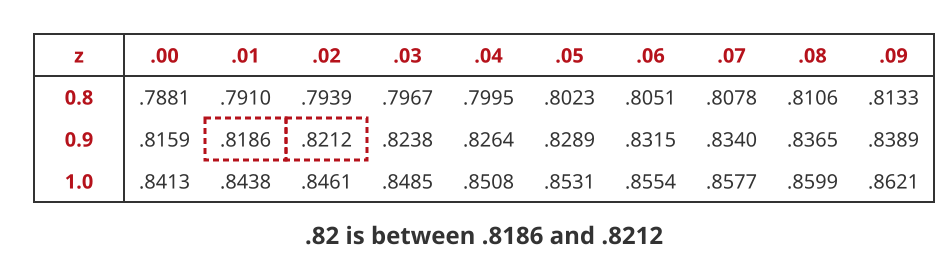
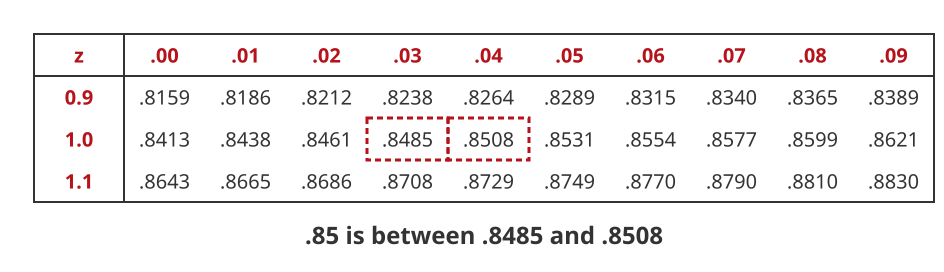

## Backwards Problems

So far we started with an x-value and found its area:

{.nostretch width=700}

1. Start with an x-value
2. Compute its z-value
3. Find the area with the z-table

## Backwards Problems

Now we go the **other way**. We start with an area and find the x-value:

{.nostretch width=700}

1. Start with an area
2. Find the z-value that gives that area
3. Compute the x-value from the z-value

These are called **backwards problems**.

## Using the Table Forwards

Before, we started with the z-value **outside** the table, in the **row** and **column**.

Then we read the area **inside** the table.

{.nostretch width=900}

## Using the Table Backwards

Now we start with the area **inside** the table, and read the z-value from the **row** and **column**.

Find the z-value with a left tail area of $0.70$:

{.nostretch width=900}

## Using the Table Backwards

The area $0.70$ is not in the table exactly. Find the two areas on either side of it:

{.nostretch width=900}

How far is each one from $0.70$?

$$
0.7019 - 0.70 = 0.0019 \qquad 0.70 - 0.6985 = 0.0015
$$

## Using the Table Backwards

Use the **closest** area. $0.6985$ is only $0.0015$ away, so it is closer than $0.7019$:

{.nostretch width=900}

## Using the Table Backwards

Read the z-value from the row and column of the closest area:

{.nostretch width=900}

$$
z = 0.52
$$

## Find Z for a Left Tail Area

Our table has left tail areas, so we look for the area directly.

## 1. Z for a Left Tail of 25%

Find the z-value that gives a left tail area of $25\%$. Use the standard normal table.

## 1. Z for a Left Tail of 25%

Look for the area closest to $0.25$:

{.nostretch width=900}

## 1. Z for a Left Tail of 25%

The area $0.25$ is between $0.2483$ and $0.2514$:

{.nostretch width=900}

How far is each one from $0.25$?

$$
0.2514 - 0.25 = 0.0014 \qquad 0.25 - 0.2483 = 0.0017
$$

## 1. Z for a Left Tail of 25%

The closest area is $0.2514$, in the row $-0.6$ and the column $.07$:

{.nostretch width=900}

$$
z = -0.67
$$

## 1. Z for a Left Tail of 25%

$$
z = -0.67
$$

## Find Z for a Right Tail Area

Our table has only left tail areas. So we change the right tail into a left tail:

$$
\text{left tail area} = 1.0 - \text{right tail area}
$$

Then we look for that left tail area in the table.

## 2. Z for a Right Tail of 18%

Find the z-value that gives a right tail area of $18\%$. Use the standard normal table.

## 2. Z for a Right Tail of 18%

The right tail is $0.18$, so the left tail is

$$
\text{left tail area} = 1.0 - 0.18 = 0.82
$$

## 2. Z for a Right Tail of 18%

Look for the area closest to $0.82$:

{.nostretch width=900}

## 2. Z for a Right Tail of 18%

The area $0.82$ is between $0.8186$ and $0.8212$:

{.nostretch width=900}

How far is each one from $0.82$?

$$
0.8212 - 0.82 = 0.0012 \qquad 0.82 - 0.8186 = 0.0014
$$

## 2. Z for a Right Tail of 18%

The closest area is $0.8212$, in the row $0.9$ and the column $.02$:

{.nostretch width=900}

$$
z = 0.92
$$

## 2. Z for a Right Tail of 18%

$$
z = 0.92
$$

## Two Ways to Write the Z Formula

We have used this formula to go from $x$ to $z$:

$$
z = \frac{x - \mu}{\sigma}
$$

We can write the same formula a second way, to go from $z$ to $x$:

$$
x = \mu + z\sigma
$$

## Both Formulas Say the Same Thing

Suppose $\mu = 18$ and $\sigma = 3$.

Going forwards from $x = 24$:

$$
z = \frac{x - \mu}{\sigma} = \frac{24 - 18}{3} = \frac{6}{3} = 2
$$

Going backwards from $z = 2$:

$$
x = \mu + z\sigma = 18 + 2(3) = 18 + 6 = 24
$$

## Which Formula to Use

- **Forwards** (x to area): use $z = \dfrac{x - \mu}{\sigma}$
- **Backwards** (area to x): use $x = \mu + z\sigma$

$x = \mu + z\sigma$ says: start at the mean and go $z$ standard deviations.

A negative $z$ means go **below** the mean, a positive $z$ means go **above** it.

## 3. Find x that represents the bottom 25% of the data

A normal distribution has $\mu = 18$ and $\sigma = 3$. Find the x-value with a left tail area of $25\%$.

## 3. Find x that represents the bottom 25% of the data

$\mu = 18$, $\sigma = 3$. We want the x-value whose left tail area is $0.25$:

## 3. Find x that represents the bottom 25% of the data

First find the z-value with the same left tail area:

## 3. Find x that represents the bottom 25% of the data

Look for the area closest to $0.25$:

{.nostretch width=900}

## 3. Find x that represents the bottom 25% of the data

The area $0.25$ is between $0.2483$ and $0.2514$:

{.nostretch width=900}

How far is each one from $0.25$?

$$
0.2514 - 0.25 = 0.0014 \qquad 0.25 - 0.2483 = 0.0017
$$

## 3. Find x that represents the bottom 25% of the data

The closest area is $0.2514$, in the row $-0.6$ and the column $.07$:

{.nostretch width=900}

$$
z = -0.67
$$

## 3. Find x that represents the bottom 25% of the data

Plug $z = -0.67$, $\mu = 18$ and $\sigma = 3$ into $x = \mu + z\sigma$:

$$
x = 18 + (-0.67)(3) = 18 - 2.01 = 15.99
$$

## 3. Find x that represents the bottom 25% of the data

$x = 15.99$ has a left tail area of $25\%$.

## 4. Find x that represents the top 15% of the data

A normal distribution has $\mu = 23$ and $\sigma = 4$. Find the x-value with a right tail area of $15\%$.

## 4. Find x that represents the top 15% of the data

$\mu = 23$, $\sigma = 4$. We want the x-value whose right tail area is $0.15$:

## 4. Find x that represents the top 15% of the data

First find the z-value with the same right tail area:

## 4. Find x that represents the top 15% of the data

The right tail is $0.15$, so the left tail is

$$
\text{left tail area} = 1.0 - 0.15 = 0.85
$$

## 4. Find x that represents the top 15% of the data

Look for the area closest to $0.85$:

{.nostretch width=900}

## 4. Find x that represents the top 15% of the data

The area $0.85$ is between $0.8485$ and $0.8508$:

{.nostretch width=900}

How far is each one from $0.85$?

$$
0.8508 - 0.85 = 0.0008 \qquad 0.85 - 0.8485 = 0.0015
$$

## 4. Find x that represents the top 15% of the data

The closest area is $0.8508$, in the row $1.0$ and the column $.04$:

{.nostretch width=900}

$$
z = 1.04
$$

## 4. Find x that represents the top 15% of the data

Plug $z = 1.04$, $\mu = 23$ and $\sigma = 4$ into $x = \mu + z\sigma$:

$$
x = 23 + 1.04(4) = 23 + 4.16 = 27.16
$$

## 4. Find x that represents the top 15% of the data

$x = 27.16$ has a right tail area of $15\%$.
