## Backwards Problems

So far we started with an x-value and found its area:

1. Start with an x-value
2. Compute its z-value
3. Find the area with the z-table

## Backwards Problems

Now we go the **other way**. We start with an area and find the x-value:

1. Start with an area
2. Find the z-value that gives that area
3. Compute the x-value from the z-value

These are called **backwards problems**.

## Using the Table Backwards

Before, we found the z-value **outside** the table and read the area **inside** it.

Now we find the area **inside** the table and read the z-value from the **row** and **column**.

The area we want may not be in the table exactly. We use the **closest** area we can find.

## Find Z for a Left Tail Area

Our table has left tail areas, so we look for the area directly.

## 1. Z for a Left Tail of 25%

Find the z-value that gives a left tail area of $25\%$. Use the standard normal table.

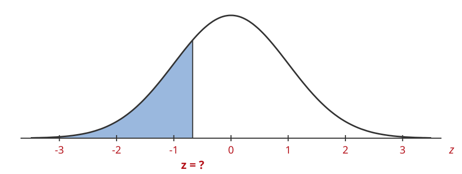

## 1. Z for a Left Tail of 25%

Look for the area closest to $0.25$:

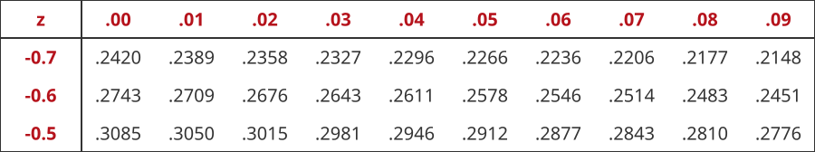

## 1. Z for a Left Tail of 25%

The closest area is $0.2514$, in the row $-0.6$ and the column $.07$:

$$
z = -0.67
$$

## 1. Z for a Left Tail of 25%

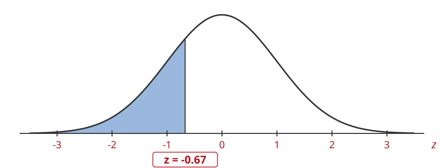

$$
z = -0.67
$$

## Find Z for a Right Tail Area

Our table has only left tail areas. So we change the right tail into a left tail:

$$
\text{left tail area} = 1.0 - \text{right tail area}
$$

Then we look for that left tail area in the table.

## 2. Z for a Right Tail of 18%

Find the z-value that gives a right tail area of $18\%$. Use the standard normal table.

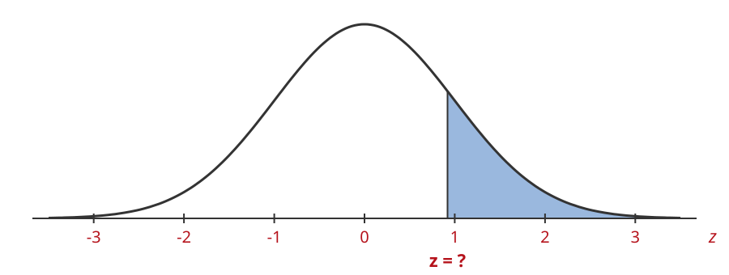

## 2. Z for a Right Tail of 18%

The right tail is $0.18$, so the left tail is

$$
\text{left tail area} = 1.0 - 0.18 = 0.82
$$

## 2. Z for a Right Tail of 18%

Look for the area closest to $0.82$:

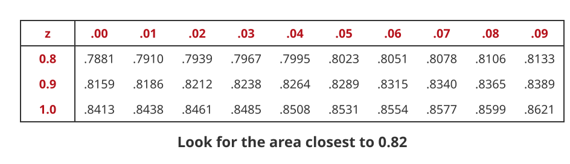

## 2. Z for a Right Tail of 18%

The closest area is $0.8212$, in the row $0.9$ and the column $.02$:

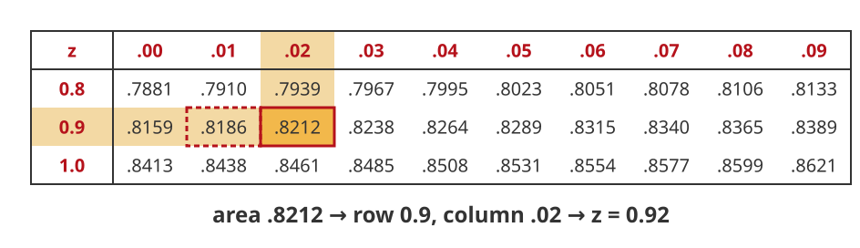

$$
z = 0.92
$$

## 2. Z for a Right Tail of 18%

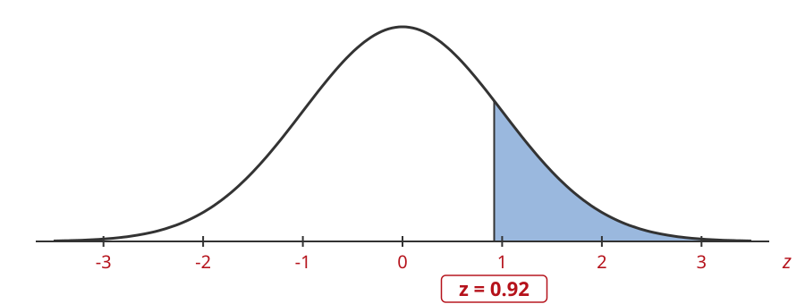

$$
z = 0.92
$$

## Solve Backwards for X

Once we have the z-value, we solve the z-score formula for $x$:

$$
z = \frac{x - \mu}{\sigma}
$$

1. Plug in $z$, $\mu$ and $\sigma$
2. Multiply both sides by $\sigma$
3. Add $\mu$ to both sides

This is the same as:

$$
x = \mu + z\sigma
$$

## 3. Bottom 25%

A normal distribution has $\mu = 18$ and $\sigma = 3$. Find the x-value with a left tail area of $25\%$.

## 3. Bottom 25%

$\mu = 18$, $\sigma = 3$. We want the x-value whose left tail area is $0.25$:

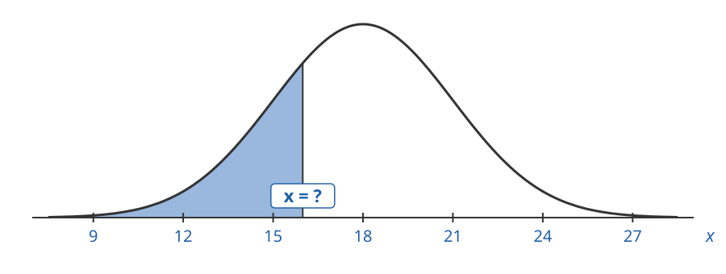

## 3. Bottom 25%

First find the z-value with the same left tail area:

## 3. Bottom 25%

Look for the area closest to $0.25$:

## 3. Bottom 25%

The closest area is $0.2514$, in the row $-0.6$ and the column $.07$:

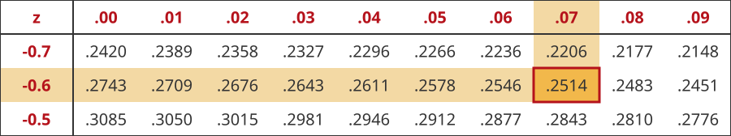

$$
z = -0.67
$$

## 3. Bottom 25%

Plug in $z = -0.67$, $\mu = 18$ and $\sigma = 3$, then solve for $x$:

$$
\begin{aligned}
-0.67 &= \frac{x - 18}{3} \\
3(-0.67) &= x - 18 \\
-2.01 + 18 &= x \\
15.99 &= x
\end{aligned}
$$

## 3. Bottom 25%

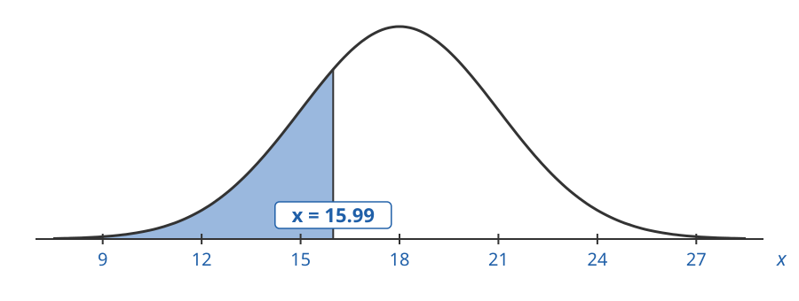

$x = 15.99$ has a left tail area of $25\%$.

## 4. Top 15%

A normal distribution has $\mu = 23$ and $\sigma = 4$. Find the x-value with a right tail area of $15\%$.

## 4. Top 15%

$\mu = 23$, $\sigma = 4$. We want the x-value whose right tail area is $0.15$:

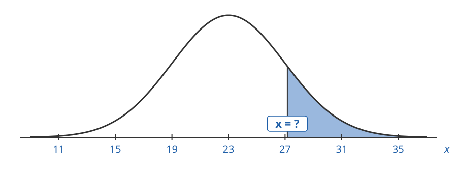

## 4. Top 15%

First find the z-value with the same right tail area:

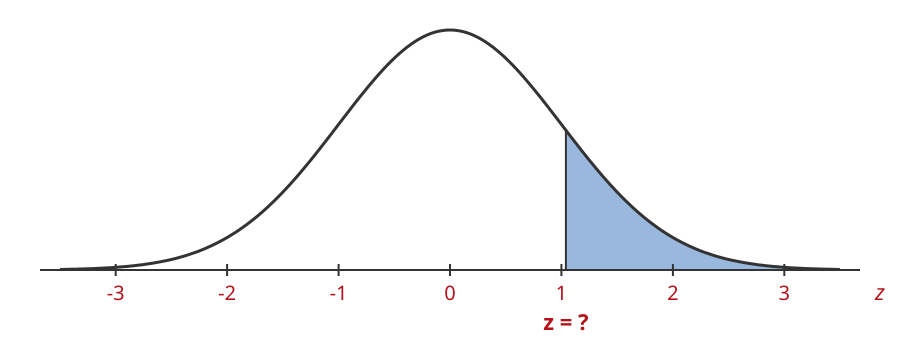

## 4. Top 15%

The right tail is $0.15$, so the left tail is

$$
\text{left tail area} = 1.0 - 0.15 = 0.85
$$

## 4. Top 15%

Look for the area closest to $0.85$:

## 4. Top 15%

The closest area is $0.8508$, in the row $1.0$ and the column $.04$:

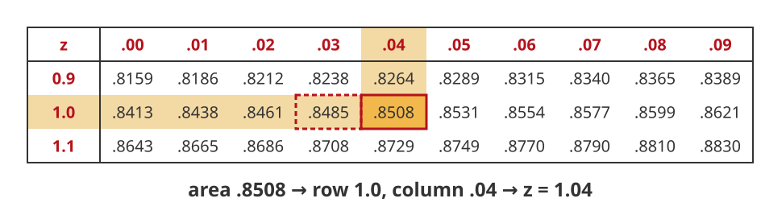

$$
z = 1.04
$$

## 4. Top 15%

Plug in $z = 1.04$, $\mu = 23$ and $\sigma = 4$, then solve for $x$:

$$
\begin{aligned}
1.04 &= \frac{x - 23}{4} \\
4(1.04) &= x - 23 \\
4.16 + 23 &= x \\
27.16 &= x
\end{aligned}
$$

## 4. Top 15%

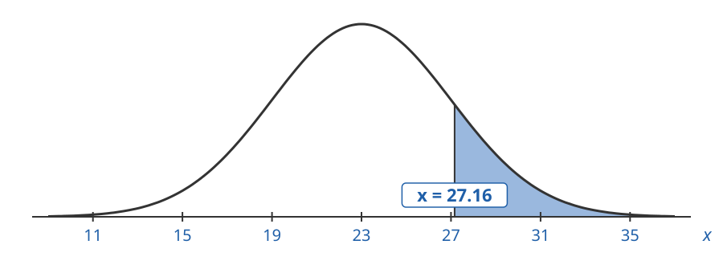

$x = 27.16$ has a right tail area of $15\%$.

## Applications of Backwards Problems

Backwards problems answer questions like:

- What demand is in the **bottom 10%** of all demands?
- How much inventory do we need so we run out only **5%** of the time?

We know the area (the chance), and we want the x-value.

## 5. Bottom 10% of Demand

Monthly demand for a retail SKU is normal with mean $257$ units and standard deviation $45$ units.

What demand is in the bottom $10\%$ of all demand values?

## 5. Bottom 10% of Demand

$\mu = 257$, $\sigma = 45$. We want the x-value whose left tail area is $0.10$:

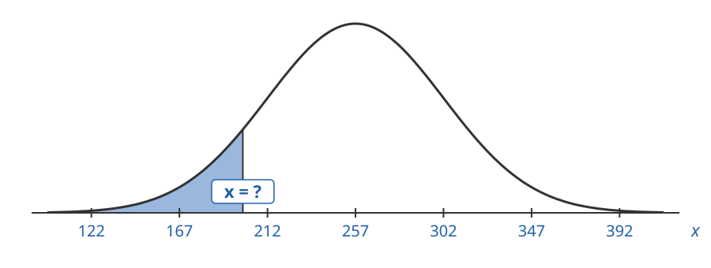

## 5. Bottom 10% of Demand

First find the z-value with the same left tail area:

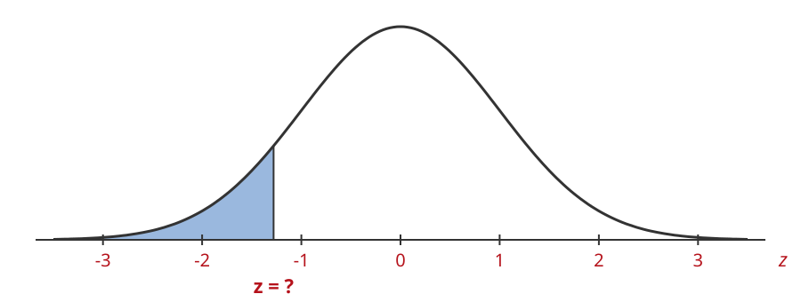

## 5. Bottom 10% of Demand

Look for the area closest to $0.10$:

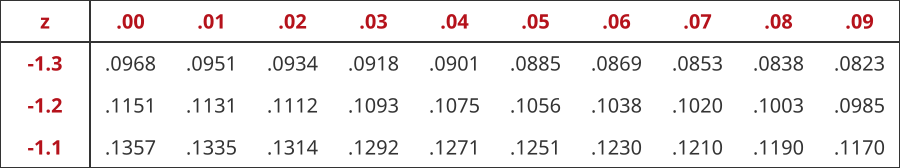

## 5. Bottom 10% of Demand

The closest area is $0.1003$, in the row $-1.2$ and the column $.08$:

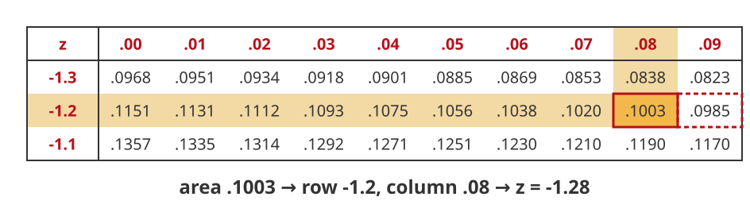

$$
z = -1.28
$$

## 5. Bottom 10% of Demand

Plug in $z = -1.28$, $\mu = 257$ and $\sigma = 45$, then solve for $x$:

$$
\begin{aligned}
-1.28 &= \frac{x - 257}{45} \\
45(-1.28) &= x - 257 \\
-57.6 + 257 &= x \\
199.4 &= x
\end{aligned}
$$

## 5. Bottom 10% of Demand

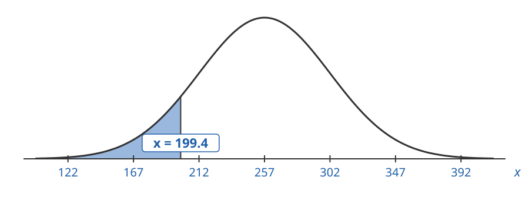

$x = 199.4$ has a left tail area of $10\%$.

Any demand below about $199$ units is in the bottom $10\%$ of demand values.

## Service Level

The **service level** is the chance we do **not** run out of stock in a period.

- A $90\%$ service level means lost sales $10\%$ of the time.
- A $95\%$ service level means lost sales $5\%$ of the time.
- A $99\%$ service level means lost sales $1\%$ of the time.

## Service Level

To get a service level, stock enough so demand is below our inventory that often.

The service level is a **left tail area**:

- $90\%$ service level: left tail area of $0.90$
- $95\%$ service level: left tail area of $0.95$
- $99\%$ service level: left tail area of $0.99$

## 6. Inventory for 95% Service Level

Monthly demand for a retail SKU is normal with mean $340$ units and standard deviation $80$ units.

How much inventory should we carry next month for a $95\%$ service level?

## 6. Inventory for 95% Service Level

$\mu = 340$, $\sigma = 80$. We want the x-value whose left tail area is $0.95$:

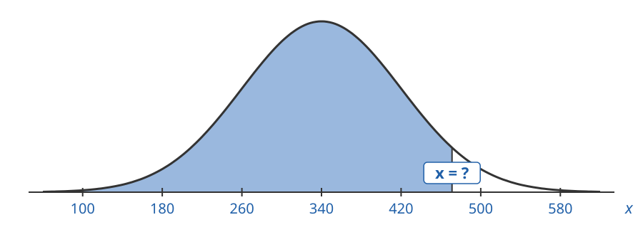

## 6. Inventory for 95% Service Level

First find the z-value with the same left tail area:

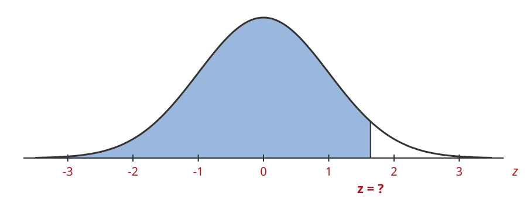

## 6. Inventory for 95% Service Level

Look for the area closest to $0.95$:

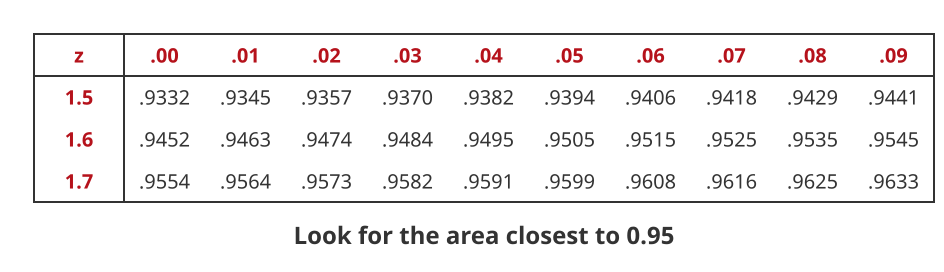

## 6. Inventory for 95% Service Level

The closest area is $0.9495$, in the row $1.6$ and the column $.04$:

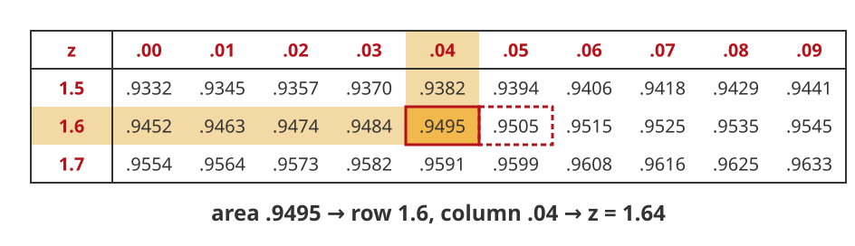

$$
z = 1.64
$$

$0.9505$ (for $z = 1.65$) is just as close. Either one is fine.

## 6. Inventory for 95% Service Level

Plug in $z = 1.64$, $\mu = 340$ and $\sigma = 80$, then solve for $x$:

$$
\begin{aligned}
1.64 &= \frac{x - 340}{80} \\
80(1.64) &= x - 340 \\
131.2 + 340 &= x \\
471.2 &= x
\end{aligned}
$$

## 6. Inventory for 95% Service Level

$x = 471.2$ has a left tail area of $95\%$.

Carry at least $472$ units for a $95\%$ service level.
