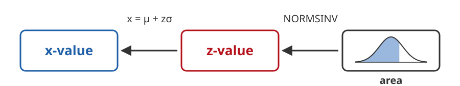
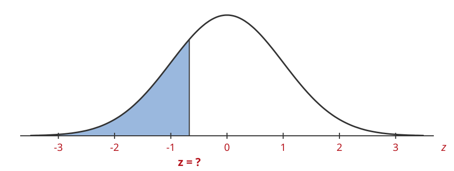
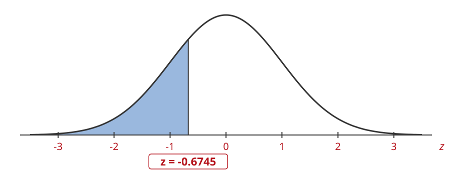
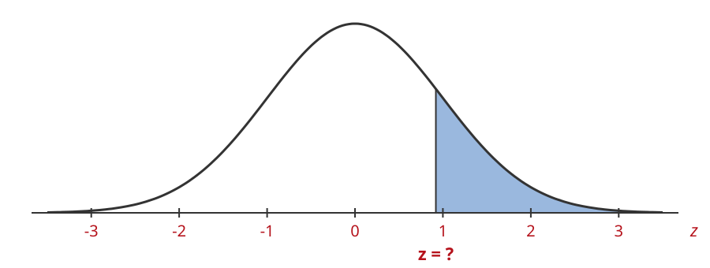
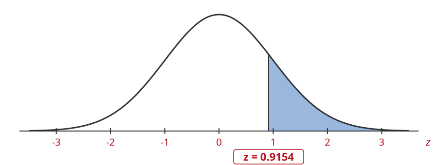
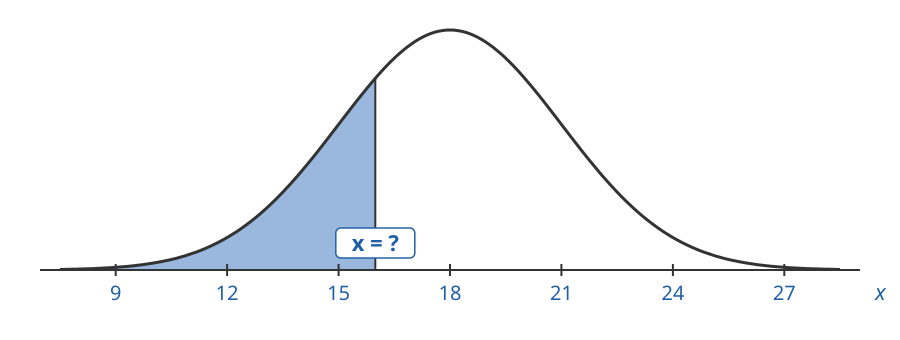
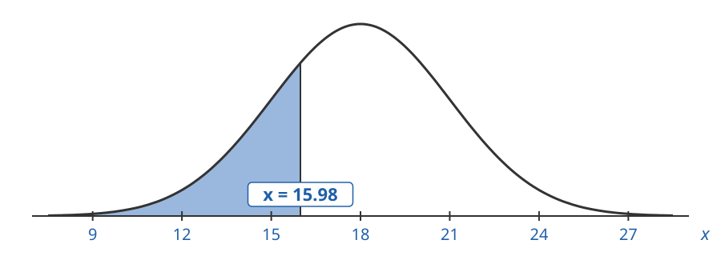
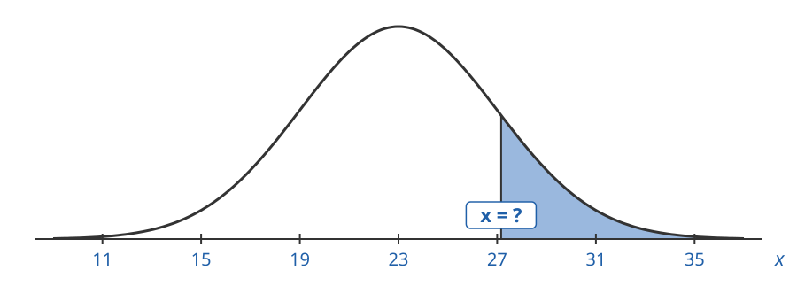
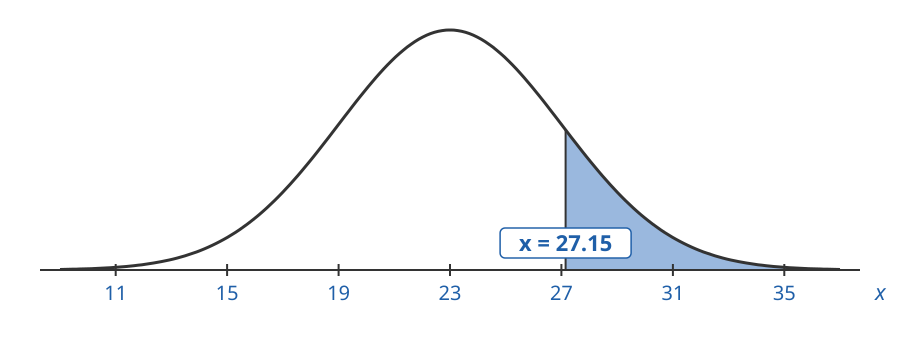

## Backwards Problems With a Spreadsheet

In backwards problems we start with an area and find the x-value.

A spreadsheet can find the z-value for us, instead of using the table backwards:

{.nostretch width=700}

## The NORMSINV Function

`NORMSDIST` goes **forwards**: it takes a z-value and gives the left tail area.

`NORMSINV` goes **backwards**: it takes a left tail area and gives the z-value.

| Direction | Formula |
|:--|:--|
| Forwards | `area = NORMSDIST(z)` |
| Backwards | `z = NORMSINV(area)` |

## Z for a Left Tail Area

`NORMSINV` takes a left tail area, so we use the area directly:

$$
z = \texttt{NORMSINV}(\text{left tail area})
$$

## 1. Z for a Left Tail of 25%

Find the z-value that gives a left tail area of $25\%$ using a spreadsheet.

## 1. Z for a Left Tail of 25%

Type `left tail area` in cell B2, then type $0.25$ into C2:

|   | A | B | C | D |
|:-:|:--|:--|:--|:--|
| **1** |  |  |  |  |
| **2** |  | left tail area | 0.25 |  |
| **3** |  |  |  |  |

## 1. Z for a Left Tail of 25%

Type `z` in B3.

In C3 type `=NORMSINV(`, click on C2, type `)` and hit enter:

|   | A | B | C | D |
|:-:|:--|:--|:--|:--|
| **1** |  |  |  |  |
| **2** |  | left tail area | 0.25 |  |
| **3** |  | z | `=NORMSINV(C2)` |  |
| **4** |  |  |  |  |

## 1. Z for a Left Tail of 25%

Here is the result:

|   | A | B | C | D |
|:-:|:--|:--|:--|:--|
| **1** |  |  |  |  |
| **2** |  | left tail area | 0.25 |  |
| **3** |  | z | -0.6745 |  |
| **4** |  |  |  |  |

## 1. Z for a Left Tail of 25%

$$
z = -0.6745
$$

## Z for a Right Tail Area

`NORMSINV` only takes left tail areas. So we change the right tail into a left tail:

$$
\text{left tail area} = 1.0 - \text{right tail area}
$$

In the spreadsheet we find the left tail area in its own cell first, then use `NORMSINV` on it.

## 2. Z for a Right Tail of 18%

Find the z-value that gives a right tail area of $18\%$ using a spreadsheet.

## 2. Z for a Right Tail of 18%

Type `right tail area` in cell B2, then type $0.18$ into C2:

|   | A | B | C | D |
|:-:|:--|:--|:--|:--|
| **1** |  |  |  |  |
| **2** |  | right tail area | 0.18 |  |
| **3** |  |  |  |  |
| **4** |  |  |  |  |
| **5** |  |  |  |  |

## 2. Z for a Right Tail of 18%

Type `left tail area` in B3.

In C3 type `=1.0-`, click on C2 and hit enter:

|   | A | B | C | D |
|:-:|:--|:--|:--|:--|
| **1** |  |  |  |  |
| **2** |  | right tail area | 0.18 |  |
| **3** |  | left tail area | `=1.0-C2` |  |
| **4** |  |  |  |  |
| **5** |  |  |  |  |

## 2. Z for a Right Tail of 18%

Type `z` in B4.

In C4 type `=NORMSINV(`, click on C3, type `)` and hit enter:

|   | A | B | C | D |
|:-:|:--|:--|:--|:--|
| **1** |  |  |  |  |
| **2** |  | right tail area | 0.18 |  |
| **3** |  | left tail area | 0.82 |  |
| **4** |  | z | `=NORMSINV(C3)` |  |
| **5** |  |  |  |  |

## 2. Z for a Right Tail of 18%

Here is the result:

|   | A | B | C | D |
|:-:|:--|:--|:--|:--|
| **1** |  |  |  |  |
| **2** |  | right tail area | 0.18 |  |
| **3** |  | left tail area | 0.82 |  |
| **4** |  | z | 0.9154 |  |
| **5** |  |  |  |  |

## 2. Z for a Right Tail of 18%

$$
z = 0.9154
$$

## Solve Backwards for X

Once we have the z-value, we find $x$ with:

$$
x = \mu + z\sigma
$$

In the spreadsheet, if $\mu$ is in C2, $\sigma$ is in C3 and $z$ is in C5:

$$
\texttt{=C2+C5*C3}
$$

## 3. Find x that represents the bottom 25% of the data

A normal distribution has $\mu = 18$ and $\sigma = 3$. Find the x-value with a left tail area of $25\%$ using a spreadsheet.

## 3. Find x that represents the bottom 25% of the data

$\mu = 18$, $\sigma = 3$. We want the x-value whose left tail area is $0.25$:

## 3. Find x that represents the bottom 25% of the data

Type `μ`, `σ` and `left tail area` in B2 to B4, and their values in C2 to C4:

|   | A | B | C | D |
|:-:|:--|:--|:--|:--|
| **1** |  |  |  |  |
| **2** |  | μ | 18 |  |
| **3** |  | σ | 3 |  |
| **4** |  | left tail area | 0.25 |  |
| **5** |  |  |  |  |
| **6** |  |  |  |  |

## 3. Find x that represents the bottom 25% of the data

Type `z` in B5.

In C5 type `=NORMSINV(`, click on C4, type `)` and hit enter:

|   | A | B | C | D |
|:-:|:--|:--|:--|:--|
| **1** |  |  |  |  |
| **2** |  | μ | 18 |  |
| **3** |  | σ | 3 |  |
| **4** |  | left tail area | 0.25 |  |
| **5** |  | z | `=NORMSINV(C4)` |  |
| **6** |  |  |  |  |

## 3. Find x that represents the bottom 25% of the data

Type `x` in B6.

In C6 type `=`, click on C2, type `+`, click on C5, type `*`, click on C3 and hit enter:

|   | A | B | C | D |
|:-:|:--|:--|:--|:--|
| **1** |  |  |  |  |
| **2** |  | μ | 18 |  |
| **3** |  | σ | 3 |  |
| **4** |  | left tail area | 0.25 |  |
| **5** |  | z | -0.6745 |  |
| **6** |  | x | `=C2+C5*C3` |  |

## 3. Find x that represents the bottom 25% of the data

Here is the result:

|   | A | B | C | D |
|:-:|:--|:--|:--|:--|
| **1** |  |  |  |  |
| **2** |  | μ | 18 |  |
| **3** |  | σ | 3 |  |
| **4** |  | left tail area | 0.25 |  |
| **5** |  | z | -0.6745 |  |
| **6** |  | x | 15.98 |  |

## 3. Find x that represents the bottom 25% of the data

$x = 15.98$ has a left tail area of $25\%$.

## 4. Find x that represents the top 15% of the data

A normal distribution has $\mu = 23$ and $\sigma = 4$. Find the x-value with a right tail area of $15\%$ using a spreadsheet.

## 4. Find x that represents the top 15% of the data

$\mu = 23$, $\sigma = 4$. We want the x-value whose right tail area is $0.15$:

## 4. Find x that represents the top 15% of the data

Type `μ`, `σ` and `right tail area` in B2 to B4, and their values in C2 to C4:

|   | A | B | C | D |
|:-:|:--|:--|:--|:--|
| **1** |  |  |  |  |
| **2** |  | μ | 23 |  |
| **3** |  | σ | 4 |  |
| **4** |  | right tail area | 0.15 |  |
| **5** |  |  |  |  |
| **6** |  |  |  |  |
| **7** |  |  |  |  |

## 4. Find x that represents the top 15% of the data

Type `left tail area` in B5.

In C5 type `=1.0-`, click on C4 and hit enter:

|   | A | B | C | D |
|:-:|:--|:--|:--|:--|
| **1** |  |  |  |  |
| **2** |  | μ | 23 |  |
| **3** |  | σ | 4 |  |
| **4** |  | right tail area | 0.15 |  |
| **5** |  | left tail area | `=1.0-C4` |  |
| **6** |  |  |  |  |
| **7** |  |  |  |  |

## 4. Find x that represents the top 15% of the data

Type `z` in B6.

In C6 type `=NORMSINV(`, click on C5, type `)` and hit enter:

|   | A | B | C | D |
|:-:|:--|:--|:--|:--|
| **1** |  |  |  |  |
| **2** |  | μ | 23 |  |
| **3** |  | σ | 4 |  |
| **4** |  | right tail area | 0.15 |  |
| **5** |  | left tail area | 0.85 |  |
| **6** |  | z | `=NORMSINV(C5)` |  |
| **7** |  |  |  |  |

## 4. Find x that represents the top 15% of the data

Type `x` in B7.

In C7 type `=`, click on C2, type `+`, click on C6, type `*`, click on C3 and hit enter:

|   | A | B | C | D |
|:-:|:--|:--|:--|:--|
| **1** |  |  |  |  |
| **2** |  | μ | 23 |  |
| **3** |  | σ | 4 |  |
| **4** |  | right tail area | 0.15 |  |
| **5** |  | left tail area | 0.85 |  |
| **6** |  | z | 1.0364 |  |
| **7** |  | x | `=C2+C6*C3` |  |

## 4. Find x that represents the top 15% of the data

Here is the result:

|   | A | B | C | D |
|:-:|:--|:--|:--|:--|
| **1** |  |  |  |  |
| **2** |  | μ | 23 |  |
| **3** |  | σ | 4 |  |
| **4** |  | right tail area | 0.15 |  |
| **5** |  | left tail area | 0.85 |  |
| **6** |  | z | 1.0364 |  |
| **7** |  | x | 27.15 |  |

## 4. Find x that represents the top 15% of the data

$x = 27.15$ has a right tail area of $15\%$.
