## Applications of Normal Distributions

Areas under a normal curve are **chances**.

The area for a range of x-values is the chance a data value lands in that range.

## What a Left Tail Area Represents

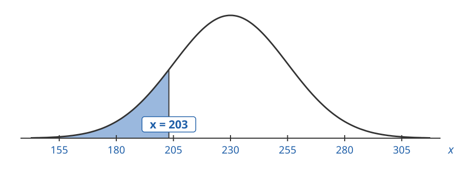{.nostretch width=520}

The shaded area is the:

- **chance** that $x$ is less than $203$
- **probability** that $x$ is less than $203$
- **proportion of the data** where $x$ is less than $203$
- **proportion of times** when $x$ is less than $203$

## What a Right Tail Area Represents

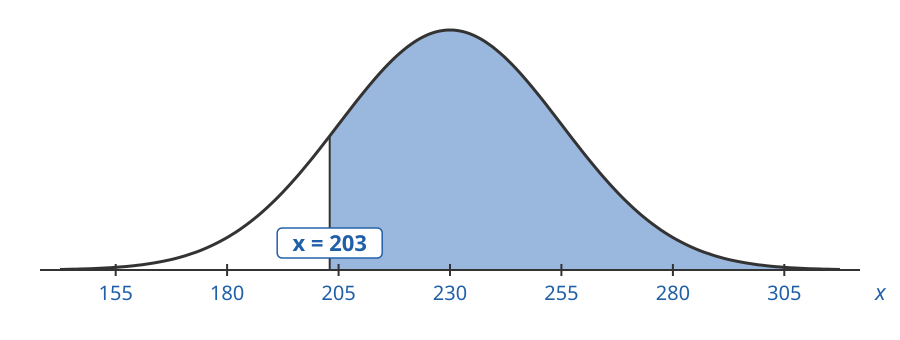{.nostretch width=520}

The shaded area is the:

- **chance** that $x$ is more than $203$
- **probability** that $x$ is more than $203$
- **proportion of the data** where $x$ is more than $203$
- **proportion of times** when $x$ is more than $203$

## What a Left Tail Area Means

Weekly demand $x$ is normal with $\mu = 230$ and $\sigma = 25$.

This means the weekly demands are a list of numbers like this:

$$
199, 239, 255, 217, 197, 228, 242, 257, 200, 198, \ldots
$$

Each number is the demand for one week.

We want to determine the chance that the demand in this list is less than $234$.

## What a Left Tail Area Means

Weekly demand $x$ is normal with $\mu = 230$ and $\sigma = 25$.

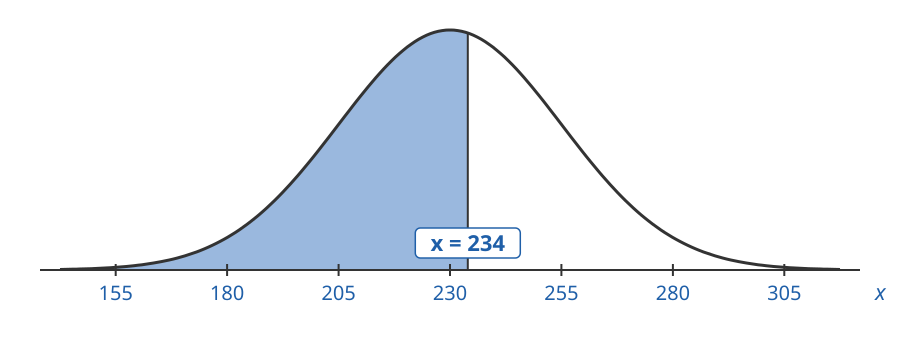{.nostretch width=520}

$$
\text{left tail area for } x = 234 \text{ is } 0.5636
$$

## What a Left Tail Area Means

The area $0.5636 \approx 56\%$ to the left of $x = 234$ is the **chance** that $x$ is less than $234$.

About $56\%$ of weeks have demand less than $234$.

In our list of $10$ weeks, $6$ are less than $234$.

## What a Right Tail Area Means

Weekly demand $x$ is normal with $\mu = 230$ and $\sigma = 25$.

This means the weekly demands are a list of numbers like this:

$$
199, 239, 255, 217, 197, 228, 242, 257, 200, 198, \ldots
$$

Each number is the demand for one week.

We want to determine the chance that the demand in this list is more than $250$.

## What a Right Tail Area Means

Weekly demand $x$ is normal with $\mu = 230$ and $\sigma = 25$.

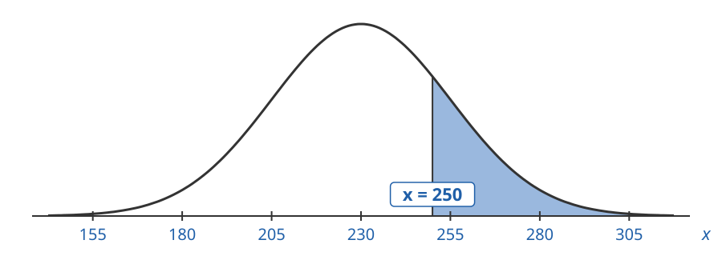

$$
\text{right tail area for } x = 250 \text{ is } 0.2119
$$

## What a Right Tail Area Means

The area $0.2119 \approx 21\%$ to the right of $x = 250$ is the **chance** that $x$ is more than $250$.

About $21\%$ of weeks have demand more than $250$.

In our list of $10$ weeks, $2$ are more than $250$.

## Finding Normal Areas

Given $\mu$ and $\sigma$:

1. Compute the z-value for each x-value:
$$
z = \frac{x - \mu}{\sigma}
$$
2. Look up the left tail area for $z$ in the z-table.
3. For a right tail area, use $1.0 - \text{left tail area}$.

## 1. Monthly Demand

Monthly demand for a retail product is normal with mean $48$ units and standard deviation $10$ units.

Find the chance that demand in a given month is $30$ or fewer units.

## 1. Monthly Demand

This means the monthly demands are a list of numbers like this:

$$
49, 41, 47, 50, 51, 64, 44, 49, 71, 50, \ldots
$$

Each number is the demand for one month.

We want to determine the chance that the demand in this list is $30$ or fewer.

## 1. Monthly Demand

$\mu = 48$, $\sigma = 10$. We want the left tail area for $x = 30$:

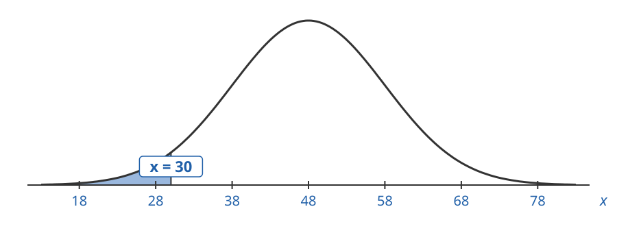

## 1. Monthly Demand

Find the z-value for $x = 30$:

$$
z = \frac{x - \mu}{\sigma} = \frac{30 - 48}{10} = \frac{-18}{10} = -1.8
$$

## 1. Monthly Demand

The left tail area for $z = -1.8$ is the same size as our original area:

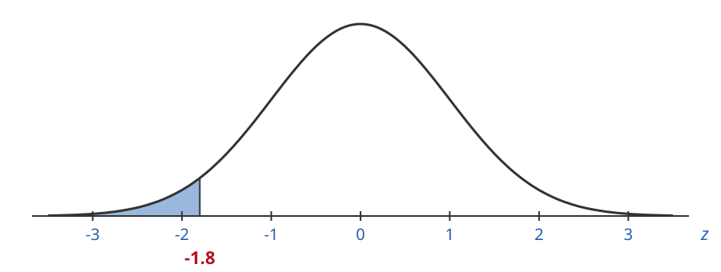

## 1. Monthly Demand

Go to the row $-1.8$ and the column $.00$:

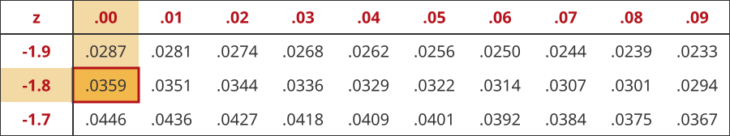

$$
\text{left tail area} = 0.0359
$$

## 1. Monthly Demand

$$
\text{left tail area} = 0.0359 \approx 4\%
$$

There is about a $4\%$ chance demand will be $30$ units or fewer.

## 2. Lost Sales

Weekly demand for a product is normal with mean $230$ and standard deviation $25$.

You have $265$ units to sell this week. **Lost sales** happen when demand is more than your inventory.

What is the chance of lost sales this week?

## 2. Lost Sales

This means the weekly demands are a list of numbers like this:

$$
256, 243, 206, 228, 230, 253, 205, 240, 273, 198, \ldots
$$

Each number is the demand for one week.

We want to determine the chance that the demand in this list is more than $265$.

## 2. Lost Sales

$\mu = 230$, $\sigma = 25$. We want the right tail area for $x = 265$:

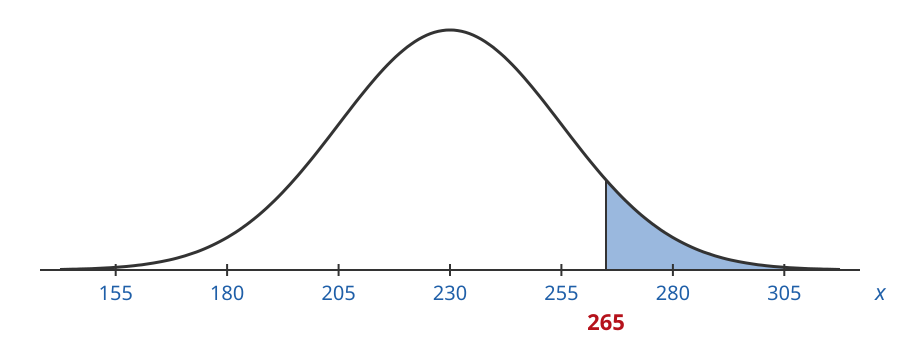

## 2. Lost Sales

Find the z-value for $x = 265$:

$$
z = \frac{x - \mu}{\sigma} = \frac{265 - 230}{25} = \frac{35}{25} = 1.4
$$

## 2. Lost Sales

The right tail area for $z = 1.4$ is the same size as our original area:

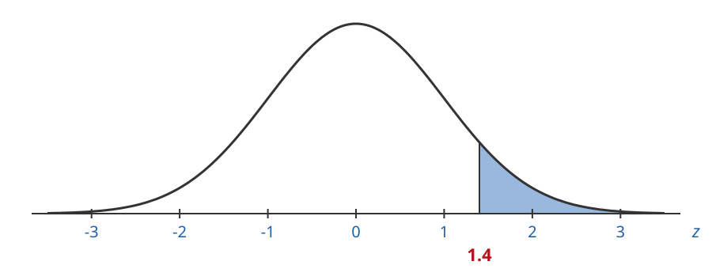

## 2. Lost Sales

Find the left tail area first. Go to the row $1.4$ and the column $.00$:

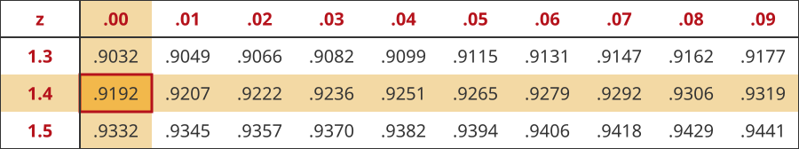

$$
\text{left tail area} = 0.9192
$$

## 2. Lost Sales

$$
\text{right tail area} = 1.0 - 0.9192 = 0.0808 \approx 8\%
$$

There is about an $8\%$ chance of lost sales this week.

## 3. Daily Demand

Daily demand for a bakery's croissants is normal with mean $120$ and standard deviation $15$.

Find the chance that demand on a given day is more than $140$ croissants.

## 3. Daily Demand

This means the daily demands are a list of numbers like this:

$$
131, 125, 138, 123, 111, 105, 131, 127, 131, 142, \ldots
$$

Each number is the demand for one day.

We want to determine the chance that the demand in this list is more than $140$.

## 3. Daily Demand

$\mu = 120$, $\sigma = 15$. We want the right tail area for $x = 140$:

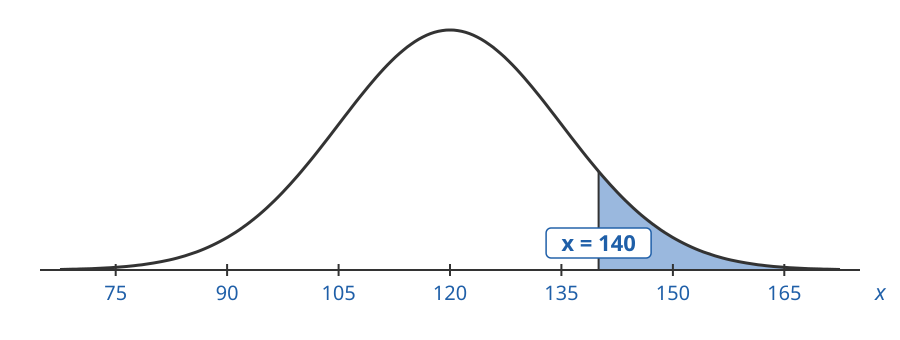

## 3. Daily Demand

Find the z-value for $x = 140$:

$$
z = \frac{x - \mu}{\sigma} = \frac{140 - 120}{15} = \frac{20}{15} = 1.33
$$

## 3. Daily Demand

The right tail area for $z = 1.33$ is the same size as our original area:

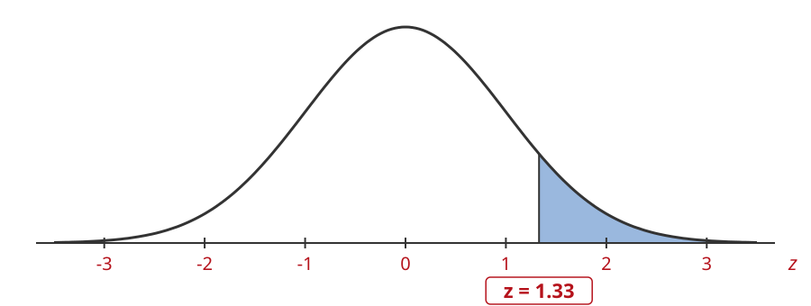

## 3. Daily Demand

Find the left tail area first. Go to the row $1.3$ and the column $.03$:

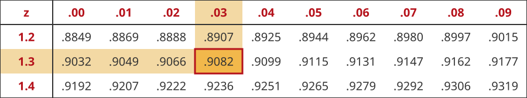

$$
\text{left tail area} = 0.9082
$$

## 3. Daily Demand

$$
\text{right tail area} = 1.0 - 0.9082 = 0.0918 \approx 9\%
$$

There is about a $9\%$ chance demand will be more than $140$ croissants.

## 4. Stocking Below the Mean

Weekly demand for a product is normal with mean $60$ and standard deviation $5$.

You stock $59$ units, **one less than the mean**.

What is the chance of lost sales this week?

## 4. Stocking Below the Mean

This means the weekly demands are a list of numbers like this:

$$
63, 54, 49, 59, 58, 58, 66, 56, 64, 57, \ldots
$$

Each number is the demand for one week.

We want to determine the chance that the demand in this list is more than $59$.

## 4. Stocking Below the Mean

Lost sales happen when demand is more than $59$.

$\mu = 60$, $\sigma = 5$. We want the right tail area for $x = 59$:

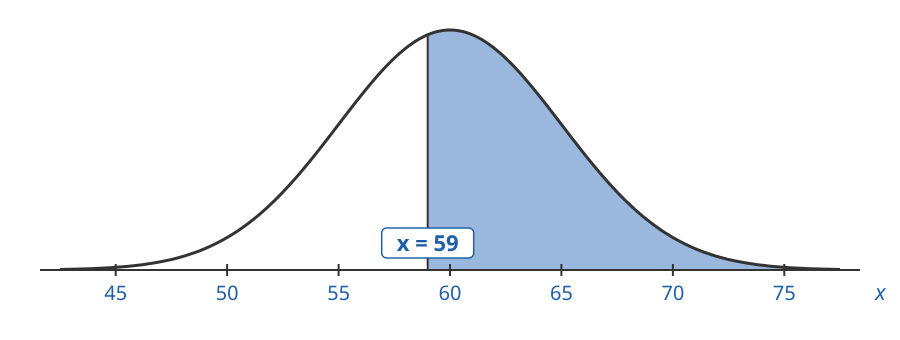

## 4. Stocking Below the Mean

Find the z-value for $x = 59$:

$$
z = \frac{x - \mu}{\sigma} = \frac{59 - 60}{5} = \frac{-1}{5} = -0.2
$$

## 4. Stocking Below the Mean

The right tail area for $z = -0.2$ is the same size as our original area:

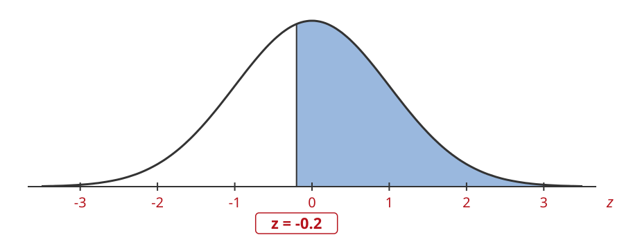

## 4. Stocking Below the Mean

Find the left tail area first. Go to the row $-0.2$ and the column $.00$:

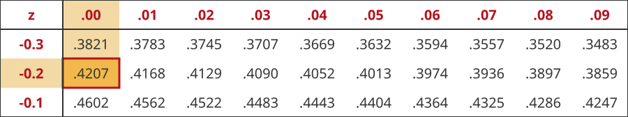

$$
\text{left tail area} = 0.4207
$$

## 4. Stocking Below the Mean

$$
\text{right tail area} = 1.0 - 0.4207 = 0.5793 \approx 58\%
$$

There is about a $58\%$ chance of lost sales this week.

## 4. Stocking Below the Mean

If you stock **exactly the mean**, the chance of lost sales is $50\%$.

Stocking **below** the mean makes lost sales **more likely than not**.

To keep the chance of lost sales small, stock **above** the mean.
