## Normal Areas

So far we found areas for the **standard normal** curve, with $\mu = 0$ and $\sigma = 1$.

Now we find areas for a normal curve with **any** mean $\mu$ and **any** standard deviation $\sigma$.

- A normal curve for data values $x$ is an **x-distribution**.
- The standard normal curve is the **z-distribution**.

## Find an Area for a Normal Curve

We change the x-area into the **same size** area on the standard normal curve:

1. Compute the z-value for each x-value:
$$
z = \frac{x - \mu}{\sigma}
$$
2. Find the area for those z-values with the z-table.

## Left Tail Areas for Normal Curves

Given $\mu$ and $\sigma$, find the left tail area for an x-value.

Change $x$ to $z$, then look up the left tail area for $z$ in the table.

## 1. Left Tail Area for x = 1.23

A normal distribution has $\mu = 3.3$ and $\sigma = 2.4$. Find the left tail area for $x = 1.23$.

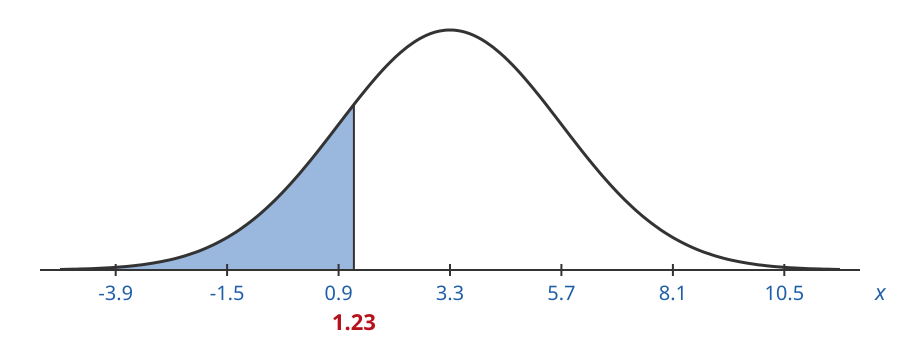

## 1. Left Tail Area for x = 1.23

Find the z-value for $x = 1.23$:

$$
z = \frac{x - \mu}{\sigma} = \frac{1.23 - 3.3}{2.4} = \frac{-2.07}{2.4} = -0.86
$$

## 1. Left Tail Area for x = 1.23

The left tail area for $z = -0.86$ is the same size as our original area:

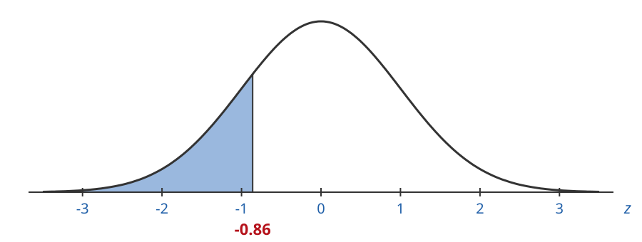

## 1. Left Tail Area for x = 1.23

Go to the row $-0.8$ and the column $.06$:

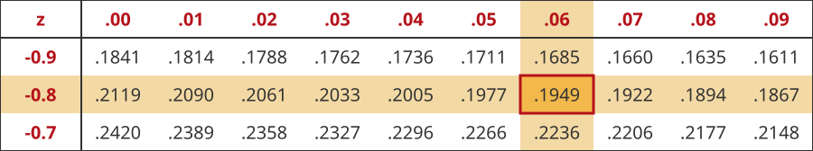

$$
\text{left tail area} = 0.1949
$$

## 1. Left Tail Area for x = 1.23

$$
\text{left tail area} = 0.1949 \approx 19\%
$$

## 2. Left Tail Area for x = 1.72

A normal distribution has $\mu = 1.2$ and $\sigma = 0.5$. Find the left tail area for $x = 1.72$.

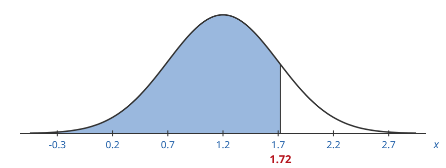

## 2. Left Tail Area for x = 1.72

Find the z-value for $x = 1.72$:

$$
z = \frac{x - \mu}{\sigma} = \frac{1.72 - 1.2}{0.5} = \frac{0.52}{0.5} = 1.04
$$

## 2. Left Tail Area for x = 1.72

The left tail area for $z = 1.04$ is the same size as our original area:

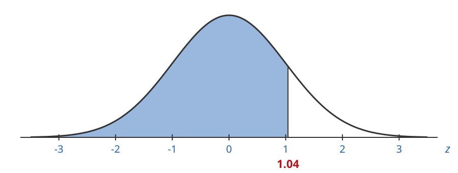

## 2. Left Tail Area for x = 1.72

Go to the row $1.0$ and the column $.04$:

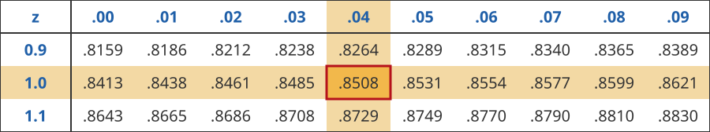

$$
\text{left tail area} = 0.8508
$$

## 2. Left Tail Area for x = 1.72

$$
\text{left tail area} = 0.8508 \approx 85\%
$$

## Right Tail Areas for Normal Curves

We use the same trick as for the standard normal curve.

Find the left tail area for $z$, then subtract it from $1.0$:

$$
\text{right tail area} = 1.0 - \text{left tail area}
$$

## 3. Right Tail Area for x = 53

A normal distribution has $\mu = 42$ and $\sigma = 12$. Find the right tail area for $x = 53$.

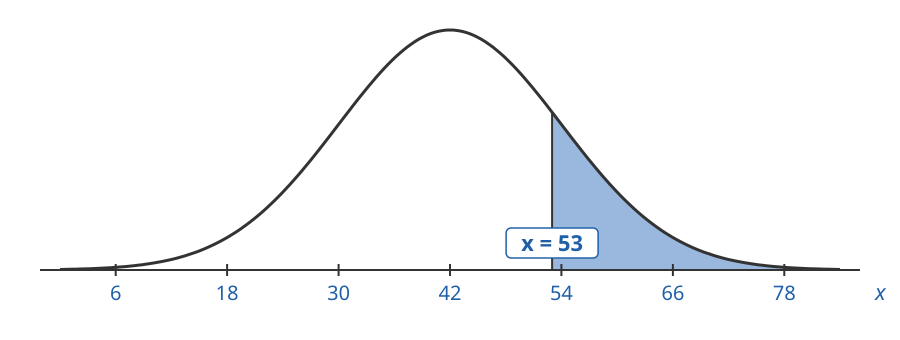

## 3. Right Tail Area for x = 53

Find the z-value for $x = 53$:

$$
z = \frac{x - \mu}{\sigma} = \frac{53 - 42}{12} = \frac{11}{12} = 0.92
$$

## 3. Right Tail Area for x = 53

The right tail area for $z = 0.92$ is the same size as our original area:

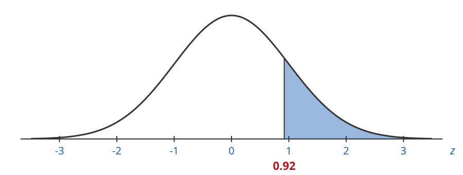

## 3. Right Tail Area for x = 53

Find the left tail area first. Go to the row $0.9$ and the column $.02$:

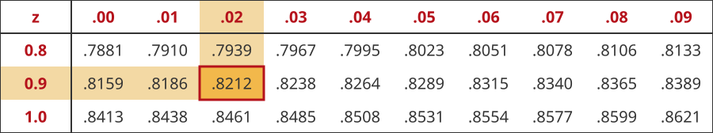

$$
\text{left tail area} = 0.8212
$$

## 3. Right Tail Area for x = 53

$$
\text{right tail area} = 1.0 - 0.8212 = 0.1788 \approx 18\%
$$

## 4. Right Tail Area for x = 2.3

A normal distribution has $\mu = 2.8$ and $\sigma = 1.5$. Find the right tail area for $x = 2.3$.

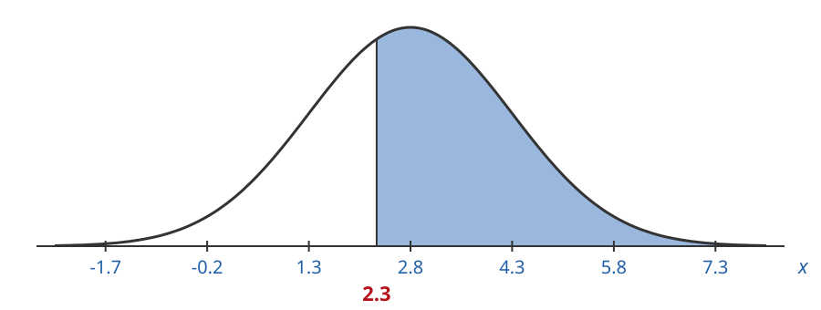

## 4. Right Tail Area for x = 2.3

Find the z-value for $x = 2.3$:

$$
z = \frac{x - \mu}{\sigma} = \frac{2.3 - 2.8}{1.5} = \frac{-0.5}{1.5} = -0.33
$$

## 4. Right Tail Area for x = 2.3

The right tail area for $z = -0.33$ is the same size as our original area:

## 4. Right Tail Area for x = 2.3

Find the left tail area first. Go to the row $-0.3$ and the column $.03$:

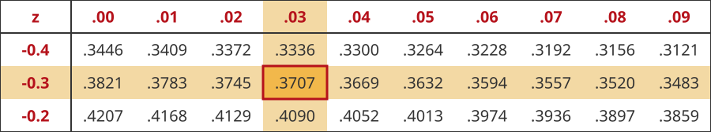

$$
\text{left tail area} = 0.3707
$$

## 4. Right Tail Area for x = 2.3

$$
\text{right tail area} = 1.0 - 0.3707 = 0.6293 \approx 63\%
$$

## Area Between Two X-Values

Find the left tail area up to each x-value.

Subtract the smaller left tail area from the larger one:

$$
\text{area between} = \text{left tail area for } z_2 - \text{left tail area for } z_1
$$

## 5. Area Between x = 10 and x = 27

A normal distribution has $\mu = 23$ and $\sigma = 8$. Find the area between $x_1 = 10$ and $x_2 = 27$.

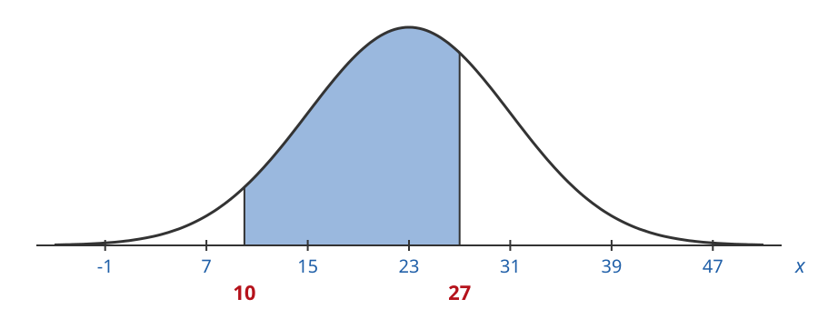

## 5. Area Between x = 10 and x = 27

Find the z-value for each x-value:

$$
z_2 = \frac{27 - 23}{8} = \frac{4}{8} = 0.5
$$

$$
z_1 = \frac{10 - 23}{8} = \frac{-13}{8} = -1.63
$$

## 5. Area Between x = 10 and x = 27

The area between $z_1 = -1.63$ and $z_2 = 0.5$ is the same size as our original area:

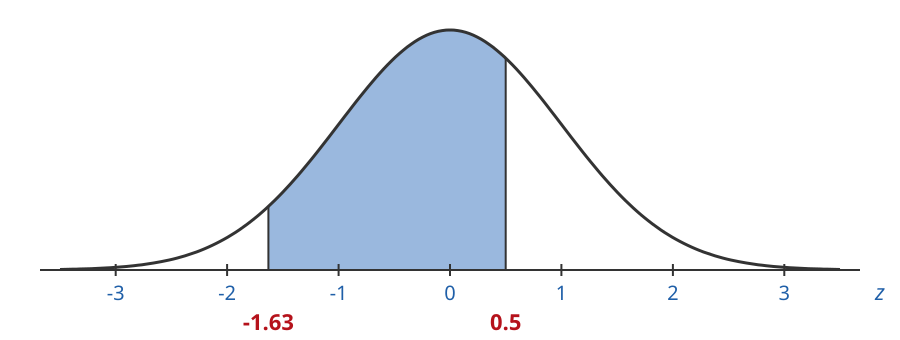

## 5. Area Between x = 10 and x = 27

Left tail area for $z_2 = 0.5$: row $0.5$, column $.00$

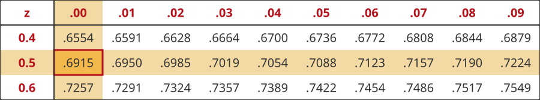

$$
\text{left tail area for } z_2 = 0.6915
$$

## 5. Area Between x = 10 and x = 27

Left tail area for $z_1 = -1.63$: row $-1.6$, column $.03$

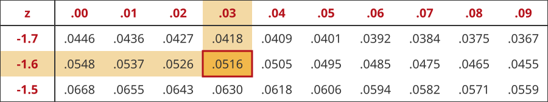

$$
\text{left tail area for } z_1 = 0.0516
$$

## 5. Area Between x = 10 and x = 27

$$
\text{area between} = 0.6915 - 0.0516 = 0.6399 \approx 64\%
$$

## 6. Area Between x = 1.6 and x = 2.8

A normal distribution has $\mu = 1.3$ and $\sigma = 0.8$. Find the area between $x_1 = 1.6$ and $x_2 = 2.8$.

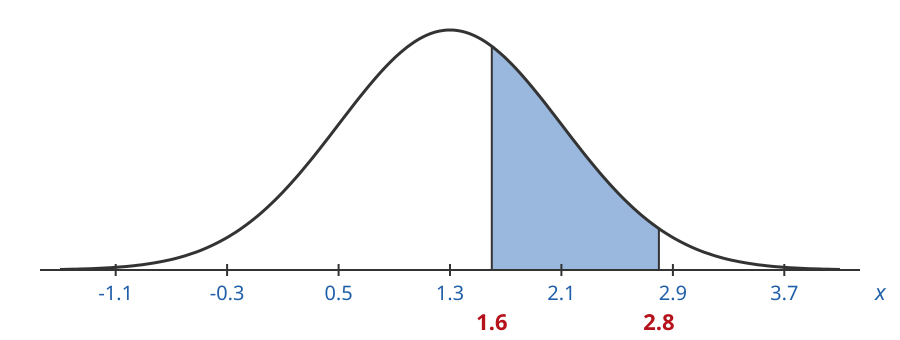

## 6. Area Between x = 1.6 and x = 2.8

Find the z-value for each x-value:

$$
z_2 = \frac{2.8 - 1.3}{0.8} = \frac{1.5}{0.8} = 1.88
$$

$$
z_1 = \frac{1.6 - 1.3}{0.8} = \frac{0.3}{0.8} = 0.38
$$

## 6. Area Between x = 1.6 and x = 2.8

The area between $z_1 = 0.38$ and $z_2 = 1.88$ is the same size as our original area:

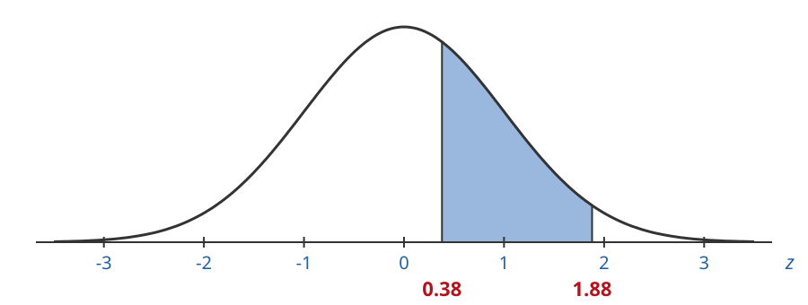

## 6. Area Between x = 1.6 and x = 2.8

Left tail area for $z_2 = 1.88$: row $1.8$, column $.08$

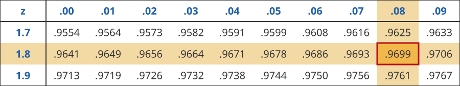

$$
\text{left tail area for } z_2 = 0.9699
$$

## 6. Area Between x = 1.6 and x = 2.8

Left tail area for $z_1 = 0.38$: row $0.3$, column $.08$

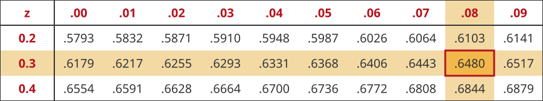

$$
\text{left tail area for } z_1 = 0.6480
$$

## 6. Area Between x = 1.6 and x = 2.8

$$
\text{area between} = 0.9699 - 0.6480 = 0.3219 \approx 32\%
$$

## Applications of Normal Distributions

Areas under a normal curve are **chances**.

The area for a range of x-values is the chance a data value lands in that range.

## 7. Monthly Demand

Monthly demand for a retail product is normal with mean $48$ units and standard deviation $10$ units.

Find the chance that demand in a given month is $30$ or fewer units.

## 7. Monthly Demand

$\mu = 48$, $\sigma = 10$. We want the left tail area for $x = 30$:

## 7. Monthly Demand

Find the z-value for $x = 30$:

$$
z = \frac{x - \mu}{\sigma} = \frac{30 - 48}{10} = \frac{-18}{10} = -1.8
$$

## 7. Monthly Demand

The left tail area for $z = -1.8$ is the same size as our original area:

## 7. Monthly Demand

Go to the row $-1.8$ and the column $.00$:

$$
\text{left tail area} = 0.0359
$$

## 7. Monthly Demand

$$
\text{left tail area} = 0.0359 \approx 4\%
$$

There is about a $4\%$ chance demand will be $30$ units or fewer.

## 8. Lost Sales

Weekly demand for a product is normal with mean $230$ and standard deviation $25$.

You have $265$ units to sell this week. **Lost sales** happen when demand is more than your inventory.

What is the chance of lost sales this week?

## 8. Lost Sales

$\mu = 230$, $\sigma = 25$. We want the right tail area for $x = 265$:

## 8. Lost Sales

Find the z-value for $x = 265$:

$$
z = \frac{x - \mu}{\sigma} = \frac{265 - 230}{25} = \frac{35}{25} = 1.4
$$

## 8. Lost Sales

The right tail area for $z = 1.4$ is the same size as our original area:

## 8. Lost Sales

Find the left tail area first. Go to the row $1.4$ and the column $.00$:

$$
\text{left tail area} = 0.9192
$$

## 8. Lost Sales

$$
\text{right tail area} = 1.0 - 0.9192 = 0.0808 \approx 8\%
$$

There is about an $8\%$ chance of lost sales this week.
