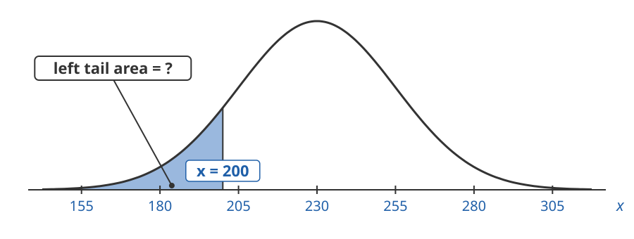
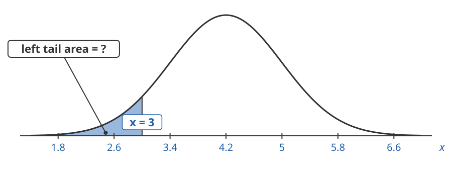
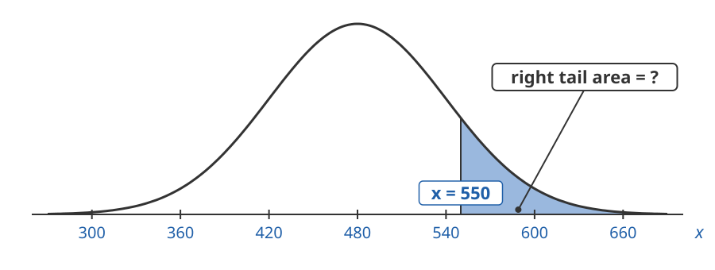
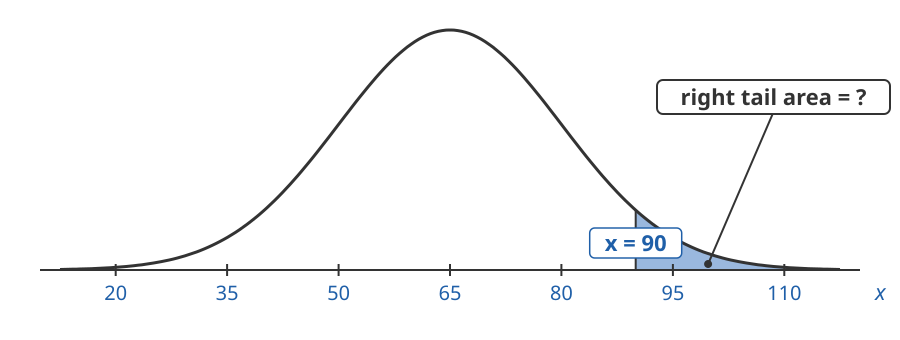
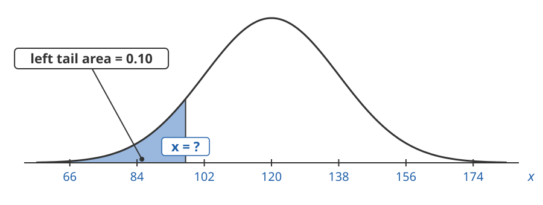
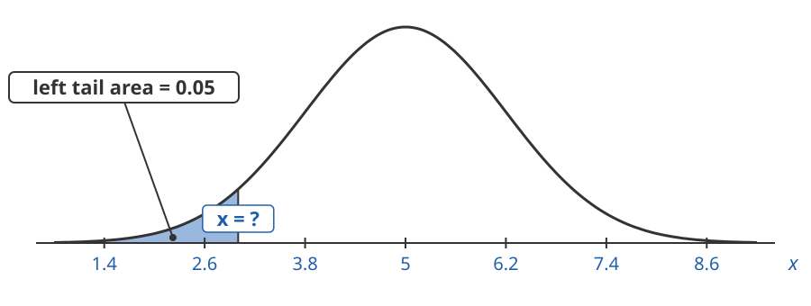
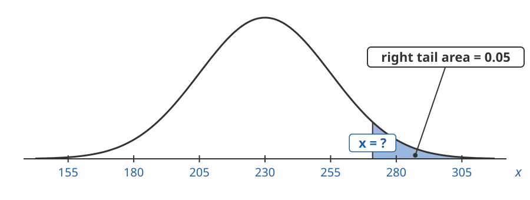
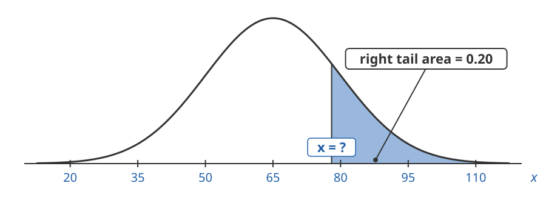

## Four Types of Normal Problems

- **Forwards, left tail**: know $x$, want the left tail area
- **Forwards, right tail**: know $x$, want the right tail area
- **Backwards, left tail**: know the left tail area, want $x$
- **Backwards, right tail**: know the right tail area, want $x$

## Forwards or Backwards?

**Forwards**: $x \to z \to \text{area}$

The question gives an **x-value** and asks for a chance, proportion or percent.

**Backwards**: $\text{area} \to z \to x$

The question gives a **percent** and asks for an x-value.

## Left Tail or Right Tail?

**Left tail** words: less than, under, fewer than, at most, bottom, lowest, fastest

**Right tail** words: more than, over, greater than, at least, top, highest, exceeded

## Forwards, Left Tail

Forwards: $x \to z \to \text{area}$

We know the x-value and want the **left tail area**.

## 1. Weekly Demand

Weekly demand for a product is normal with mean $230$ units and standard deviation $25$ units.

What is the chance that demand in a week is less than $200$ units?

## 1. Weekly Demand

**Forwards, Left Tail**: we know $x = 200$ and want the left tail area.

## 2. Delivery Times

Delivery times for online orders are normal with mean $4.2$ days and standard deviation $0.8$ days.

What proportion of orders arrive in under $3$ days?

## 2. Delivery Times

**Forwards, Left Tail**: we know $x = 3$ and want the left tail area.

## Forwards, Right Tail

Forwards: $x \to z \to \text{area}$

We know the x-value and want the **right tail area**.

## 3. Jacket Sales

Monthly sales of a jacket are normal with mean $480$ and standard deviation $60$.

What is the chance that monthly sales are more than $550$?

## 3. Jacket Sales

**Forwards, Right Tail**: we know $x = 550$ and want the right tail area.

## 4. Customer Spending

The amount customers spend per visit is normal with mean $\$65$ and standard deviation $\$15$.

What percent of customers spend more than $\$90$?

## 4. Customer Spending

**Forwards, Right Tail**: we know $x = 90$ and want the right tail area.

## Backwards, Left Tail

Backwards: $\text{area} \to z \to x$

We know the **left tail area** and want the x-value.

## 5. Slow Days

Daily demand for a product is normal with mean $120$ units and standard deviation $18$ units.

What demand marks the bottom $10\%$ of days?

## 5. Slow Days

**Backwards, Left Tail**: we know the left tail area is $0.10$ and want $x$.

## 6. Fastest Shipping

Shipping times are normal with mean $5$ days and standard deviation $1.2$ days.

What shipping time marks the fastest $5\%$ of orders?

## 6. Fastest Shipping

**Backwards, Left Tail**: the fastest times are the shortest ones. We know the left tail area is $0.05$ and want $x$.

## Backwards, Right Tail

Backwards: $\text{area} \to z \to x$

We know the **right tail area** and want the x-value.

## 7. High Demand Weeks

Weekly demand for a product is normal with mean $230$ units and standard deviation $25$ units.

What demand is exceeded in only $5\%$ of weeks?

## 7. High Demand Weeks

**Backwards, Right Tail**: we know the right tail area is $0.05$ and want $x$.

## 8. Top Spenders

The amount customers spend per visit is normal with mean $\$65$ and standard deviation $\$15$.

How much must a customer spend to be in the top $20\%$ of spenders?

## 8. Top Spenders

**Backwards, Right Tail**: we know the right tail area is $0.20$ and want $x$.

## Practice: What Type of Problem?

For each problem:

1. Draw the normal curve and shade the area.
2. Label what you **know** and what you **want**.
3. Is it **forwards** or **backwards**? Is it a **left tail** or a **right tail**?

## Practice 1. Store Visitors

Daily visitors to a store are normal with mean $850$ and standard deviation $90$.

How many visitors does the store get on only its busiest $10\%$ of days?

## Practice 2. Coffee Bags

The weights of bags of coffee are normal with mean $340$ grams and standard deviation $6$ grams.

What proportion of bags weigh less than $330$ grams?

## Practice 3. Checkout Waits

Checkout wait times are normal with mean $4.5$ minutes and standard deviation $1.1$ minutes.

What wait time marks the shortest $15\%$ of waits?

## Practice 4. Weekly Returns

The number of items returned each week is normal with mean $42$ and standard deviation $8$.

What is the chance that more than $55$ items are returned in a week?

## Practice 5. Online Orders

Online order totals are normal with mean $\$78$ and standard deviation $\$22$.

What percent of orders are at least $\$100$?

## Practice 6. Sneaker Sales

Monthly sales of a sneaker are normal with mean $640$ pairs and standard deviation $75$ pairs.

What sales level is exceeded in only $8\%$ of months?

## Practice 7. Restocking

The time to restock a shelf is normal with mean $25$ minutes and standard deviation $5$ minutes.

What is the chance that a restock takes $18$ minutes or less?

## Practice 8. Slow Weeks

Weekly sales of an item are normal with mean $60$ units and standard deviation $12$ units.

What weekly sales level puts a week in the lowest $20\%$ of weeks?
