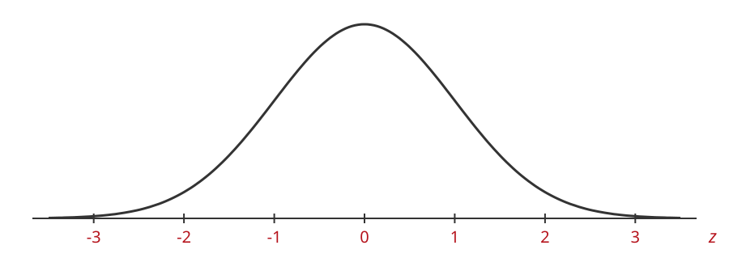
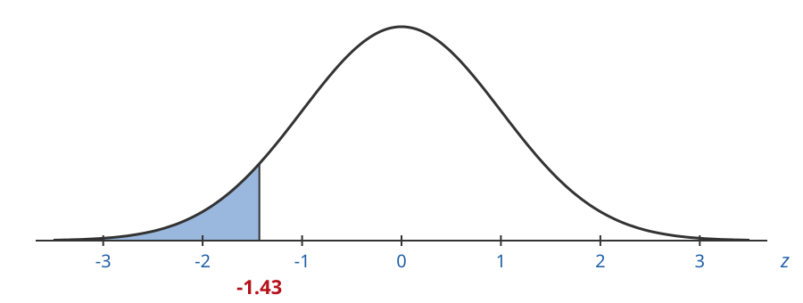
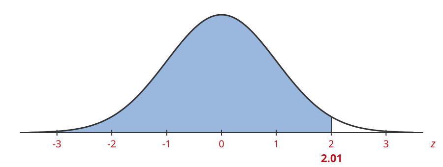
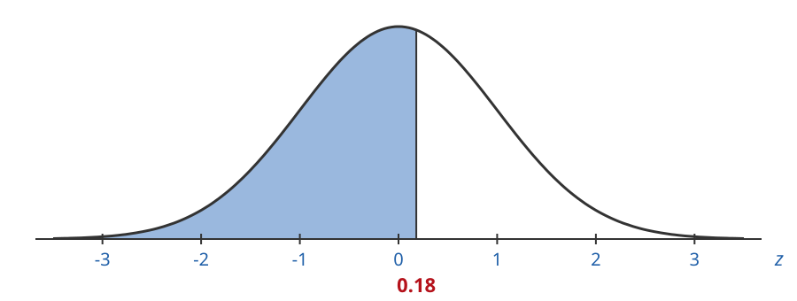
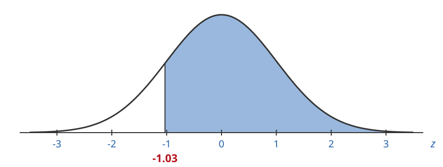
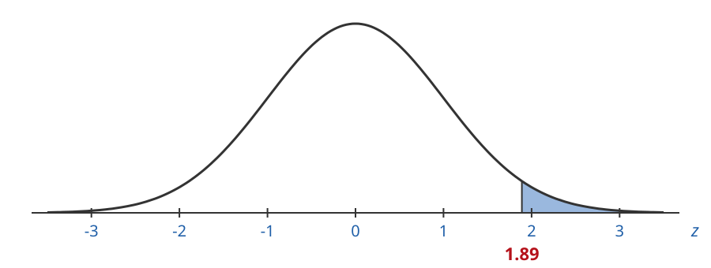
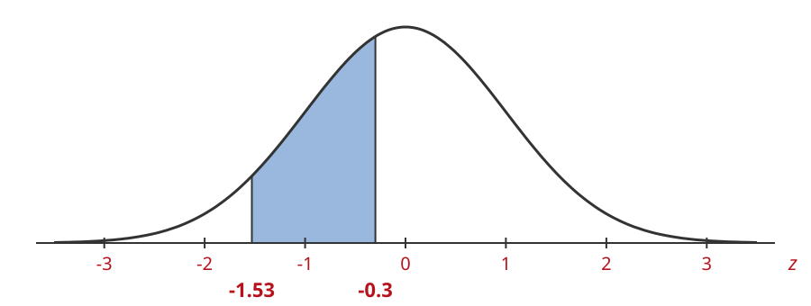
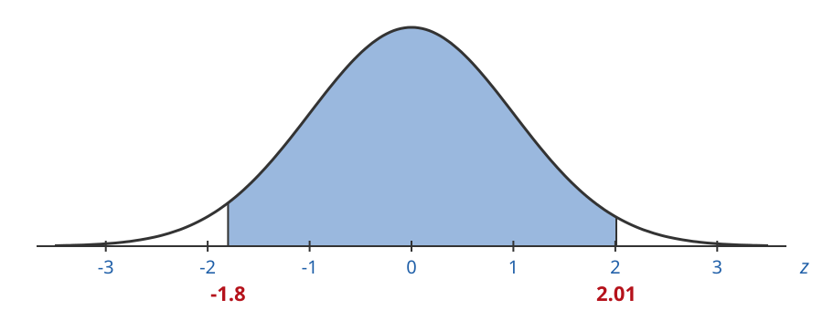
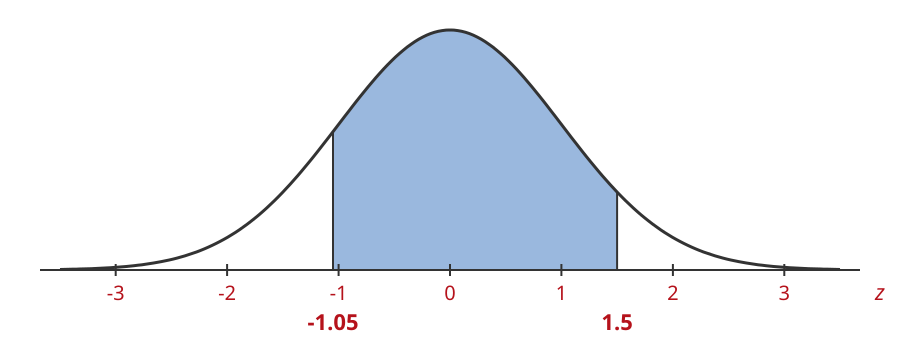

## Standard Normal Curve

The **standard normal curve** is a very special normal distribution.

It is also called the **z distribution**.

It has mean $0$ and standard deviation $1$:

$$
\mu = 0 \qquad \sigma = 1
$$

## The Standard Normal Curve

## Positive and Negative Z-Values

- **Positive** z-values are to the right of $0$, **above** the mean.
- **Negative** z-values are to the left of $0$, **below** the mean.

## Above and Below the Mean

This holds for other normal curves too, where the mean $\mu$ is not $0$.

- A data value **above** the mean has a **positive** z-value.
- A data value **below** the mean has a **negative** z-value.

## Most of the Area

Most of the area under the curve is between $z = -3$ and $z = 3$.

Z-values outside this range are **rare**. They point to something **unusual**.

## Areas Under the Curve

Areas under the curve tell us how likely or unlikely something is.

We need three kinds of areas:

- **Left tail area**: the area to the left of a z-value
- **Right tail area**: the area to the right of a z-value
- **Area between**: the area between two z-values

## Left Tail Areas

The **left tail area** is the area to the **left** of a z-value.

Every z-value has a left tail area that goes with it.

## 1. Left Tail Area

The z-value is $-1.43$. Is the left tail area more or less than $50\%$?

## 1. Left Tail Area

The z-value is $-1.43$. Is the left tail area more or less than $50\%$?

**Less than $50\%$.** The area is about $7.6\%$.

## 2. Left Tail Area

The z-value is $2.01$. Is the left tail area more or less than $50\%$?

## 2. Left Tail Area

The z-value is $2.01$. Is the left tail area more or less than $50\%$?

**More than $50\%$.** The area is about $97.8\%$.

## 3. Left Tail Area

The z-value is $0.18$. Is the left tail area more or less than $50\%$?

## 3. Left Tail Area

The z-value is $0.18$. Is the left tail area more or less than $50\%$?

**A little more than $50\%$.** The area is about $57.1\%$.

## Left Tail Areas Grow

| z-value | $-1.43$ | $0.18$ | $2.01$ |
|:--|:-:|:-:|:-:|
| Left tail area | $7.6\%$ | $57.1\%$ | $97.8\%$ |

The farther **right** the z-value, the **larger** the left tail area.

## Right Tail Areas

The **right tail area** is the area to the **right** of a z-value.

Every z-value has a right tail area that goes with it.

## 4. Right Tail Area

The z-value is $-1.03$. Is the right tail area more or less than $50\%$?

## 4. Right Tail Area

The z-value is $-1.03$. Is the right tail area more or less than $50\%$?

**More than $50\%$.** The area is about $84.9\%$.

## 5. Right Tail Area

The z-value is $0.31$. Is the right tail area more or less than $50\%$?

## 5. Right Tail Area

The z-value is $0.31$. Is the right tail area more or less than $50\%$?

**A little less than $50\%$.** The area is about $37.8\%$.

## 6. Right Tail Area

The z-value is $1.89$. Is the right tail area more or less than $50\%$?

## 6. Right Tail Area

The z-value is $1.89$. Is the right tail area more or less than $50\%$?

**Much less than $50\%$.** The area is very small, about $2.9\%$.

## Right Tail Areas Shrink

| z-value | $-1.03$ | $0.31$ | $1.89$ |
|:--|:-:|:-:|:-:|
| Right tail area | $84.9\%$ | $37.8\%$ | $2.9\%$ |

The farther **right** the z-value, the **smaller** the right tail area.

## Area Between

The **area between** is the area between **two** z-values.

## 7. Area Between

Estimate the area between $z = -1.53$ and $z = -0.3$.

## 7. Area Between

Estimate the area between $z = -1.53$ and $z = -0.3$.

It looks like about $25\%$ to $30\%$. The area is about $31.9\%$.

## 8. Area Between

Estimate the area between $z = -1.8$ and $z = 2.01$.

## 8. Area Between

Estimate the area between $z = -1.8$ and $z = 2.01$.

It looks like most of the area. The area is about $94.2\%$.

## 9. Area Between

Estimate the area between $z = -1.05$ and $z = 1.5$.

## 9. Area Between

Estimate the area between $z = -1.05$ and $z = 1.5$.

It looks like about $70\%$ to $80\%$. The area is about $78.6\%$.
