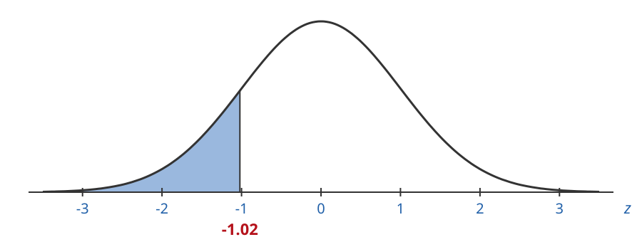
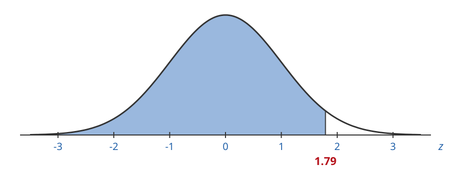
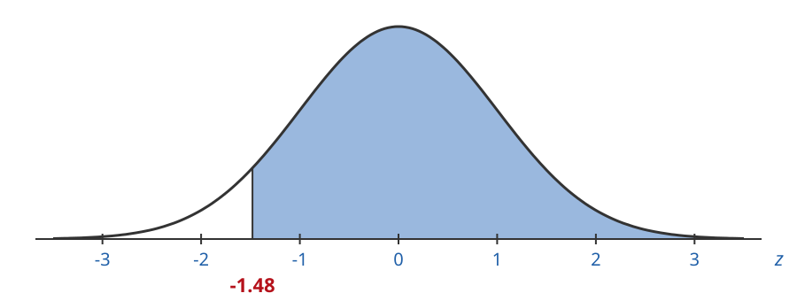
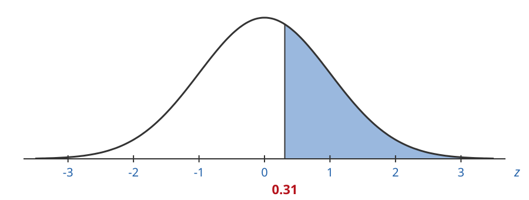
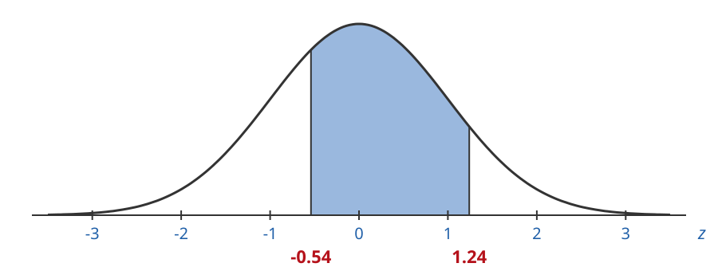

## Areas With a Spreadsheet

A spreadsheet can find the same areas we found with the standard normal table.

Excel and Google Sheets both work the same way. You can use either one.

## The NORMSDIST Function

`NORMSDIST` gives the **left tail area** for a z-value:

| Area | Spreadsheet formula |
|:--|:--|
| Left tail area | `=NORMSDIST(z)` |
| Right tail area | `=1.0-NORMSDIST(z)` |
| Area between $z_1$ and $z_2$ | `=NORMSDIST(z2)-NORMSDIST(z1)` |

## Left Tail Areas With Spreadsheets

`NORMSDIST` gives left tail areas directly:

$$
\text{left tail area} = \texttt{NORMSDIST}(z)
$$

## 1. Left Tail Area for z = -1.02

Find the left tail area when $z = -1.02$ using a spreadsheet.

## 1. Left Tail Area for z = -1.02

Type `z` in cell B2, then type $-1.02$ into C2:

|   | A | B | C | D |
|:-:|:--|:--|:--|:--|
| **1** |  |  |  |  |
| **2** |  | z | -1.02 |  |
| **3** |  |  |  |  |
| **4** |  |  |  |  |

## 1. Left Tail Area for z = -1.02

Type `left tail area` in B3.

In C3 type `=NORMSDIST(`, click on C2, type `)` and hit enter:

|   | A | B | C | D |
|:-:|:--|:--|:--|:--|
| **1** |  |  |  |  |
| **2** |  | z | -1.02 |  |
| **3** |  | left tail area | `=NORMSDIST(C2)` |  |
| **4** |  |  |  |  |

## 1. Left Tail Area for z = -1.02

Here is the result:

|   | A | B | C | D |
|:-:|:--|:--|:--|:--|
| **1** |  |  |  |  |
| **2** |  | z | -1.02 |  |
| **3** |  | left tail area | 0.1539 |  |
| **4** |  |  |  |  |

## 1. Left Tail Area for z = -1.02

$$
\text{left tail area} = 0.1539 \approx 15\%
$$

## 2. Left Tail Area for z = 1.79

Find the left tail area when $z = 1.79$ using a spreadsheet.

## 2. Left Tail Area for z = 1.79

Type `z` in cell B2, then type $1.79$ into C2:

|   | A | B | C | D |
|:-:|:--|:--|:--|:--|
| **1** |  |  |  |  |
| **2** |  | z | 1.79 |  |
| **3** |  |  |  |  |
| **4** |  |  |  |  |

## 2. Left Tail Area for z = 1.79

Type `left tail area` in B3.

In C3 type `=NORMSDIST(`, click on C2, type `)` and hit enter:

|   | A | B | C | D |
|:-:|:--|:--|:--|:--|
| **1** |  |  |  |  |
| **2** |  | z | 1.79 |  |
| **3** |  | left tail area | `=NORMSDIST(C2)` |  |
| **4** |  |  |  |  |

## 2. Left Tail Area for z = 1.79

Here is the result:

|   | A | B | C | D |
|:-:|:--|:--|:--|:--|
| **1** |  |  |  |  |
| **2** |  | z | 1.79 |  |
| **3** |  | left tail area | 0.9633 |  |
| **4** |  |  |  |  |

## 2. Left Tail Area for z = 1.79

$$
\text{left tail area} = 0.9633 \approx 96\%
$$

## Right Tail Areas With Spreadsheets

`NORMSDIST` only gives left tails, so we use a trick.

The whole area is $1.0$. Find the left tail area and subtract it from $1.0$:

$$
\text{right tail area} = 1.0 - \texttt{NORMSDIST}(z)
$$

## 3. Right Tail Area for z = -1.48

Find the right tail area when $z = -1.48$ using a spreadsheet.

## 3. Right Tail Area for z = -1.48

Type `z` in cell B2, then type $-1.48$ into C2:

|   | A | B | C | D |
|:-:|:--|:--|:--|:--|
| **1** |  |  |  |  |
| **2** |  | z | -1.48 |  |
| **3** |  |  |  |  |
| **4** |  |  |  |  |

## 3. Right Tail Area for z = -1.48

Type `right tail area` in B3.

In C3 type `=1.0-NORMSDIST(`, click on C2, type `)` and hit enter:

|   | A | B | C | D |
|:-:|:--|:--|:--|:--|
| **1** |  |  |  |  |
| **2** |  | z | -1.48 |  |
| **3** |  | right tail area | `=1.0-NORMSDIST(C2)` |  |
| **4** |  |  |  |  |

## 3. Right Tail Area for z = -1.48

Here is the result:

|   | A | B | C | D |
|:-:|:--|:--|:--|:--|
| **1** |  |  |  |  |
| **2** |  | z | -1.48 |  |
| **3** |  | right tail area | 0.9306 |  |
| **4** |  |  |  |  |

## 3. Right Tail Area for z = -1.48

$$
\text{right tail area} = 0.9306 \approx 93\%
$$

## 4. Right Tail Area for z = 0.31

Find the right tail area when $z = 0.31$ using a spreadsheet.

## 4. Right Tail Area for z = 0.31

Type `z` in cell B2, then type $0.31$ into C2:

|   | A | B | C | D |
|:-:|:--|:--|:--|:--|
| **1** |  |  |  |  |
| **2** |  | z | 0.31 |  |
| **3** |  |  |  |  |
| **4** |  |  |  |  |

## 4. Right Tail Area for z = 0.31

Type `right tail area` in B3.

In C3 type `=1.0-NORMSDIST(`, click on C2, type `)` and hit enter:

|   | A | B | C | D |
|:-:|:--|:--|:--|:--|
| **1** |  |  |  |  |
| **2** |  | z | 0.31 |  |
| **3** |  | right tail area | `=1.0-NORMSDIST(C2)` |  |
| **4** |  |  |  |  |

## 4. Right Tail Area for z = 0.31

Here is the result:

|   | A | B | C | D |
|:-:|:--|:--|:--|:--|
| **1** |  |  |  |  |
| **2** |  | z | 0.31 |  |
| **3** |  | right tail area | 0.3783 |  |
| **4** |  |  |  |  |

## 4. Right Tail Area for z = 0.31

$$
\text{right tail area} = 0.3783 \approx 38\%
$$

## Area Between With Spreadsheets

Find the left tail area for the **greater** z-value $z_2$.

Subtract the left tail area for the **lesser** z-value $z_1$:

$$
\text{area between} = \texttt{NORMSDIST}(z_2) - \texttt{NORMSDIST}(z_1)
$$

## 5. Area Between z = -0.54 and z = 1.24

Find the area between $z_1 = -0.54$ and $z_2 = 1.24$ using a spreadsheet.

## 5. Area Between z = -0.54 and z = 1.24

Type `z1` in B2 and $-0.54$ into C2. Type `z2` in B3 and $1.24$ into C3:

|   | A | B | C | D |
|:-:|:--|:--|:--|:--|
| **1** |  |  |  |  |
| **2** |  | z1 | -0.54 |  |
| **3** |  | z2 | 1.24 |  |
| **4** |  |  |  |  |
| **5** |  |  |  |  |

## 5. Area Between z = -0.54 and z = 1.24

Type `area between` in B4.

In C4 enter `=NORMSDIST(C3)-NORMSDIST(C2)` and hit enter:

|   | A | B | C | D |
|:-:|:--|:--|:--|:--|
| **1** |  |  |  |  |
| **2** |  | z1 | -0.54 |  |
| **3** |  | z2 | 1.24 |  |
| **4** |  | area between | `=NORMSDIST(C3)-NORMSDIST(C2)` |  |
| **5** |  |  |  |  |

## 5. Area Between z = -0.54 and z = 1.24

Here is the result:

|   | A | B | C | D |
|:-:|:--|:--|:--|:--|
| **1** |  |  |  |  |
| **2** |  | z1 | -0.54 |  |
| **3** |  | z2 | 1.24 |  |
| **4** |  | area between | 0.5979 |  |
| **5** |  |  |  |  |

## 5. Area Between z = -0.54 and z = 1.24

$$
\text{area between} = 0.5979 \approx 60\%
$$

The shaded area is about $60\%$ of the entire area.
