## Standard Normal Table

The **standard normal table** (the **z-table**) gives areas under the standard normal curve.

Our table has only **left tail areas** in it.

## Right Tails and Areas Between

For a right tail area or an area between, we need some tricks.

We use the table to find left tail areas, then work from those.

We will see how to do that later. Today we find **left tail areas**.

## Reading the Table

Split the z-value into two parts:

- The **row** has the ones digit and the first decimal place.
- The **column** has the second decimal place.

$$
z = -1.25 \quad \longrightarrow \quad \text{row } -1.2, \quad \text{column } .05
$$

The left tail area is where the row and column meet.

## 1. Left Tail Area for z = -1.25

Find the left tail area when $z = -1.25$. Use the standard normal table.

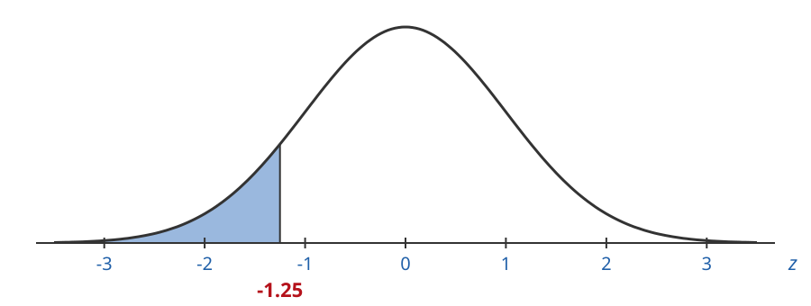

## 1. Left Tail Area for z = -1.25

Find the left tail area when $z = -1.25$.

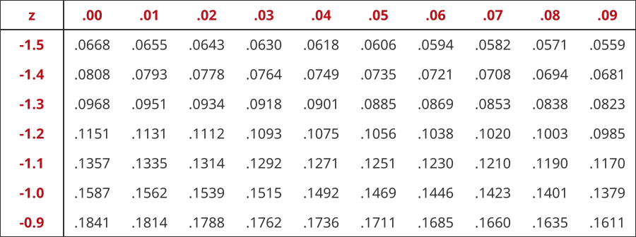

## 1. Left Tail Area for z = -1.25

Go to the row $-1.2$ and the column $.05$.

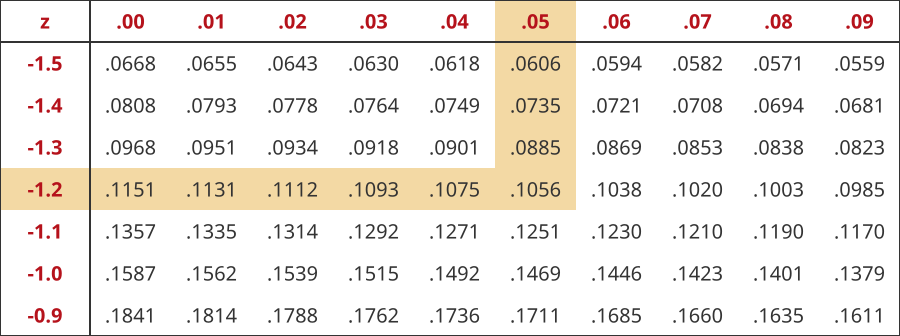

## 1. Left Tail Area for z = -1.25

Go to the row $-1.2$ and the column $.05$.

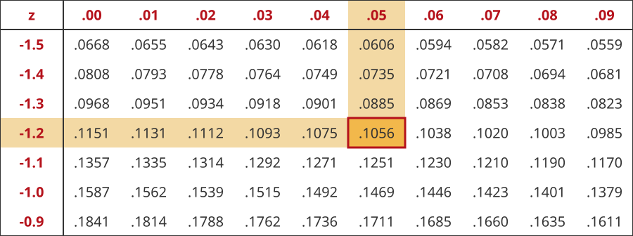

$$
\text{left tail area} = 0.1056
$$

## 1. Left Tail Area for z = -1.25

$$
\text{left tail area} = 0.1056 \approx 11\%
$$

The shaded region is about $11\%$ of the entire area.

## 2. Left Tail Area for z = 1.32

Find the left tail area when $z = 1.32$. Use the standard normal table.

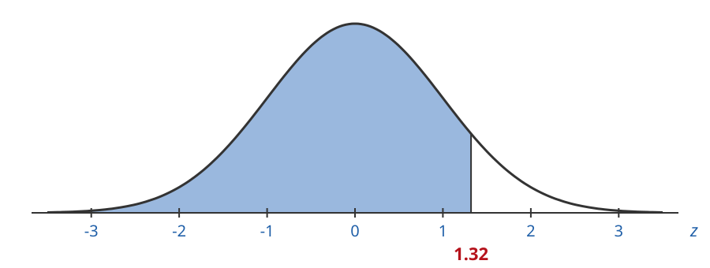

## 2. Left Tail Area for z = 1.32

Find the left tail area when $z = 1.32$.

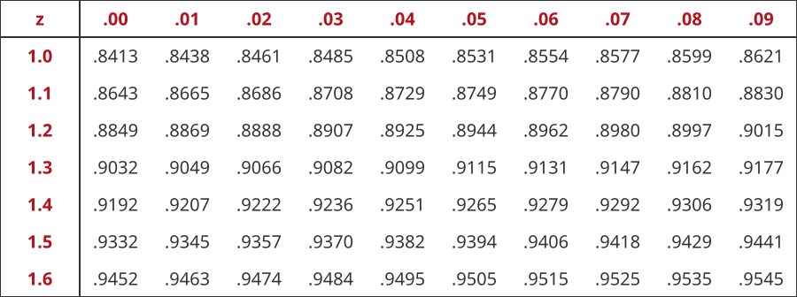

## 2. Left Tail Area for z = 1.32

Go to the row $1.3$ and the column $.02$.

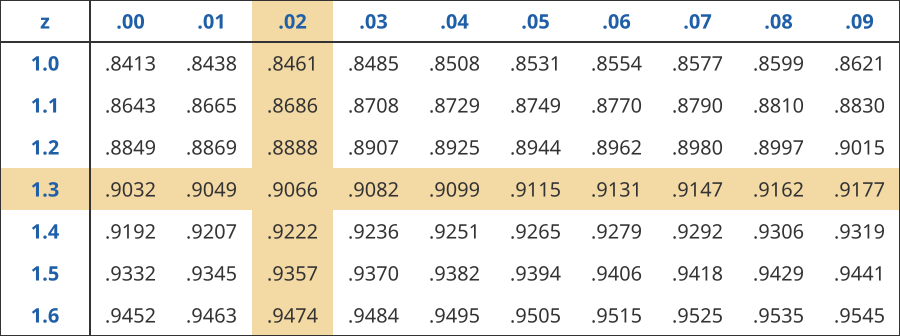

## 2. Left Tail Area for z = 1.32

Go to the row $1.3$ and the column $.02$.

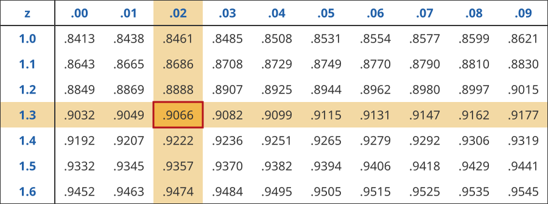

$$
\text{left tail area} = 0.9066
$$

## 2. Left Tail Area for z = 1.32

$$
\text{left tail area} = 0.9066 \approx 91\%
$$

The shaded region is about $91\%$ of the entire area.

## 3. Left Tail Area for z = 0.07

Find the left tail area when $z = 0.07$. Use the standard normal table.

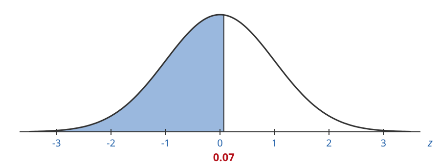

## 3. Left Tail Area for z = 0.07

Find the left tail area when $z = 0.07$.

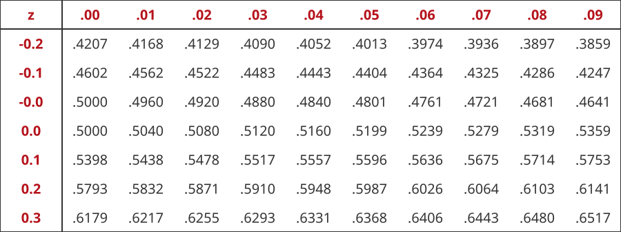

## 3. Left Tail Area for z = 0.07

Go to the row $0.0$ and the column $.07$.

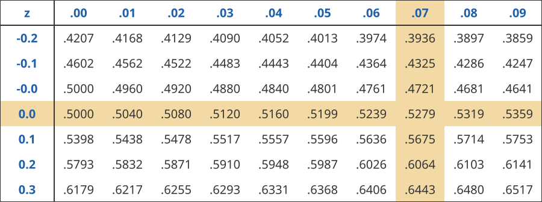

Careful: use $0.0$, not $-0.0$. The $-0.0$ row is for negative z-values.

## 3. Left Tail Area for z = 0.07

Go to the row $0.0$ and the column $.07$.

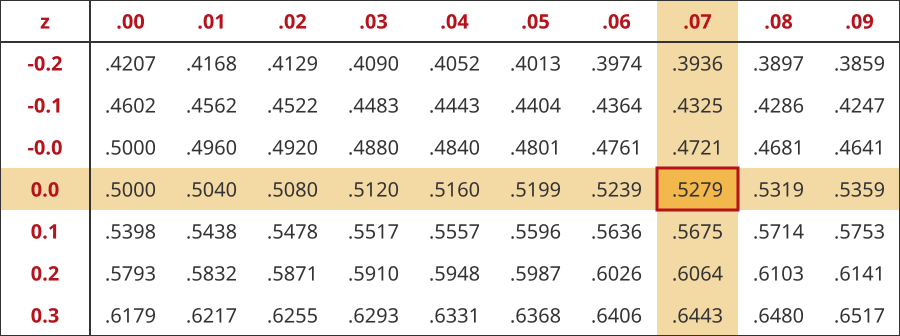

$$
\text{left tail area} = 0.5279
$$

## 3. Left Tail Area for z = 0.07

$$
\text{left tail area} = 0.5279 \approx 53\%
$$

The shaded region is about $53\%$ of the entire area.

## 4. Left Tail Area for z = 0.84

Find the left tail area when $z = 0.84$. Use the standard normal table.

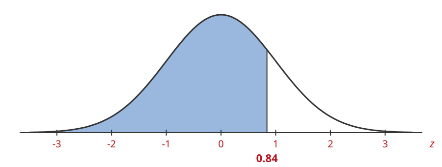

## 4. Left Tail Area for z = 0.84

Find the left tail area when $z = 0.84$.

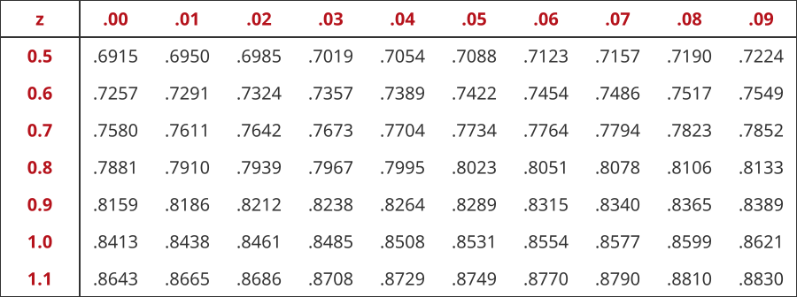

## 4. Left Tail Area for z = 0.84

Go to the row $0.8$ and the column $.04$.

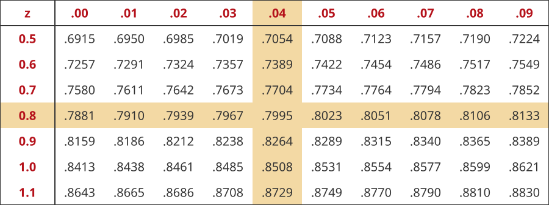

## 4. Left Tail Area for z = 0.84

Go to the row $0.8$ and the column $.04$.

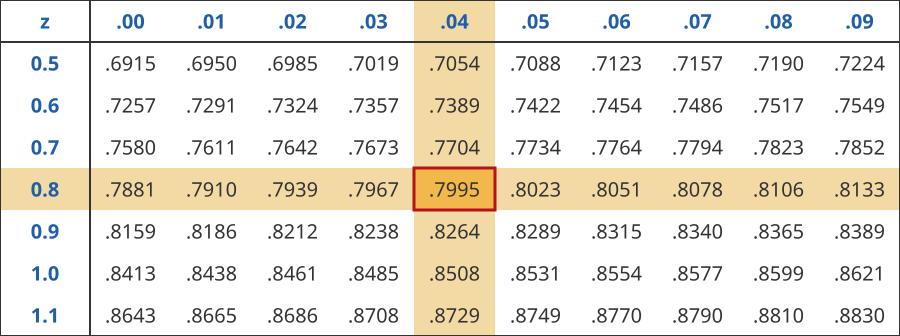

$$
\text{left tail area} = 0.7995
$$

## 4. Left Tail Area for z = 0.84

$$
\text{left tail area} = 0.7995 \approx 80\%
$$

The shaded region is about $80\%$ of the entire area.

## 5. Left Tail Area for z = -2.17

Find the left tail area when $z = -2.17$. Use the standard normal table.

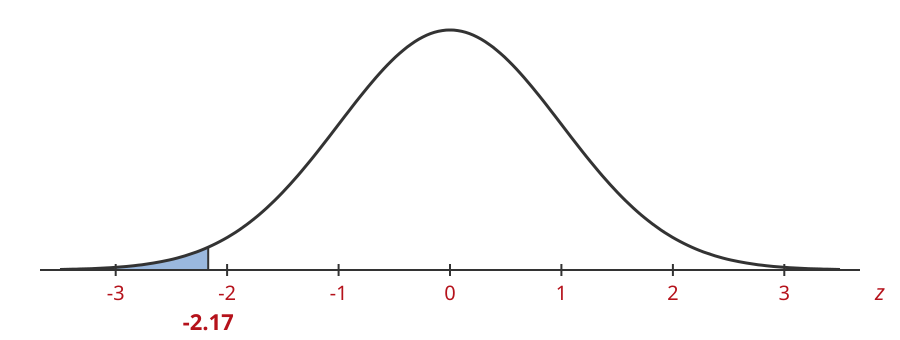

## 5. Left Tail Area for z = -2.17

Find the left tail area when $z = -2.17$.

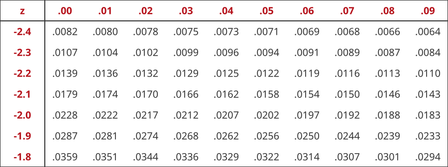

## 5. Left Tail Area for z = -2.17

Go to the row $-2.1$ and the column $.07$.

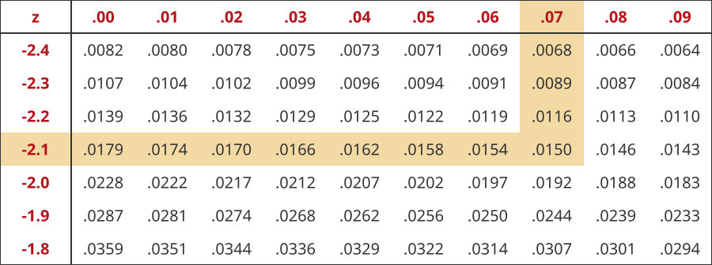

## 5. Left Tail Area for z = -2.17

Go to the row $-2.1$ and the column $.07$.

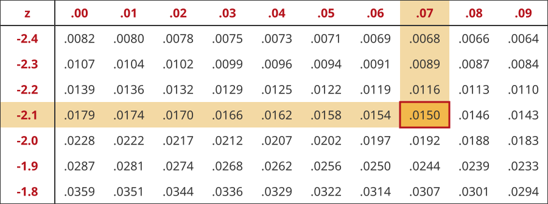

$$
\text{left tail area} = 0.0150
$$

## 5. Left Tail Area for z = -2.17

$$
\text{left tail area} = 0.0150 \approx 2\%
$$

The shaded region is about $2\%$ of the entire area.
