## Z-Values

A **z-value** tells us how far a data value is from the mean, measured in standard deviations.

Here is the formula in words:

$$
z = \frac{\text{data} - \text{mean}}{\text{std dev}} = \frac{\text{data value} - \text{middle}}{\text{spread}}
$$

## Population Z-Value

Suppose we know the population mean $\mu$ and the population standard deviation $\sigma$.

The z-value of a data value $x$ is:

$$
z = \frac{x - \mu}{\sigma}
$$

## 1. Find the Z-Value

The mean is $\mu = 52$ and the standard deviation is $\sigma = 8$.

Find the z-value of $x = 54$.

## 1. Find the Z-Value

The mean is $\mu = 52$ and the standard deviation is $\sigma = 8$.

Find the z-value of $x = 54$.

$$
z = \frac{x - \mu}{\sigma} = \frac{54 - 52}{8} = \frac{2}{8} = 0.25
$$

## 2. Z-Value of an Exam Score

The exam scores have mean $\mu = 72$ and standard deviation $\sigma = 8$.

Find the z-value of an exam score of $x = 65$.

## 2. Z-Value of an Exam Score

The exam scores have mean $\mu = 72$ and standard deviation $\sigma = 8$.

Find the z-value of an exam score of $x = 65$.

$$
z = \frac{x - \mu}{\sigma} = \frac{65 - 72}{8} = \frac{-7}{8} = -0.875
$$

## The Sign of a Z-Value

Example 1 gave a positive z-value. Example 2 gave a negative one.

- If $z$ is **positive**, $x$ is **above** the mean.
- If $z$ is **negative**, $x$ is **below** the mean.
- If $z = 0$, $x$ is **equal** to the mean.

## Z Counts Standard Deviations

The z-value is the **number of standard deviations** $x$ is away from the mean.

| $x$ | $-3\sigma$ | $-2\sigma$ | $-1\sigma$ | $\mu$ | $+1\sigma$ | $+2\sigma$ | $+3\sigma$ |
|:-:|:-:|:-:|:-:|:-:|:-:|:-:|:-:|
| $z$ | $-3$ | $-2$ | $-1$ | $0$ | $1$ | $2$ | $3$ |

Adding one $\sigma$ to $x$ adds $1$ to $z$.

## 3. Number of Standard Deviations

The mean is $\mu = 12$ and the standard deviation is $\sigma = 4$.

Fill in the x-values for each z-value:

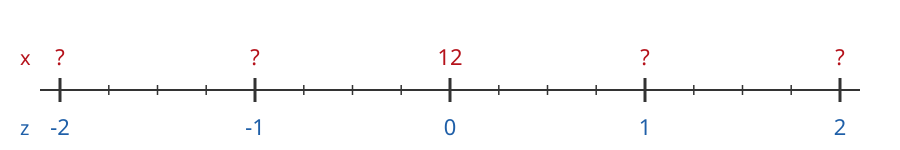

$\mu = 12$ corresponds to $z = 0$.

:::: {.columns}

::: {.column width="50%"}
$12 + 4 = 16$

$16 + 4 = 20$
:::

::: {.column width="50%"}
$12 - 4 = 8$

$8 - 4 = 4$
:::

::::

## 3. Number of Standard Deviations

The mean is $\mu = 12$ and the standard deviation is $\sigma = 4$.

Fill in the x-values for each z-value:

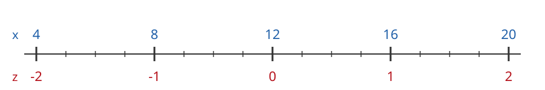

$\mu = 12$ corresponds to $z = 0$.

:::: {.columns}

::: {.column width="50%"}
$12 + 4 = 16$

$16 + 4 = 20$
:::

::: {.column width="50%"}
$12 - 4 = 8$

$8 - 4 = 4$
:::

::::

## 3. Number of Standard Deviations

The mean is $\mu = 12$ and the standard deviation is $\sigma = 4$.

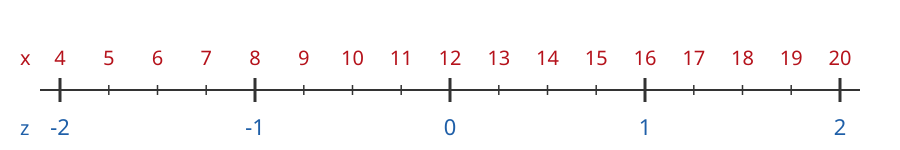

## 3. Number of Standard Deviations

The mean is $\mu = 12$ and the standard deviation is $\sigma = 4$.

What is the z-score of $x = 18$?

## 3. Number of Standard Deviations

The mean is $\mu = 12$ and the standard deviation is $\sigma = 4$.

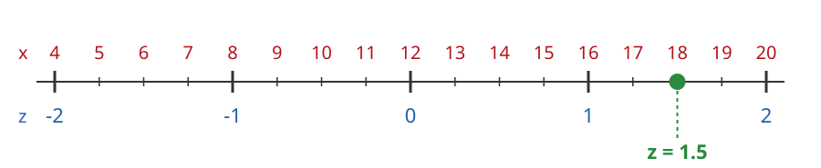

What is the z-score of $x = 18$?

$$
z = \frac{18 - 12}{4} = \frac{6}{4} = 1.5
$$

## 3. Number of Standard Deviations

The mean is $\mu = 12$ and the standard deviation is $\sigma = 4$.

What is the z-score of $x = 17$?

## 3. Number of Standard Deviations

The mean is $\mu = 12$ and the standard deviation is $\sigma = 4$.

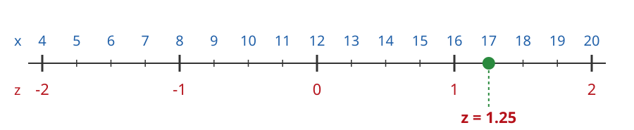

What is the z-score of $x = 17$?

$$
z = \frac{17 - 12}{4} = \frac{5}{4} = 1.25
$$

## 3. Number of Standard Deviations

The mean is $\mu = 12$ and the standard deviation is $\sigma = 4$.

What is the z-score of $x = 7$?

## 3. Number of Standard Deviations

The mean is $\mu = 12$ and the standard deviation is $\sigma = 4$.

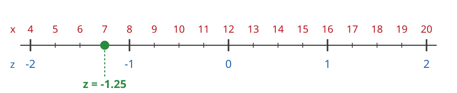

What is the z-score of $x = 7$?

$$
z = \frac{7 - 12}{4} = \frac{-5}{4} = -1.25
$$

## 3. Number of Standard Deviations

The mean is $\mu = 12$ and the standard deviation is $\sigma = 4$.

What is the z-score of $x = 13$?

## 3. Number of Standard Deviations

The mean is $\mu = 12$ and the standard deviation is $\sigma = 4$.

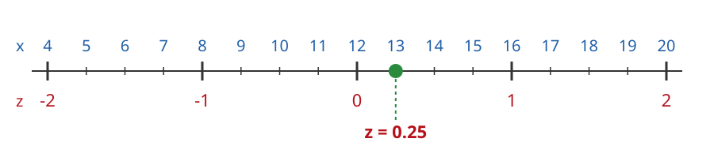

What is the z-score of $x = 13$?

$$
z = \frac{13 - 12}{4} = \frac{1}{4} = 0.25
$$

## 4. Number of Standard Deviations

The mean is $\mu = 21$ and the standard deviation is $\sigma = 5$.

Fill in the x-values for each z-value:

$\mu = 21$ corresponds to $z = 0$.

:::: {.columns}

::: {.column width="50%"}
$21 + 5 = 26$

$26 + 5 = 31$
:::

::: {.column width="50%"}
$21 - 5 = 16$

$16 - 5 = 11$
:::

::::

## 4. Number of Standard Deviations

The mean is $\mu = 21$ and the standard deviation is $\sigma = 5$.

Fill in the x-values for each z-value:

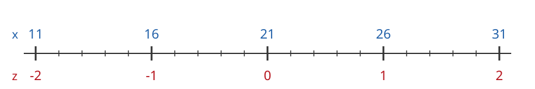

$\mu = 21$ corresponds to $z = 0$.

:::: {.columns}

::: {.column width="50%"}
$21 + 5 = 26$

$26 + 5 = 31$
:::

::: {.column width="50%"}
$21 - 5 = 16$

$16 - 5 = 11$
:::

::::

## 4. Number of Standard Deviations

The mean is $\mu = 21$ and the standard deviation is $\sigma = 5$.

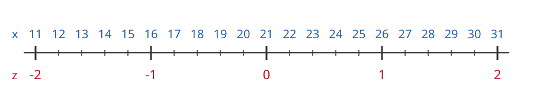

## 4. Number of Standard Deviations

The mean is $\mu = 21$ and the standard deviation is $\sigma = 5$.

What is the z-score of $x = 28$?

## 4. Number of Standard Deviations

The mean is $\mu = 21$ and the standard deviation is $\sigma = 5$.

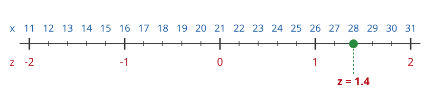

What is the z-score of $x = 28$?

$$
z = \frac{28 - 21}{5} = \frac{7}{5} = 1.4
$$

## 4. Number of Standard Deviations

The mean is $\mu = 21$ and the standard deviation is $\sigma = 5$.

What is the z-score of $x = 23$?

## 4. Number of Standard Deviations

The mean is $\mu = 21$ and the standard deviation is $\sigma = 5$.

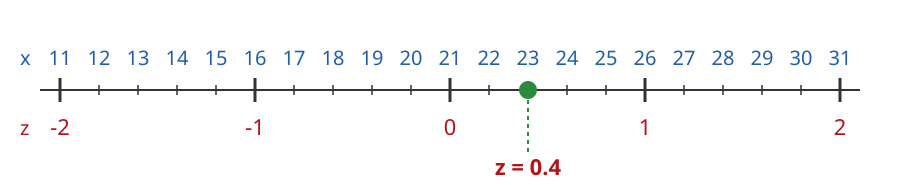

What is the z-score of $x = 23$?

$$
z = \frac{23 - 21}{5} = \frac{2}{5} = 0.4
$$

## 4. Number of Standard Deviations

The mean is $\mu = 21$ and the standard deviation is $\sigma = 5$.

What is the z-score of $x = 17$?

## 4. Number of Standard Deviations

The mean is $\mu = 21$ and the standard deviation is $\sigma = 5$.

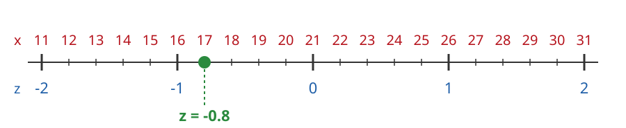

What is the z-score of $x = 17$?

$$
z = \frac{17 - 21}{5} = \frac{-4}{5} = -0.8
$$

## 4. Number of Standard Deviations

The mean is $\mu = 21$ and the standard deviation is $\sigma = 5$.

What is the z-score of $x = 12$?

## 4. Number of Standard Deviations

The mean is $\mu = 21$ and the standard deviation is $\sigma = 5$.

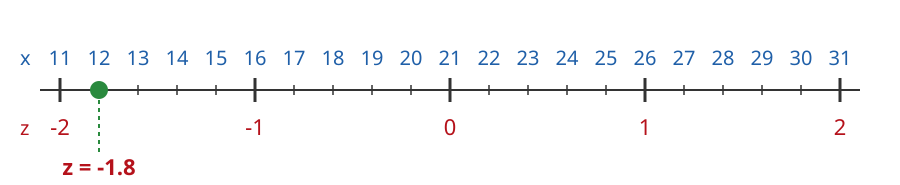

What is the z-score of $x = 12$?

$$
z = \frac{12 - 21}{5} = \frac{-9}{5} = -1.8
$$

## Comparing Different Situations

Z-values let us compare data values that come from **different** groups.

Each value is measured against its own group's mean and standard deviation.

## 5. Who Did Better?

You and a friend take exams in different classes.

| | Score | Class mean | Class std dev |
|:--|:-:|:-:|:-:|
| You | $75$ | $71$ | $3$ |
| Friend | $82$ | $81$ | $5$ |

Your friend got the higher score. Who did better compared to their class?

## 5. Who Did Better?

| | Score | Class mean | Class std dev |
|:--|:-:|:-:|:-:|
| You | $75$ | $71$ | $3$ |
| Friend | $82$ | $81$ | $5$ |

:::: {.columns}

::: {.column width="50%"}
Your z-value:

$$
z = \frac{75 - 71}{3} = \frac{4}{3} = 1.33
$$
:::

::: {.column width="50%"}
Your friend's z-value:

$$
z = \frac{82 - 81}{5} = \frac{1}{5} = 0.2
$$
:::

::::

## 5. Who Did Better?

$$
\text{You: } z = 1.33 \qquad \text{Friend: } z = 0.2
$$

You are $1.33$ standard deviations above your class mean.

Your friend is only $0.2$ standard deviations above theirs.

**You did better** compared to your class.

## Population and Sample Z-Values

**Population:** use the population mean $\mu$ and the population standard deviation $\sigma$:

$$
z = \frac{x - \mu}{\sigma}
$$

**Sample:** use the sample mean $\bar{x}$ and the sample standard deviation $s$:

$$
z = \frac{x - \bar{x}}{s}
$$

Both mean the same thing: the number of standard deviations $x$ is from the mean.
