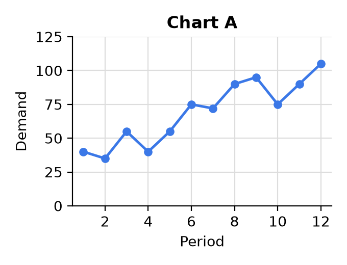
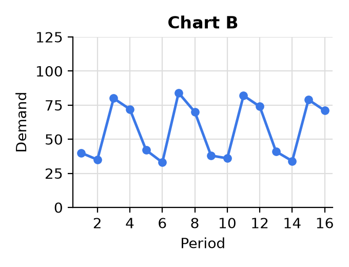
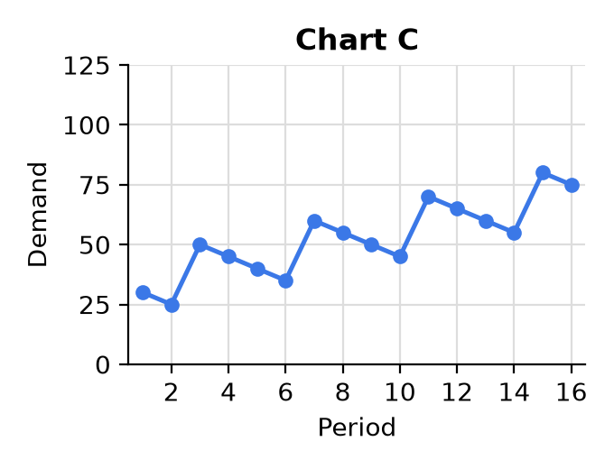

---
format:
  pdf:
    geometry:
      - margin=0.6in
    fontsize: 11pt
    include-in-header:
      text: |
        \setlength{\parskip}{4pt}
        \setlength{\parindent}{0pt}
        \pagenumbering{gobble}
  html:
    embed-resources: true
---

# MA321 Review 3: Time Series

Name: ______________________________

Calculator allowed. No notes, no phone, no internet. Show your work.

**1.** Here are the actual demand and the forecast for 3 months. Find the MAPE.

```{=latex}
\begin{center}
\renewcommand{\arraystretch}{2.2}
\begin{tabular}{|c|c|c|p{1.2in}|p{1.2in}|p{1.2in}|}
\hline
\textbf{Month} & \textbf{Actual} & \textbf{Forecast} & & & \\ \hline
1 & 50 & 45 & & & \\ \hline
2 & 80 & 88 & & & \\ \hline
3 & 40 & 50 & & & \\ \hline
\end{tabular}
\end{center}
```

::: {.content-visible when-format="html"}
```{=html}
<table style="border-collapse: collapse; margin: 1em auto; text-align: center;">
<tr><th style="border: 1px solid #000; padding: 8px 14px;">Month</th><th style="border: 1px solid #000; padding: 8px 14px;">Actual</th><th style="border: 1px solid #000; padding: 8px 14px;">Forecast</th><th style="border: 1px solid #000; width: 110px;"></th><th style="border: 1px solid #000; width: 110px;"></th><th style="border: 1px solid #000; width: 110px;"></th></tr>
<tr><td style="border: 1px solid #000; padding: 14px;">1</td><td style="border: 1px solid #000;">50</td><td style="border: 1px solid #000;">45</td><td style="border: 1px solid #000;"></td><td style="border: 1px solid #000;"></td><td style="border: 1px solid #000;"></td></tr>
<tr><td style="border: 1px solid #000; padding: 14px;">2</td><td style="border: 1px solid #000;">80</td><td style="border: 1px solid #000;">88</td><td style="border: 1px solid #000;"></td><td style="border: 1px solid #000;"></td><td style="border: 1px solid #000;"></td></tr>
<tr><td style="border: 1px solid #000; padding: 14px;">3</td><td style="border: 1px solid #000;">40</td><td style="border: 1px solid #000;">50</td><td style="border: 1px solid #000;"></td><td style="border: 1px solid #000;"></td><td style="border: 1px solid #000;"></td></tr>
</table>
```
:::

MAPE = ______________

```{=latex}
\vspace{0.3in}
```

**2.** Describe the components in each graph.

::: {layout-ncol=3}





:::

Circle True or False.

a) True / False: Chart B is stationary.

b) True / False: Chart A has seasonality.

c) True / False: Chart C has a trend.

d) True / False: Chart A has more noise than Chart C.

e) True / False: Chart C is stationary.

```{=latex}
\newpage
```

**3.** Suppose you have an average baseline of 20 units per month. The seasonal indices for the next 6 months are 0.6, 1.2, 0.95, 1.1, 1.4, 0.75.

a) Forecast the next 6 months.

```{=latex}
\vspace{0.65in}
```

b) Forecast the next 6 months if your average baseline were 20% lower.

```{=latex}
\vspace{0.65in}
```

**4.**

a) Forecast 1 has a MAPE of 30% and forecast 2 has a MAPE of 12%. Which one is more accurate?

```{=latex}
\vspace{0.3in}
```

b) Describe in words how the graph of the forecast compares to the graph of the actuals when the MAPE is 3%.

```{=latex}
\vspace{0.55in}
```

c) True or False: MAPE can be over 100%.

```{=latex}
\vspace{0.3in}
```

**5.** Here are the quarterly averages (composites) from the last 4 years.

```{=latex}
\begin{center}
\renewcommand{\arraystretch}{1.5}
\begin{tabular}{|l|c|p{1.2in}|}
\hline
 & \textbf{Composite} & \textbf{Index} \\ \hline
Quarter 1 & 30 & \\ \hline
Quarter 2 & 45 & \\ \hline
Quarter 3 & 60 & \\ \hline
Quarter 4 & 65 & \\ \hline
\end{tabular}
\end{center}
```

::: {.content-visible when-format="html"}
```{=html}
<table style="border-collapse: collapse; margin: 1em auto; text-align: center;">
<tr><th style="border: 1px solid #000; padding: 8px 14px;"></th><th style="border: 1px solid #000; padding: 8px 14px;">Composite</th><th style="border: 1px solid #000; padding: 8px 14px; width: 110px;">Index</th></tr>
<tr><td style="border: 1px solid #000; padding: 8px 14px;">Quarter 1</td><td style="border: 1px solid #000;">30</td><td style="border: 1px solid #000;"></td></tr>
<tr><td style="border: 1px solid #000; padding: 8px 14px;">Quarter 2</td><td style="border: 1px solid #000;">45</td><td style="border: 1px solid #000;"></td></tr>
<tr><td style="border: 1px solid #000; padding: 8px 14px;">Quarter 3</td><td style="border: 1px solid #000;">60</td><td style="border: 1px solid #000;"></td></tr>
<tr><td style="border: 1px solid #000; padding: 8px 14px;">Quarter 4</td><td style="border: 1px solid #000;">65</td><td style="border: 1px solid #000;"></td></tr>
</table>
```
:::

a) Find the seasonal indices and fill them in.

```{=latex}
\vspace{0.7in}
```

b) If your average baseline (non-seasonal) prediction for next year is 40 units, what are the seasonalized forecasts for Quarters 1, 2, 3 and 4 next year?
