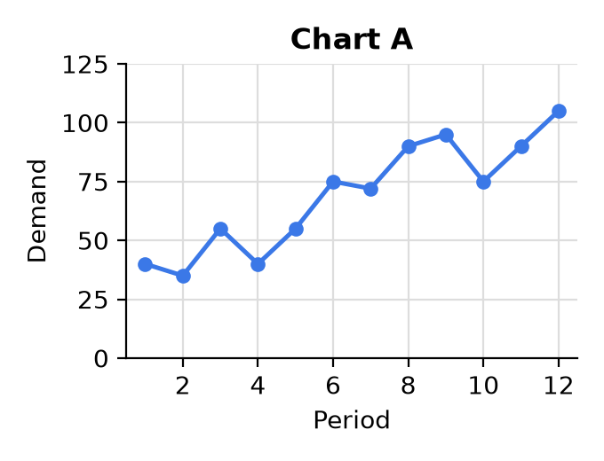
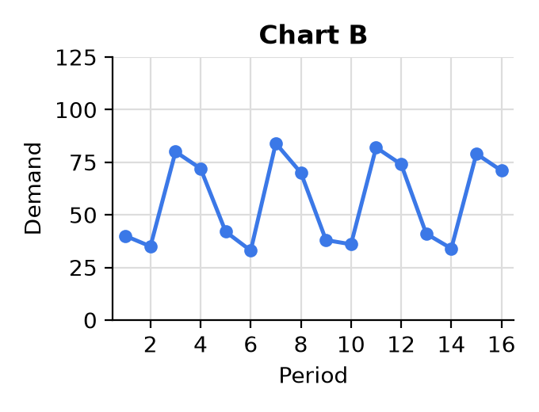
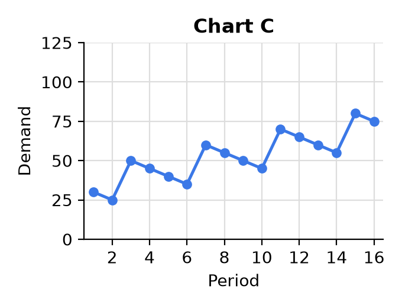

---
format:
  pdf:
    geometry:
      - margin=0.6in
    fontsize: 11pt
    include-in-header:
      text: |
        \setlength{\parskip}{4pt}
        \setlength{\parindent}{0pt}
        \pagenumbering{gobble}
  html:
    embed-resources: true
---

# MA321 Quiz 3 Review Answers

**1.** % Error = Abs(Difference) ÷ Actual.

```{=latex}
\begin{center}
\renewcommand{\arraystretch}{1.6}
\begin{tabular}{|c|c|c|c|c|c|}
\hline
\textbf{Month} & \textbf{Actual} & \textbf{Forecast} & \textbf{Difference} & \textbf{Abs(Difference)} & \textbf{\% Error} \\ \hline
1 & 50 & 45 & 5 & 5 & 10\% \\ \hline
2 & 80 & 88 & $-8$ & 8 & 10\% \\ \hline
3 & 40 & 50 & $-10$ & 10 & 25\% \\ \hline
\end{tabular}
\end{center}
```

::: {.content-visible when-format="html"}
```{=html}
<table style="border-collapse: collapse; margin: 1em auto; text-align: center;">
<tr><th style="border: 1px solid #000; padding: 6px 12px;">Month</th><th style="border: 1px solid #000; padding: 6px 12px;">Actual</th><th style="border: 1px solid #000; padding: 6px 12px;">Forecast</th><th style="border: 1px solid #000; padding: 6px 12px;">Difference</th><th style="border: 1px solid #000; padding: 6px 12px;">Abs(Difference)</th><th style="border: 1px solid #000; padding: 6px 12px;">% Error</th></tr>
<tr><td style="border: 1px solid #000; padding: 6px;">1</td><td style="border: 1px solid #000;">50</td><td style="border: 1px solid #000;">45</td><td style="border: 1px solid #000;">5</td><td style="border: 1px solid #000;">5</td><td style="border: 1px solid #000;">10%</td></tr>
<tr><td style="border: 1px solid #000; padding: 6px;">2</td><td style="border: 1px solid #000;">80</td><td style="border: 1px solid #000;">88</td><td style="border: 1px solid #000;">−8</td><td style="border: 1px solid #000;">8</td><td style="border: 1px solid #000;">10%</td></tr>
<tr><td style="border: 1px solid #000; padding: 6px;">3</td><td style="border: 1px solid #000;">40</td><td style="border: 1px solid #000;">50</td><td style="border: 1px solid #000;">−10</td><td style="border: 1px solid #000;">10</td><td style="border: 1px solid #000;">25%</td></tr>
</table>
```
:::

MAPE = (10% + 10% + 25%) ÷ 3 = **15%**

**2.** Answer True or False for each.

::: {layout-ncol=3}





:::

Chart A: upward trend, not seasonal, lots of noise. \
Chart B: no trend (stationary), seasonal (repeats every 4 periods), little noise. \
Chart C: upward trend, seasonal (repeats every 4 periods), little noise.

a) **True.** Chart B has no trend; it moves up and down around the same level.

b) **False.** Chart A has no repeating pattern; its ups and downs are noise.

c) **True.** Chart C goes up over time.

d) **True.** Chart A jumps around a lot; Chart C follows a clean repeating pattern.

e) **False.** Chart C has an upward trend, so it is not stationary.

**3.** $\text{Forecast} = \text{Baseline} \times \text{Seasonal Index}$. For b, the baseline is 20% lower: $20 \times 0.8 = 16$.

```{=latex}
\begin{center}
\renewcommand{\arraystretch}{1.6}
\begin{tabular}{|c|c|c|c|}
\hline
\textbf{Month} & \textbf{Seasonal Index} & \textbf{a) Forecast (baseline 20)} & \textbf{b) Forecast (baseline 16)} \\ \hline
1 & 0.6 & $20 \times 0.6 = \mathbf{12}$ & $16 \times 0.6 = \mathbf{9.6}$ \\ \hline
2 & 1.2 & $20 \times 1.2 = \mathbf{24}$ & $16 \times 1.2 = \mathbf{19.2}$ \\ \hline
3 & 0.95 & $20 \times 0.95 = \mathbf{19}$ & $16 \times 0.95 = \mathbf{15.2}$ \\ \hline
4 & 1.1 & $20 \times 1.1 = \mathbf{22}$ & $16 \times 1.1 = \mathbf{17.6}$ \\ \hline
5 & 1.4 & $20 \times 1.4 = \mathbf{28}$ & $16 \times 1.4 = \mathbf{22.4}$ \\ \hline
6 & 0.75 & $20 \times 0.75 = \mathbf{15}$ & $16 \times 0.75 = \mathbf{12}$ \\ \hline
\end{tabular}
\end{center}
```

::: {.content-visible when-format="html"}
```{=html}
<table style="border-collapse: collapse; margin: 1em auto; text-align: center;">
<tr><th style="border: 1px solid #000; padding: 6px 12px;">Month</th><th style="border: 1px solid #000; padding: 6px 12px;">Seasonal Index</th><th style="border: 1px solid #000; padding: 6px 12px;">a) Forecast (baseline 20)</th><th style="border: 1px solid #000; padding: 6px 12px;">b) Forecast (baseline 16)</th></tr>
<tr><td style="border: 1px solid #000; padding: 6px 12px;">1</td><td style="border: 1px solid #000; padding: 6px 12px;">0.6</td><td style="border: 1px solid #000; padding: 6px 12px;">\(20 \times 0.6 = \mathbf{12}\)</td><td style="border: 1px solid #000; padding: 6px 12px;">\(16 \times 0.6 = \mathbf{9.6}\)</td></tr>
<tr><td style="border: 1px solid #000; padding: 6px 12px;">2</td><td style="border: 1px solid #000; padding: 6px 12px;">1.2</td><td style="border: 1px solid #000; padding: 6px 12px;">\(20 \times 1.2 = \mathbf{24}\)</td><td style="border: 1px solid #000; padding: 6px 12px;">\(16 \times 1.2 = \mathbf{19.2}\)</td></tr>
<tr><td style="border: 1px solid #000; padding: 6px 12px;">3</td><td style="border: 1px solid #000; padding: 6px 12px;">0.95</td><td style="border: 1px solid #000; padding: 6px 12px;">\(20 \times 0.95 = \mathbf{19}\)</td><td style="border: 1px solid #000; padding: 6px 12px;">\(16 \times 0.95 = \mathbf{15.2}\)</td></tr>
<tr><td style="border: 1px solid #000; padding: 6px 12px;">4</td><td style="border: 1px solid #000; padding: 6px 12px;">1.1</td><td style="border: 1px solid #000; padding: 6px 12px;">\(20 \times 1.1 = \mathbf{22}\)</td><td style="border: 1px solid #000; padding: 6px 12px;">\(16 \times 1.1 = \mathbf{17.6}\)</td></tr>
<tr><td style="border: 1px solid #000; padding: 6px 12px;">5</td><td style="border: 1px solid #000; padding: 6px 12px;">1.4</td><td style="border: 1px solid #000; padding: 6px 12px;">\(20 \times 1.4 = \mathbf{28}\)</td><td style="border: 1px solid #000; padding: 6px 12px;">\(16 \times 1.4 = \mathbf{22.4}\)</td></tr>
<tr><td style="border: 1px solid #000; padding: 6px 12px;">6</td><td style="border: 1px solid #000; padding: 6px 12px;">0.75</td><td style="border: 1px solid #000; padding: 6px 12px;">\(20 \times 0.75 = \mathbf{15}\)</td><td style="border: 1px solid #000; padding: 6px 12px;">\(16 \times 0.75 = \mathbf{12}\)</td></tr>
</table>
```
:::

Each forecast in b is 20% lower than the one in a.

```{=latex}
\newpage
```

**4.**

a) **Forecast 2.** The lower MAPE (12%) is more accurate.

b) The forecast graph stays very close to the actuals graph. On average the forecast is only 3% off from the actual demand.

c) **True.** If the forecasts are far off (for example, forecasting 30 when the actual is 10 is a 200% error), the MAPE can be over 100%.

**5.** $\text{Deseasonalized demand} = \dfrac{\text{Actual}}{\text{Index}}$

```{=latex}
\begin{center}
\renewcommand{\arraystretch}{2.4}
\begin{tabular}{|l|c|c|c|}
\hline
\textbf{Month} & \textbf{Actual} & \textbf{Index} & \textbf{Deseasonalized} \\ \hline
January & 36 & 0.8 & $\dfrac{36}{0.8} = \mathbf{45}$ \\ \hline
February & 54 & 0.9 & $\dfrac{54}{0.9} = \mathbf{60}$ \\ \hline
March & 50 & 1.0 & $\dfrac{50}{1.0} = \mathbf{50}$ \\ \hline
April & 60 & 1.2 & $\dfrac{60}{1.2} = \mathbf{50}$ \\ \hline
May & 63 & 1.5 & $\dfrac{63}{1.5} = \mathbf{42}$ \\ \hline
June & 30 & 0.6 & $\dfrac{30}{0.6} = \mathbf{50}$ \\ \hline
\end{tabular}
\end{center}
```

::: {.content-visible when-format="html"}
```{=html}
<table style="border-collapse: collapse; margin: 1em auto; text-align: center;">
<tr><th style="border: 1px solid #000; padding: 6px 12px;">Month</th><th style="border: 1px solid #000; padding: 6px 12px;">Actual</th><th style="border: 1px solid #000; padding: 6px 12px;">Index</th><th style="border: 1px solid #000; padding: 6px 12px;">Deseasonalized</th></tr>
<tr><td style="border: 1px solid #000; padding: 6px 12px;">January</td><td style="border: 1px solid #000; padding: 6px 12px;">36</td><td style="border: 1px solid #000; padding: 6px 12px;">0.8</td><td style="border: 1px solid #000; padding: 6px 12px;">\(\dfrac{36}{0.8} = \mathbf{45}\)</td></tr>
<tr><td style="border: 1px solid #000; padding: 6px 12px;">February</td><td style="border: 1px solid #000; padding: 6px 12px;">54</td><td style="border: 1px solid #000; padding: 6px 12px;">0.9</td><td style="border: 1px solid #000; padding: 6px 12px;">\(\dfrac{54}{0.9} = \mathbf{60}\)</td></tr>
<tr><td style="border: 1px solid #000; padding: 6px 12px;">March</td><td style="border: 1px solid #000; padding: 6px 12px;">50</td><td style="border: 1px solid #000; padding: 6px 12px;">1.0</td><td style="border: 1px solid #000; padding: 6px 12px;">\(\dfrac{50}{1.0} = \mathbf{50}\)</td></tr>
<tr><td style="border: 1px solid #000; padding: 6px 12px;">April</td><td style="border: 1px solid #000; padding: 6px 12px;">60</td><td style="border: 1px solid #000; padding: 6px 12px;">1.2</td><td style="border: 1px solid #000; padding: 6px 12px;">\(\dfrac{60}{1.2} = \mathbf{50}\)</td></tr>
<tr><td style="border: 1px solid #000; padding: 6px 12px;">May</td><td style="border: 1px solid #000; padding: 6px 12px;">63</td><td style="border: 1px solid #000; padding: 6px 12px;">1.5</td><td style="border: 1px solid #000; padding: 6px 12px;">\(\dfrac{63}{1.5} = \mathbf{42}\)</td></tr>
<tr><td style="border: 1px solid #000; padding: 6px 12px;">June</td><td style="border: 1px solid #000; padding: 6px 12px;">30</td><td style="border: 1px solid #000; padding: 6px 12px;">0.6</td><td style="border: 1px solid #000; padding: 6px 12px;">\(\dfrac{30}{0.6} = \mathbf{50}\)</td></tr>
</table>
```
:::

b) **Best: February** (60), the highest deseasonalized demand. **Worst: May** (42), the lowest.

May had the highest actual sales (63), but May is expected to be a big month (index 1.5), so it actually underperformed. June had the lowest actual sales (30), but June is a slow month (index 0.6), so it performed at an average level (50).
